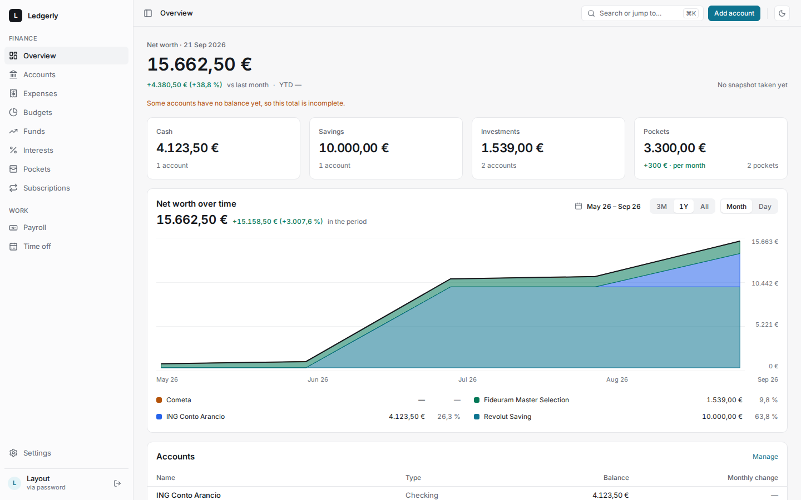
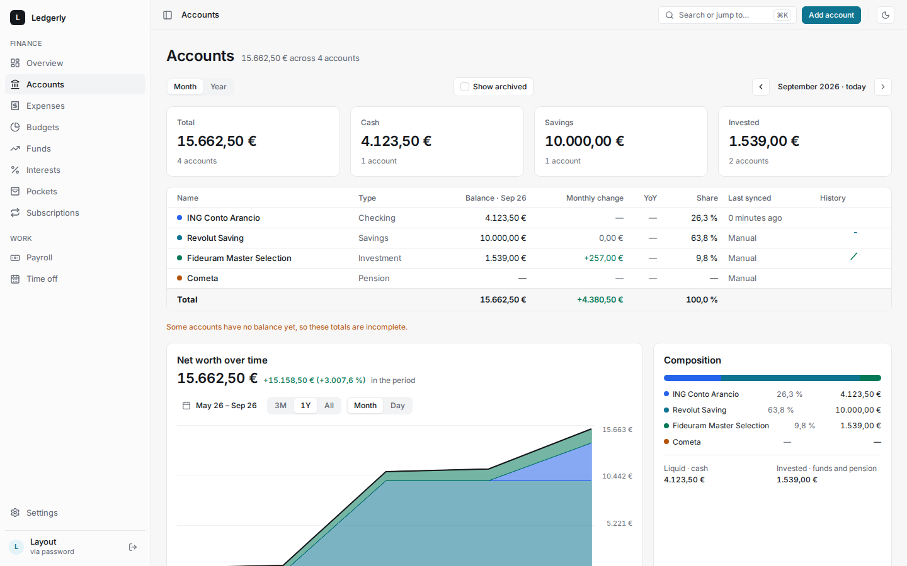
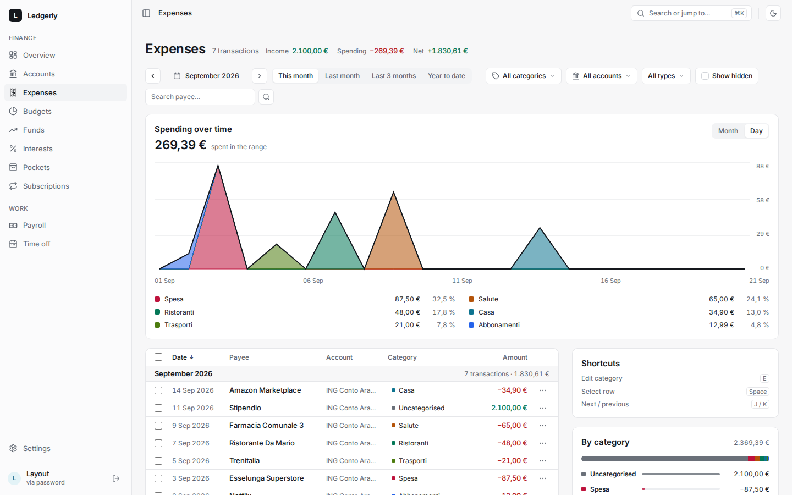
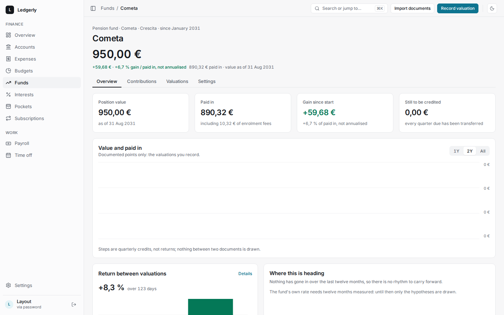

# Ledgerly

A self-hosted dashboard for personal finance and household paperwork: net worth, spending,
budgets, investments, payslips, pension fund and time off, in one place.

## What it does

- **Net worth over time** — manual and synced accounts, with monthly snapshots and low-balance alerts.
- **Spending** — movements synced from Budget Makers Wallet, categories, labels and detected recurrences.
- **Budgets, pockets and subscriptions** — monthly limits, money set aside without moving it, and a
  check that each subscription was really charged.
- **Interest, funds and investments** — interest accrual per account, PAC and pension funds
  (Fondo Cometa), eToro and Binance portfolios with the profit and loss of a period.
- **Payslips** — upload a PDF, review every value next to the page it came from, then apply it.
  The payslip feeds the pension fund and the leave balance.
- **Time off** — holiday and ROL balances from the payslip, synced with the Trek leave calendar.
- **API and MCP** — a read API for scripts and an MCP server for AI assistants, both behind OAuth2.

Every screen works on a phone and in the dark theme. Sign-in is by password with TOTP, or by SSO
with Authentik. The interface is in English and Italian.

| Accounts                                   | Expenses                                   | A pension fund                         |
| ------------------------------------------ | ------------------------------------------ | -------------------------------------- |
|  |  |  |

The screenshots show an invented test user, not real data.

## Stack

Next.js and TypeScript, PostgreSQL with Drizzle, S3-compatible storage for documents, Better Auth
for sign-in. It runs as two containers (the app and a cron sidecar) behind Traefik on the homelab,
at `https://dash.longobardo.me`.

## Documentation

| Guide                                | For                                                            |
| ------------------------------------ | -------------------------------------------------------------- |
| [Features](docs/features.md)         | How each section works and the rules behind the numbers.       |
| [API and MCP](docs/api.md)           | OAuth2, the `/api/v1` routes, the MCP server, document import. |
| [Development](docs/development.md)   | Setup, conventions and tests.                                  |
| [Operations](docs/operations.md)     | Deploy, configuration, homelab services, backups, admin tasks. |
| [Release checklist](docs/RELEASE.md) | A step-by-step release, with what to do when it goes wrong.    |

All documents are listed in [`docs/README.md`](docs/README.md).

## Licence

[PolyForm Noncommercial 1.0.0](LICENSE): free for any noncommercial use. Commercial use is not
licensed.
