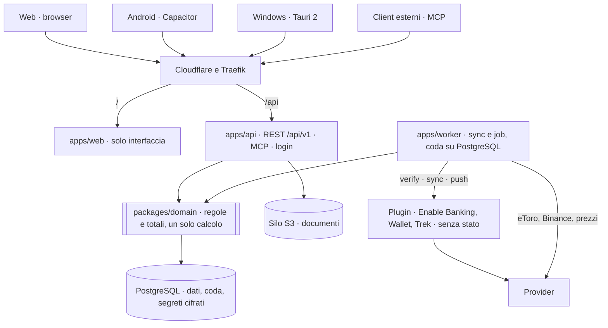
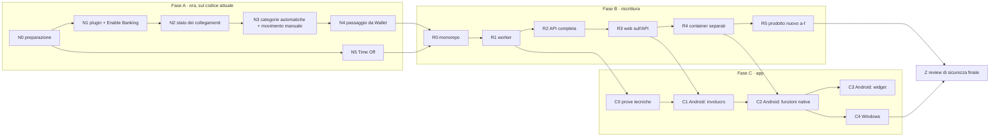

# Ledgerly · piano di riorganizzazione, riscrittura modulare e app multipiattaforma

Stato: **bozza in attesa dell'OK di Mattia**. Nessuno sviluppo parte prima di questo OK.
Base del codice: `main` a `5fbbdbc` (13/11/2026), ultimo tag `v0.10.1`.
Decisioni: approvate da Mattia il 13/11/2026, dopo il brainstorming delle tre fasi (prodotto, architettura, app).

Questo piano non modifica i documenti di design esistenti. Il [registro delle decisioni](rewrite-plan/01-decisions.md)
dice quali punti di `investments.md`, `investments-ux.md` e `funds-ux.md` sono sostituiti.

## File del piano

| # | File | Contenuto |
|---|---|---|
| 1 | [`01-decisions.md`](rewrite-plan/01-decisions.md) | Registro delle decisioni: decisione, data, cosa sostituisce, rilascio che la realizza |
| 2 | [`02-audit.md`](rewrite-plan/02-audit.md) | Audit del codice per modulo: sintesi. Dettaglio con `percorso:riga` in [`audit-domain.md`](rewrite-plan/audit-domain.md), [`audit-platform.md`](rewrite-plan/audit-platform.md), [`audit-ui.md`](rewrite-plan/audit-ui.md) |
| 3 | [`03-releases.md`](rewrite-plan/03-releases.md) | Fasi e rilasci in ordine: obiettivo, contenuto, git, migrazioni, rollback, test, criteri di accettazione, OK richiesto, dimensione |
| 4 | [`04-now.md`](rewrite-plan/04-now.md) | Lavoro «ora» sul codice attuale: runtime dei plugin, Enable Banking, stato dei collegamenti, categorizzazione, movimento manuale, Time Off |
| 5 | [`05-refactor.md`](rewrite-plan/05-refactor.md) | Refactor modulo per modulo, con il criterio di uscita |
| 6 | [`06-data.md`](rewrite-plan/06-data.md) | Migrazioni previste, regola di compatibilità, dump, test «stessi numeri» |
| 7 | [`07-apps.md`](rewrite-plan/07-apps.md) | App Android e Windows, senza distribuzione |
| 8 | [`08-agents.md`](rewrite-plan/08-agents.md) | Agenti: ruoli, confini dei pacchetti, ordine, review del codice, secondo agente, secondo database di test |
| 9 | [`09-risks.md`](rewrite-plan/09-risks.md) | Rischi, ipotesi aperte e ipotesi da confermare, con il passo che le chiude |

## Premesse

1. Ogni host gestisce la sua istanza. Poi aggiunge amici e familiari, ognuno con il suo account.
2. Gli utenti non sono tecnici. Le impostazioni tecniche sono nascoste o sotto «Avanzate».
3. L'istanza è pubblica su internet (tunnel Cloudflare → Traefik). Le app la raggiungono senza altri strumenti di rete.
4. La review di sicurezza è una sola, alla fine, quando Mattia dichiara tutto completo.
5. Vincoli di sempre: nessuna perdita di dati; ogni rilascio ha rollback (immagine `pre-*` + dump); Overview e
   conti singoli mostrano gli stessi numeri; le chiavi dei provider sono in sola lettura (eccezione dichiarata: Trek).
6. I calcoli approvati (P&L, Modified Dietz, XIRR, interessi, Cometa) non cambiano risultato.

## Architettura di arrivo



```text
apps/      api · worker · web · android · windows
packages/  domain · api-contract · api-client · design-tokens · ui · plugin-contract · plugin-host
plugins/   enablebanking · wallet · trek · catalog.json
```

## Ordine dei rilasci



| Rilascio | Obiettivo | Cosa cambia per l'utente | Git | Migrazioni | OK di Mattia | Dim. |
|---|---|---|---|---|---|---|
| N0 | Cartella dei dump, icona installabile, correzioni di servizio | Ledgerly si installa dal browser | `main` | No | Solo percorso dei dump | S |
| N1 | Runtime minimo dei plugin, plugin Enable Banking, prima banca | Collega una banca | branch + PR | Sì, additive | Sì (#1, #3, #4, #5) | L |
| N2 | Stato semplice per collegamento, registro per l'admin, più banche | Una riga chiara per collegamento | branch + PR | Sì | Sì (#1) | S |
| N3 | Categorie automatiche, «Da categorizzare», movimento manuale | Categorie senza Wallet, spese a mano | branch + PR | Sì, additive | Sì (#1) | L |
| N4 | Passaggio di un conto da Wallet a Enable Banking | Un conto cambia sorgente senza doppioni | branch + PR | Dati | Sì (#1) | M |
| N5 | Time Off: primo e ultimo giorno + pannello | Nessun gesto nascosto | `main` | No | No | M |
| R0 | Monorepo npm workspaces, codice morto tolto | Nulla | `main` | No | No | M |
| R1 | Worker dedicato, coda su PostgreSQL, fine del container cron | Nulla | branch + PR | Sì, additive | Sì (#1) | M |
| R2 | API completa, chiamate dagli involucri, refactor del dominio modulo per modulo | Nulla | `main`; PR per auth e schema | Sì, additive | Sì per le parti #1 e #4 | L |
| R3 | Web sull'API, schermate solo client, refactor dell'interfaccia | Nulla di visibile | `main` | No | No | L |
| R4 | `api` e `web` in container separati | Nulla | branch + PR | No | Sì (#3) | S |
| R5a | Menu a 3 gruppi, moduli attivabili, primo avvio, Settings | Navigazione nuova | branch + PR | Sì, additive | Sì (#1) | M |
| R5b | Investments unificata, Overview a gruppi | Una home con 3 gruppi | `main`; PR se cambia l'API | No | Solo se #4 | L |
| R5c | Wallet e Trek come plugin, tab Plugin completo | Wallet e Trek si installano | branch + PR | Sì | Sì (#1, #3, #5) | L |
| R5d | Portafoglio manuale, prezzi per ISIN | «Registra operazione» | branch + PR | Sì, additive | Sì (#1, #5) | L |
| R5e | Avvisi, blocco «Da fare», «Nascondi importi» | Avvisi solo quando serve un'azione | branch + PR | Sì, additive | Sì (#1) | M |
| R5f | Pulizia dello schema | Nulla | branch + PR | Sì, rimozioni | Sì (#1) | S |
| C0 | Prove tecniche degli involucri | Nulla | fuori da `main` | No | Gate Security Gatekeeper | S |
| C1 | Android: involucro, login, cache cifrata | App Android installata a mano | `main` | No | No | M |
| C2 | Android: biometria, avvisi periodici, condivisione PDF, azioni rapide | App «compagno» completa | `main` | No | No | M |
| C3 | Android: widget | Widget «Da fare» e «Questo mese» | `main` | No | No | S |
| C4 | Windows: guscio con la stessa interfaccia | App Windows da build locale | `main` | No | Gate Security Gatekeeper | M |
| Z | Review di sicurezza finale | Nulla | — | — | La chiede Mattia | — |

I numeri `#n` sono i criteri di `git-policy` §6. Dettaglio di ogni rilascio: [`03-releases.md`](rewrite-plan/03-releases.md).

## OK richiesti a Mattia

1. **Questo piano.** Sblocca N0.
2. **Un OK per ogni rilascio con un criterio §6**, sul singolo SHA, prima del deploy (colonna «OK di Mattia»).
3. **Le ipotesi da confermare** di [`09-risks.md`](rewrite-plan/09-risks.md) §9.3. Se Mattia non risponde, vale il default scritto lì.
4. **Passi che solo Mattia può fare:** applicazione Enable Banking di tipo Production e accesso alla banca (N1); chiave
   gratuita EODHD (R5d); installazione dell'APK sul telefono (C1); build su un PC Windows (C4).
