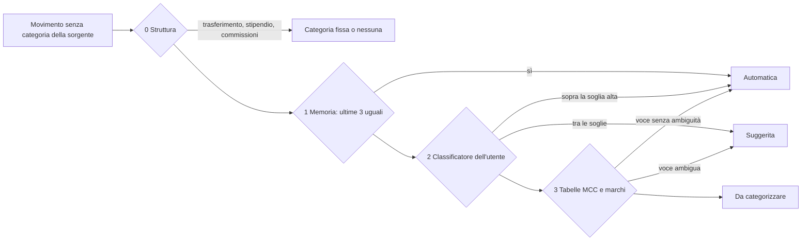
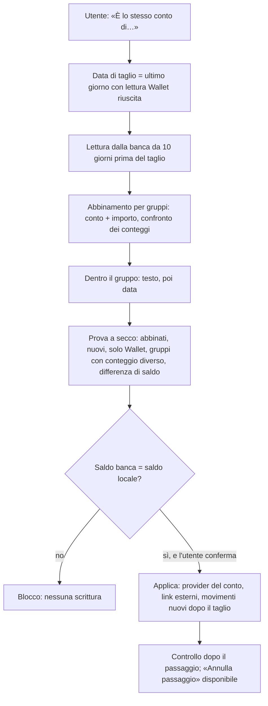

# 4. Lavoro «ora», prima di R0

Indice del piano: [`../rewrite-plan.md`](../rewrite-plan.md). Rilasci: N0-N5 in [`03-releases.md`](03-releases.md).

Questo lavoro si fa sul codice attuale (una sola app Next.js). Regola per limitare il lavoro doppio:

| Parte | Sopravvive alla riscrittura | Come si scrive ora |
|---|---|---|
| Contratto dei plugin, kit di test, plugin Enable Banking | Sì, senza modifiche (HTTP) | In `plugins/` e in una cartella `src/platform/plugins/` senza import da Next.js |
| Schema, dati, regole pure con i loro test (abbinamento, categorizzazione, stato del collegamento) | Sì: si spostano in `packages/domain` | Funzioni pure, servizi `(ctx, input)`, nessun import da `src/app` |
| Schermate (tab Plugin, procedura della banca, «Da rivedere», pannello Time Off) | L'interazione sì, il codice in parte | Componenti client senza lettura dati propria: le Server Actions restano solo un involucro sottile, così R3 cambia solo l'involucro |

## 4.1 Runtime minimo dei plugin (N1)

```mermaid
sequenceDiagram
  participant U as Utente (browser)
  participant C as Core (web oggi, api e worker dopo R1)
  participant P as Plugin Enable Banking
  participant B as Enable Banking e banca
  U->>C: Inserisce id applicazione e chiave (solo scrittura)
  C->>C: Cifra e salva per utente
  U->>C: Sceglie la banca
  C->>P: POST /auth/start (credenziali dell'utente, banca, state)
  P->>B: POST /auth
  P-->>C: Indirizzo della banca
  C-->>U: Redirect alla banca
  U->>B: Accesso e consenso
  B-->>U: Redirect a /api/v1/plugins/enablebanking/callback?code
  U->>C: code + state (sessione dell'utente)
  C->>P: POST /auth/complete
  P->>B: POST /sessions
  P-->>C: Sessione, scadenza, conti
  C->>C: Cifra la sessione; l'utente sceglie i conti
  C->>P: POST /sync (subito, storico lungo, header Psu-*)
  P-->>C: Lotto di conti, saldi, movimenti
  C->>C: Valida con lo schema e scrive con i servizi del dominio
```

**Contratto v1** (`packages/plugin-contract` dopo R0; JSON Schema + kit di test):

| Chiamata | Chi chiama | Scopo |
|---|---|---|
| `GET /manifest` | Core | `id`, `version`, `contract`, nomi e testi (en, it), `capabilities`, schema dei campi (`userSettings` per le credenziali dell'utente, campi del collegamento), host di uscita, pianificazione consigliata, «do categorie: sì o no» |
| `POST /verify` | Core | Credenziali → `read-only`, `write`, `unverifiable` |
| `POST /auth/start` | Core | Banca, paese, `state` → indirizzo dove mandare il browser |
| `POST /auth/complete` | Core | `code` → sessione, `expiresAt`, conti |
| `POST /sync` | Core | Credenziali, cursore, finestra, utente presente o no → lotto di entità con id esterno, nuovo cursore, copertura |
| `POST /push` | Core | Solo con `provider.write` (non usato da Enable Banking) |

Regole del runtime minimo:

| Regola | Dettaglio |
|---|---|
| Chi chiama | Solo il core. Il plugin non chiama mai il core e non ha porte raggiungibili dal browser |
| Rete | Rete `ledgerly_plugins` dello stack Ledgerly. Il plugin non è su `db_internal`, `proxy_public`, `mail_internal` |
| Container | `user: "1000:1000"`, filesystem in sola lettura, nessun bind mount, limiti di memoria e CPU, healthcheck, `autoheal`, log `json-file`. Immagine costruita dal repo |
| Segreti | Il plugin riceve nella chiamata solo le credenziali di quell'utente e di quel collegamento. Non le salva. Non ha `APP_ENCRYPTION_KEY`, `DATABASE_URL`, segreti OIDC |
| Core → plugin | Segreto condiviso per plugin, nell'header |
| Scritture | Mai dal plugin. Il core valida la risposta con lo schema del contratto e scrive con `upsertFromProvider`, `applyProviderAccounts`, `linkExternal` |
| Errori | Classe e stato HTTP da una lista chiusa. Mai il messaggio grezzo del provider |
| Versione | Il core accetta la versione corrente del contratto e la precedente |
| Installazione | Solo l'admin: aggiunge il servizio al compose e registra l'indirizzo nel tab Plugin. Il core non riceve il socket Docker |
| Uscita verso internet | Dichiarata nel manifest. Limitazione agli host dichiarati: decisione I8, in R5c |

Cosa **non** entra in N1: catalogo, plugin fuori catalogo, aggiornamento e rimozione dall'interfaccia, Wallet e Trek come plugin. Arrivano in R5c.

## 4.2 Plugin Enable Banking (N1)

| Tema | Regola |
|---|---|
| Passo 1 | Prova su una banca vera, prima del resto dello sviluppo. Mattia registra un'applicazione Production con il redirect `https://<istanza>/api/v1/plugins/enablebanking/callback` e una chiave nuova. La rotta di ritorno e il flusso minimo nascono per primi, così Mattia non copia codici a mano. La prova misura: conti esposti, `entry_reference`, tipi di saldo, MCC e codice bancario, movimenti in sospeso, forma del testo |
| Credenziali | Per utente: id applicazione e chiave privata, inseriti dall'utente in Settings (campo di sola scrittura), cifrati nel core in `plugin_user_credentials`. Il plugin firma il JWT RS256 con la chiave ricevuta nella chiamata e non la conserva |
| Collegamenti | Uno per banca: `integration_connections` con `instance_key` = banca. La sessione e `expires_at` stanno nelle credenziali del collegamento |
| Prima sync | Parte subito dopo `auth/complete`, nella stessa richiesta dell'utente, con `date_from` massimo: la finestra oltre 90 giorni si chiude in pochi minuti |
| Letture automatiche | 3 al giorno per collegamento. Un 429 della banca: stato `rate_limited`, attesa di 6 ore |
| «Sincronizza ora» | Manda gli header `Psu-*` (utente presente) |
| Identità del movimento | `entry_reference` se presente; altrimenti un hash di conto, data contabile, importo, segno, causale normalizzata, controparte e ordine tra i movimenti uguali del giorno. Solo movimenti `BOOK` |
| Campi grezzi | `remittance_information`, nomi di `creditor` e `debtor`, `merchant_category_code`, `bank_transaction_code` salvati sul movimento: servono alla categorizzazione (N3) |
| Conti | In N1: «Nuovo conto» oppure un conto manuale esistente. «È lo stesso conto di un conto Wallet» arriva in N4 |
| Rinnovo | Stesso flusso. I conti si abbinano con `identification_hash`. La sessione vecchia si chiude dopo la riuscita della nuova |
| Sola lettura | L'applicazione è registrata solo per i dati dei conti (AIS). Il manifest non dichiara `provider.write` |

## 4.3 Stato dei collegamenti (N2)

| Stato | Deriva da | Testo | Azione |
|---|---|---|---|
| Aggiornato | `state = active`, ultima sync riuscita entro l'intervallo | «Aggiornato 2 ore fa» | — |
| In corso | Una sync in esecuzione | «Aggiornamento in corso…» | — |
| In ritardo | Fallimenti consecutivi ≥ 1 o ultima sync oltre l'intervallo | «Ultimo aggiornamento ieri alle 08:00. Nuovo tentativo alle 14:00» | «Aggiorna ora» |
| Serve un'azione | `error_code` in `auth`, `consent_expired`; `state = revoked` | «L'accesso alla banca è scaduto» / «La chiave non è più valida» | «Rinnova accesso» / «Sostituisci chiave» |
| In pausa | Nessuna regola di pianificazione | «Aggiornamento automatico spento» | «Riattiva» |

- Codici di errore: `auth`, `consent_expired`, `rate_limited`, `provider_down`, `invalid_data`. Testo fisso tradotto.
- Lo stato è una funzione pura del dominio, con un solo vocabolario. Chiude UI-ACC-1 (stato di sync composto a mano in 5 punti) per i punti toccati; gli altri si chiudono in R3.
- Vale per tutti i collegamenti: plugin, Wallet, Trek, eToro, Binance.
- Registro grezzo: Server › Diagnostica, solo admin, filtro per collegamento, 30 giorni.

## 4.4 Categorizzazione automatica (N3)



| Regola | Dettaglio |
|---|---|
| Dove gira | Nel core, non in un plugin. Lavora sui conti la cui sorgente non dà categorie. Sui conti Wallet restano le categorie di Wallet |
| Addestramento | Solo etichette confermate da una persona o dalla sorgente. Una previsione automatica non entra mai nell'addestramento. Riaddestramento completo dopo una sync con movimenti nuovi, dopo un gruppo di correzioni, o la notte. Per utente |
| Memoria | Chiave = testo normalizzato senza cifre. Automatica solo se le ultime 3 conferme sono uguali |
| Classificatore | Regressione logistica multiclasse scritta nel progetto, senza pacchetti nuovi. TF-IDF di n-grammi di caratteri 3-5, parole, conto, segno, fascia di importo. Minimo 50 etichette e 3 per categoria |
| Soglia | Calcolata a ogni addestramento sulle previsioni fuori campione, per una precisione del 95%. Se le correzioni degli ultimi 30 giorni superano il 10%, la soglia sale |
| Effetto | Automatica: conta subito in Budgets ed Expenses, con segno e motivo. Suggerita: conta come «Da categorizzare» finché non è confermata |
| Correzione | «Applico a N movimenti simili?»: solo su movimenti automatici o senza categoria |
| Categorie doppie | L'app propone l'unione (esempio dello spike: «Tobacco» e «Alcohol, tobacco»). L'unione rietichetta gli esempi |
| Utente nuovo | Circa 12 gruppi predefiniti, modificabili. Revisione guidata per gruppi di testo simile alla prima sync |
| Tabelle statiche | MCC → categoria, marchio → categoria, codice ISO → struttura. File versionati nell'immagine, uguali per tutti |
| Dati | Memoria e modello in PostgreSQL per utente (`on delete cascade`). Fuori da log, export, API, MCP. API e MCP espongono solo l'origine (`user`, `provider`, `auto`) |
| Vincolo | Normalizzazione, addestramento e inferenza nello stesso modulo. Test portabili «testo → caratteristiche → categoria» |
| Misura | Precisione obiettivo 95% (misurata nello spike: 97,0% con memoria severa e categorie doppie unite). La copertura si misura a regime, senza soglia di accettazione (46,5% sul totale, 75% nell'ultimo trimestre) |

## 4.5 Movimento manuale (N3)

- Crea, modifica e cancella un movimento locale: importo, uscita o entrata, conto, categoria, data, nota.
- Su un conto collegato a una banca è permesso, con l'avviso: «Questo conto riceve i movimenti dalla banca. Un movimento a mano può risultare doppio.»
- La sync non tocca mai un movimento manuale. Un movimento manuale non ha un link esterno.
- La categoria proposta arriva dalla cascata.
- Il caso d'uso accetta già una chiave di idempotenza (campo facoltativo ora, obbligatorio dall'API in R2).

## 4.6 Passaggio di un conto da Wallet a Enable Banking (N4)



- Un conto per volta. Wallet resta collegato per gli altri conti; il pass Wallet salta i conti passati.
- Lo storico resta quello di Wallet. Nessuna riga di movimento cancellata.
- Il tipo di saldo si sceglie per banca (`CLBD`, `XPCD`, `OPBD`): non esiste un tipo comune.
- La prova a secco copia la categoria di Wallet sul testo della banca per i movimenti abbinati: sono esempi di addestramento nel formato giusto.

## 4.7 Time Off (N5)

- Interazione: [`03-releases.md`](03-releases.md), N5. Sostituisce le regole interne M1, N3 e N10 citate in `src/modules/timeoff/ui/year-calendar.tsx:29-31,71-76,124-128`.
- Chiude UI-TOF-1 e UI-TOF-2 (gesti e round trip per clic). Il pannello è un componente client senza lettura dati propria: in R3 passa a `packages/ui` senza riscrittura.
- Il caso d'uso «scrivi un intervallo» è un servizio `(ctx, input)` nuovo nel modulo timeoff; R2 gli dà la rotta.
- Trek non cambia: la sync parte come oggi dopo la scrittura.

## 4.8 Cosa resta fuori da «ora»

Investments unificata, Portafoglio manuale, menu e moduli, tab Finance completo, Wallet e Trek come plugin, catalogo dei plugin:
il design è approvato, lo sviluppo è in R5. Motivo: sono soprattutto interfaccia e runtime, che la riscrittura rifà.
