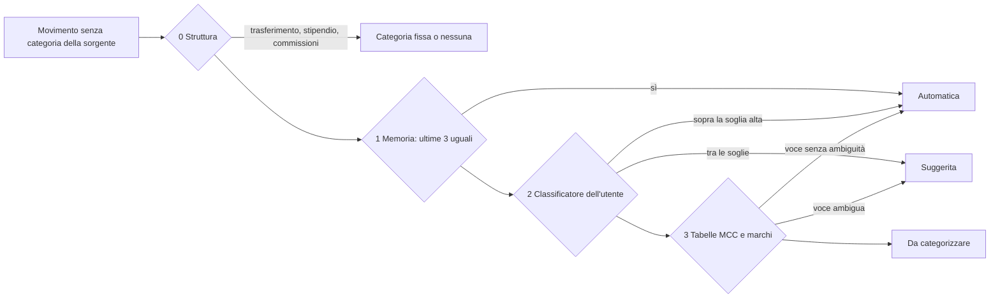
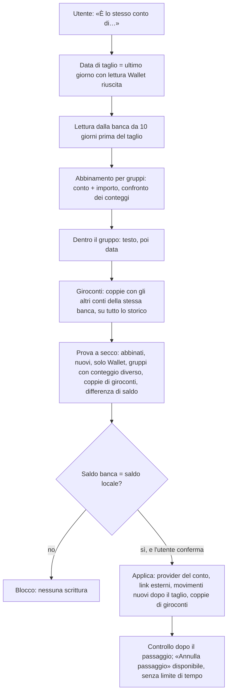

# 4. Lavoro «ora», prima di R0

Indice del piano: [`../rewrite-plan.md`](../rewrite-plan.md). Rilasci: N0-N6 in [`03-releases.md`](03-releases.md).

Revisione sulla standardizzazione (approvata da Mattia il 14/11/2026): tre anticipi senza cambio di comportamento in N1,
N2 e N5 (§4.1, §4.3, §4.7) e il rilascio nuovo N6 (§4.8). Motivo e regola: [`11-standardization.md`](11-standardization.md).

Questo lavoro si fa sul codice attuale (una sola app Next.js). Regola per limitare il lavoro doppio:

| Parte | Sopravvive alla riscrittura | Come si scrive ora |
|---|---|---|
| Contratto dei plugin, kit di test, plugin Enable Banking | Sì, senza modifiche (HTTP) | In `plugins/` e in una cartella `src/platform/plugins/` senza import da Next.js |
| Schema, dati, regole pure con i loro test (abbinamento, categorizzazione, stato del collegamento) | Sì: si spostano in `packages/domain` | Funzioni pure, servizi `(ctx, input)`, nessun import da `src/app` |
| Schermate (voce del plugin per utente, procedura della banca, «Da rivedere», pannello Time Off, fondo pensione unico) | L'interazione sì, il codice in parte | Componenti client senza lettura dati propria: le Server Actions restano solo un involucro sottile, così R3 cambia solo l'involucro |

## 4.1 Runtime minimo dei plugin (N1)

```mermaid
sequenceDiagram
  participant U as Utente (browser)
  participant C as Core (web oggi, api e worker dopo R1)
  participant P as Plugin Enable Banking
  participant B as Enable Banking e banca
  U->>C: Attiva il plugin per sé (Settings › Integrations)
  U->>C: Inserisce id applicazione e chiave (solo scrittura)
  C->>C: Cifra e salva per utente
  U->>C: Sceglie la banca
  C->>P: POST /auth/start (credenziali dell'utente, banca, state)
  P->>B: POST /auth
  P-->>C: Indirizzo della banca
  C-->>U: Redirect alla banca
  U->>B: Accesso e consenso
  B-->>U: Redirect a /api/v1/plugins/enablebanking/callback?code
  U->>C: code + state (sessione dell'utente)
  C->>P: POST /auth/complete
  P->>B: POST /sessions
  P-->>C: Sessione, scadenza, conti
  C->>C: Cifra la sessione; l'utente sceglie i conti
  C->>P: POST /sync (subito, storico lungo, header Psu-*)
  P-->>C: Lotto di conti, saldi, movimenti
  C->>C: Valida con lo schema e scrive con i servizi del dominio
```

**Contratto v1** (`packages/plugin-contract` dopo R0; JSON Schema + kit di test):

| Chiamata | Chi chiama | Scopo |
|---|---|---|
| `GET /manifest` | Core | `id`, `version`, `contract`, nomi e testi (en, it), `capabilities`, schema dei campi (`userSettings` per le credenziali dell'utente, campi del collegamento), host di uscita, pianificazione consigliata, intervallo minimo tra due sync, «do categorie: sì o no» |
| `POST /verify` | Core | Credenziali → `read-only`, `write`, `unverifiable` |
| `POST /auth/start` | Core | Banca, paese, `state` → indirizzo dove mandare il browser |
| `POST /auth/complete` | Core | `code` → sessione, `expiresAt`, conti |
| `POST /sync` | Core | Credenziali, cursore, finestra, utente presente o no → lotto di entità con id esterno, nuovo cursore, copertura |
| `POST /push` | Core | Solo con `provider.write` (non usato da Enable Banking) |

Regole del runtime minimo:

| Regola | Dettaglio |
|---|---|
| Chi chiama | Solo il core. Il plugin non chiama mai il core e non ha porte raggiungibili dal browser |
| Rete | Rete `ledgerly_plugins` dello stack Ledgerly. Il plugin non è su `db_internal`, `proxy_public`, `mail_internal` |
| Container | `user: "1000:1000"`, filesystem in sola lettura, nessun bind mount, limiti di memoria e CPU, healthcheck, `autoheal`, log `json-file`. Immagine costruita dal repo |
| Segreti | Il plugin riceve nella chiamata solo le credenziali di quell'utente e di quel collegamento. Non le salva. Non ha `APP_ENCRYPTION_KEY`, `DATABASE_URL`, segreti OIDC |
| Core → plugin | Segreto condiviso per plugin, nell'header |
| Scritture | Mai dal plugin. Il core valida la risposta con lo schema del contratto e scrive con `upsertFromProvider`, `applyProviderAccounts`, `linkExternal` |
| Errori | Classe e stato HTTP da una lista chiusa. Mai il messaggio grezzo del provider |
| Versione | Il core accetta la versione corrente del contratto e la precedente |
| Installazione | Il container del plugin fa parte dell'installazione standard dell'istanza (compose dello stack). Il core conosce il plugin dalla configurazione del server e ne legge il manifest da solo. Nessun passo dell'admin nell'interfaccia (H25). Il core non riceve il socket Docker |
| Attivazione | Per utente (H25). Il plugin è disponibile a ogni utente e non è attivo. Ogni utente lo attiva e lo disattiva per sé in Settings › Integrations. Senza attivazione il core non chiama il plugin per quell'utente. Dopo la disattivazione le letture di quell'utente si fermano; conti e movimenti restano e tornano aggiornati alla riattivazione. Schermate e stati: [`ux/n1-plugin-bank.md`](ux/n1-plugin-bank.md) §2 |
| Uscita verso internet | Dichiarata nel manifest. Limitazione agli host dichiarati: decisione I8, in R5c |

**Anticipo AN2: lo schema del manifest nasce completo.** È il contratto: cambiarlo dopo tocca ogni plugin. In N1 lo
schema ha già queste parti, anche dove Enable Banking non le usa. Nessun cambio di comportamento.

| Parte del manifest | Contenuto | Serve a |
|---|---|---|
| Etichette | Nome del fornitore, testi dei passi di collegamento, testo di attestazione, nomi dei prodotti (en, it) | Nessun nome di fornitore nelle chiavi di traduzione del core (regola M14) |
| Campi delle credenziali | Nome, tipo, obbligo, «solo scrittura», testo di aiuto | Le schede di Settings nascono dal manifest, non da una pagina per fornitore |
| Intervallo minimo | Minuti tra due sync automatiche | Oggi è una costante motivata da un solo fornitore |
| Capacità | Vocabolario aperto, controllato dal registro: `provider.write`, `categories`, `editRecord`, `deleteCategory`, `ledgerPosting`, `dailyRates`, `windowedHistory`, `totalOnlyHistory`, `costMethod`, `documents.read` | Il core chiede «il fornitore sa fare X?», non «il fornitore è Y?» |

Lo stesso schema descrive i fornitori del core (eToro, Binance) da R2: punto di estensione E5
([`10-modularity.md`](10-modularity.md) §10.11). Un valore di capacità che il core non conosce è ignorato, non rifiutato.

Cosa **non** entra in N1: tab Plugin, catalogo, Wallet e Trek come plugin. Arrivano in R5a e R5c. Aggiornamento e rimozione dall'interfaccia e plugin fuori catalogo non arrivano in nessun rilascio (H27, H28).

## 4.2 Plugin Enable Banking (N1)

| Tema | Regola |
|---|---|
| Passo 1 | Prova su una banca vera, prima del resto dello sviluppo. Mattia registra un'applicazione Production con il redirect `https://<istanza>/api/v1/plugins/enablebanking/callback` e una chiave nuova. La rotta di ritorno e il flusso minimo nascono per primi, così Mattia non copia codici a mano. La prova misura: conti esposti, `entry_reference`, tipi di saldo, MCC e codice bancario, movimenti in sospeso, forma del testo |
| Credenziali | Per utente: id applicazione e chiave privata, inseriti dall'utente in Settings (campo di sola scrittura), cifrati nel core in `plugin_user_credentials`. Il plugin firma il JWT RS256 con la chiave ricevuta nella chiamata e non la conserva |
| Collegamenti | Uno per banca: `integration_connections` con `instance_key` = banca. La sessione e `expires_at` stanno nelle credenziali del collegamento |
| Prima sync | Parte subito dopo `auth/complete`, nella stessa richiesta dell'utente, con `date_from` massimo: la finestra oltre 90 giorni si chiude in pochi minuti |
| Letture automatiche | 3 al giorno per collegamento. Un 429 della banca: stato `rate_limited`, attesa di 6 ore |
| «Sincronizza ora» | Manda gli header `Psu-*` (utente presente) |
| Identità del movimento | `entry_reference` se presente; altrimenti un hash di conto, data contabile, importo, segno, causale normalizzata, controparte e ordine tra i movimenti uguali del giorno. Solo movimenti `BOOK` |
| Campi grezzi | `remittance_information`, nomi di `creditor` e `debtor`, `merchant_category_code`, `bank_transaction_code` salvati sul movimento: servono alla categorizzazione (N3) |
| Conti | In N1: «Nuovo conto» oppure un conto manuale esistente. «È lo stesso conto di un conto Wallet» arriva in N4 |
| Rinnovo | Stesso flusso. I conti si abbinano con `identification_hash`. La sessione vecchia si chiude dopo la riuscita della nuova |
| Sola lettura | L'applicazione è registrata solo per i dati dei conti (AIS). Il manifest non dichiara `provider.write` |

## 4.3 Stato dei collegamenti (N2)

| Stato | Deriva da | Testo | Azione |
|---|---|---|---|
| Aggiornato | `state = active`, ultima sync riuscita entro l'intervallo | «Aggiornato 2 ore fa» | — |
| In corso | Una sync in esecuzione | «Aggiornamento in corso…» | — |
| In ritardo | Fallimenti consecutivi ≥ 1 o ultima sync oltre l'intervallo | «Ultimo aggiornamento ieri alle 08:00. Nuovo tentativo alle 14:00» | «Aggiorna ora» |
| Serve un'azione | `error_code` in `auth`, `consent_expired`; `state = revoked` | «L'accesso alla banca è scaduto» / «La chiave non è più valida» | «Rinnova accesso» / «Sostituisci chiave» |
| In pausa | Nessuna regola di pianificazione | «Aggiornamento automatico spento» | «Riattiva» |

- Codici di errore: `auth`, `consent_expired`, `rate_limited`, `provider_down`, `invalid_data`. Testo fisso tradotto.
- «Oltre l'intervallo» ha una sola definizione: la lettura dovuta dalla pianificazione del collegamento è in ritardo
  di oltre 15 minuti. La soglia dell'avviso «fermo» resta 36 ore.
- Lo stato è una funzione pura del dominio, con un solo vocabolario. Chiude UI-ACC-1 (stato di sync composto a mano in 5 punti) per i punti toccati; gli altri si chiudono in R3.
- Vale per tutti i collegamenti: plugin, Wallet, Trek, eToro, Binance.
- Registro grezzo: per utente, sotto «Avanzate», solo i propri collegamenti, filtro per collegamento, 30 giorni. L'admin vede solo lo stato dei plugin in Server › Diagnostica (H29).
- Plugin disattivato dall'utente: il collegamento è «In pausa», con il testo «{fornitore} non è attivo» e l'azione «Attiva». Nessun avviso di ritardo o di scadenza finché il plugin non è attivo (H30).
- **Anticipo AN3: chiavi di notifica generiche.** N2 riscrive questi avvisi. Le chiavi `wallet_sync_failed` e
  `wallet_sync_stale` diventano `sync_failed` e `sync_stale`, con il fornitore come parametro. Un solo modello di
  mail: «{collegamento} non sincronizzato». Per Mattia gli avvisi e i testi sono gli stessi. Oggi le chiavi
  sono costanti del codice (`src/modules/transactions/jobs.ts:48-49`). Se una riga salvata le contiene, la migrazione
  dei dati di N2 la porta alla chiave nuova: da verificare all'inizio di N2.

## 4.4 Categorizzazione automatica (N3)



| Regola | Dettaglio |
|---|---|
| Dove gira | Nel core, non in un plugin. Lavora sui conti la cui sorgente non dà categorie. I movimenti di una sorgente che dà le categorie non si ricategorizzano: tengono la categoria della sorgente (H34) |
| Categorie di una sorgente (N3.1, H36) | Per ogni categoria di una sorgente che le dà già, la persona la associa a una categoria di Ledgerly oppure la aggiunge come categoria nuova, anche in modo misto. Il movimento conta nella categoria di Ledgerly che corrisponde. Una categoria nuova della sorgente entra da sola come «aggiunta». Stato di partenza: ogni categoria della sorgente è «aggiunta» con il suo nome, come oggi (H34, H35). Dettaglio: [`12-account-modes.md`](12-account-modes.md) §12.3 |
| Addestramento | Solo etichette confermate da una persona o dalla sorgente. Una previsione automatica non entra mai nell'addestramento. Riaddestramento completo dopo una sync con movimenti nuovi, dopo un gruppo di correzioni, o la notte. Per utente |
| Memoria | Chiave = testo normalizzato senza cifre. Automatica solo se le ultime 3 conferme sono uguali |
| Classificatore | Regressione logistica multiclasse scritta nel progetto, senza pacchetti nuovi. TF-IDF di n-grammi di caratteri 3-5, parole, conto, segno, fascia di importo. Minimo 50 etichette e 3 per categoria |
| Soglia | Calcolata a ogni addestramento sulle previsioni fuori campione, per una precisione del 95%. Se le correzioni degli ultimi 30 giorni superano il 10%, la soglia sale |
| Effetto | Automatica: conta subito in Budgets ed Expenses, con segno e motivo. Suggerita: conta come «Da categorizzare» finché non è confermata |
| Correzione | «Applico a N movimenti simili?»: solo su movimenti automatici o senza categoria |
| Categorie doppie | L'app propone l'unione tra categorie di Ledgerly. L'unione rietichetta gli esempi. Due categorie di una sorgente che vogliono dire la stessa cosa (esempio dello spike: «Tobacco» e «Alcohol, tobacco») si associano alla stessa categoria di Ledgerly (H34) |
| Utente nuovo | Circa 12 gruppi predefiniti, modificabili. Revisione guidata per gruppi di testo simile alla prima sync |
| Tabelle statiche | MCC → categoria, marchio → categoria, codice ISO → struttura. File versionati nell'immagine, uguali per tutti |
| Dati | Memoria e modello in PostgreSQL per utente (`on delete cascade`). Fuori da log, export, API, MCP. API e MCP espongono solo l'origine (`user`, `provider`, `auto`) |
| Vincolo | Normalizzazione, addestramento e inferenza nello stesso modulo. Test portabili «testo → caratteristiche → categoria» |
| Misura | Precisione obiettivo 95% (misurata nello spike: 97,0% con memoria severa e categorie doppie unite). La copertura si misura a regime, senza soglia di accettazione (46,5% sul totale, 75% nell'ultimo trimestre) |

**Scelte dello sviluppo (16/11/2026).** Precisano la tabella sopra; il codice è in `src/modules/transactions/categorize/`.

| Punto | Scelta | Motivo |
|---|---|---|
| Soglia | Si scende dalla previsione più sicura a fasce di almeno 20: la soglia si ferma alla prima fascia che da sola è sotto l'obiettivo meno 5 punti, anche se la media di tutto quello che sta sopra è ancora al 95% | Con la sola media, cento previsioni sicure portavano oltre la soglia venti dubbie: sulla prova in ordine di tempo la precisione era 93,7%. Con le fasce è 96,3% |
| Suggerimento | Soglia bassa con lo stesso metodo, per una precisione del 66%. Sotto: niente | Un suggerimento è un aiuto, non conta |
| Caratteristiche | Piegate in 16.384 posizioni con un hash fisso | Memoria del modello limitata qualunque sia il testo: 20.000 etichette restano sotto 300 MB |
| Addestramento | A passi, cedendo il turno al server ogni 400 esempi | Sono secondi di calcolo nello stesso processo che risponde alle pagine |
| Quando | Dopo ogni lettura di una banca, dopo una conferma o una scelta, dopo la creazione dei gruppi. Solo se un'etichetta è nuova o cambiata. Nessun riaddestramento notturno | La lista dei job è fissata da un test; tre letture al giorno bastano |
| Cosa legge | Solo i movimenti senza categoria e senza origine. Un'automatica già data non si ricalcola | Un budget non cambia perché il modello è stato riaddestrato |
| Plugin sconosciuto | Un conto di un plugin di cui il core non ha mai letto il manifest non viene letto | Senza manifest non si sa se la sorgente dà le sue categorie |
| Correzioni | Un'automatica sostituita lascia il segno `corrected`: è il numeratore del «10% degli ultimi 30 giorni» | — |

## 4.5 Movimento manuale (N3)

Regole del 15/11/2026 (H32, H33, H35). Concetto e dettaglio: [`12-account-modes.md`](12-account-modes.md) §12.1 e §12.2.

- Crea, modifica e cancella un movimento locale: importo, uscita o entrata, conto, categoria, data, beneficiario (facoltativo), nota.
- È permesso su ogni conto con una modalità: «a mano», «lettura e scrittura», «sola lettura». Non sui conti di investimento. In N3: conti «a mano» e «sola lettura». I conti «lettura e scrittura» arrivano con N3.1 (H36): fino ad allora il dialogo non li offre.
- **Saldo.** Un movimento a mano cambia il saldo del conto, subito. Regola del dominio: saldo = ultimo saldo conosciuto + movimenti a mano dopo quella data. Un movimento con una data prima dell'ultimo saldo conosciuto non cambia il saldo di oggi.
- **Conto «a mano».** Il saldo nuovo è definitivo subito.
- **Conto «sola lettura».** Resta l'avviso: «Questo conto riceve i movimenti dalla banca. Un movimento a mano può risultare doppio.» Alla lettura successiva vale il saldo della sorgente. La lettura non tocca il movimento a mano, che non ha un link esterno.
- **Conto «lettura e scrittura» (N3.1).** All'aggiornamento successivo il core scrive il movimento sulla sorgente. Dopo l'invio il movimento ha un link esterno ed è un movimento della sorgente. Fino all'invio la lettura non lo tocca. Un invio non riuscito si ripete all'aggiornamento successivo. La sorgente non deve restituire un doppione del movimento appena creato.
- Sostituita: la regola del 13/11/2026 «La sync non tocca mai un movimento manuale. Un movimento manuale non ha un link esterno», per i conti «lettura e scrittura».
- La categoria proposta arriva dalla cascata.
- Il caso d'uso accetta già una chiave di idempotenza (campo facoltativo ora, obbligatorio dall'API in R2).

## 4.6 Passaggio di un conto da Wallet a Enable Banking (N4)

Con N3.1 già rilasciato (H38): il passaggio aggiorna prima la sorgente di partenza e invia i movimenti a mano non
ancora inviati. Se un movimento resta non inviato, la prova a secco lo elenca e il passaggio si ferma.



- Un conto per volta. Wallet resta collegato per gli altri conti; il pass Wallet salta i conti passati.
- Lo storico resta quello di Wallet. Nessuna riga di movimento cancellata.
- Il tipo di saldo è uno per banca (`CLBD`, `XPCD`, `OPBD`): non esiste un tipo comune. Lo sceglie Ledgerly, nel dominio; la persona non lo cambia (H43).
- La prova a secco copia la categoria di Wallet sul testo della banca per i movimenti abbinati: sono esempi di addestramento nel formato giusto.
- I gruppi con conteggio diverso («Da controllare») sono solo da leggere: nessun collegamento a mano (H44).

Decisioni del 16/11/2026 (H39-H47). Righe del rilascio ed eccezioni: [`03-releases.md`](03-releases.md) «N4».
Interfaccia: [`ux/n4-account-switch.md`](ux/n4-account-switch.md). I punti **[DEV]** li conferma lo sviluppatore.

**IBAN sul conto (H39, H45-H47).** Regola generale: vale per ogni conto con una modalità (H32) e per ogni sorgente, senza nomi di fornitore. I conti di investimento e i fondi pensione non hanno il campo (H47).

| Tema | Regola |
|---|---|
| Campo | IBAN del conto, facoltativo. Salvato senza spazi e in maiuscolo. Controllo: paese, lunghezza, cifre di controllo. La funzione esiste: `normalizeIban` (`src/modules/transactions/rules.ts`); **[DEV]** si sposta dove la usano i due moduli, senza un doppione |
| Chi lo scrive | La sorgente, a ogni aggiornamento, quando lo dà: il campo è in sola lettura per la persona. La persona, quando la sorgente non lo dà e sui conti a mano. Ledgerly non scrive mai l'IBAN sulla sorgente |
| Un IBAN, un conto | Due conti non archiviati dello stesso utente non hanno lo stesso IBAN. Il controllo è una funzione pura del dominio `accounts`: riceve l'IBAN e i conti dell'utente, risponde con il conto che ha già quell'IBAN |
| Tre strade di creazione | 1) Procedura di collegamento di una sorgente. 2) Aggiornamento automatico che trova un conto nuovo. 3) Creazione o modifica a mano. Tutte chiamano lo stesso controllo, sul server. Esito con un IBAN già presente: nessun conto creato, codice `iban_exists`, avviso con il nome del conto |
| Conto senza IBAN | Nessun blocco. La banca non dà l'IBAN per ogni conto: nella prova di N1, 1 conto su 3 lo aveva |
| Conti già doppi | Due conti di oggi con lo stesso IBAN restano. Il controllo vale per le scritture nuove **[DEV]**. Il passaggio non li unisce: specifica §2.4.2, caso 7 |
| Dato personale | Mai in URL, toast, log, registro e «Copia rapporto». API, MCP ed export non lo contengono, né intero né mascherato: le rotte di scrittura lo accettano, nessuna risposta lo restituisce (H45) |
| Primo riempimento | La sorgente riempie il campo al primo aggiornamento dopo il rilascio. In più, al rilascio: i valori di «IBAN o riferimento» (`accounts.reference`) che sono un IBAN valido si copiano nel campo IBAN. Il campo vecchio resta, con il nome «Riferimento», e il suo valore non cambia (H46) |

**Giroconti su tutto lo storico (H40).** Regola nuova del dominio `transactions`. Oggi un giroconto si riconosce
solo dal riferimento della controparte dato dalla sorgente (`pairTransfers`) o dall'IBAN nel testo
(`planIbanTransfers`). La banca non dà il riferimento e i movimenti vecchi non hanno il testo della banca.

| Tema | Regola |
|---|---|
| Tra quali conti | Il conto passato e gli altri conti dello stesso collegamento della banca che sono in Ledgerly. Nessun altro conto |
| Periodo | Tutto lo storico dei conti. Vale anche per i movimenti futuri |
| Coppia | Un'uscita su un conto e un'entrata sull'altro, stesso importo, stessa valuta, date vicine. **[DEV]** Finestra dei giorni: proposta 5, come `IBAN_TRANSFER_MAX_DAYS` |
| Casi ambigui | Come per l'abbinamento per gruppi: se nel gruppo (coppia di conti + importo + finestra) i conteggi dei due lati sono diversi, nessuna coppia. **[DEV]** Da confermare sui dati reali della prova |
| Movimenti esclusi | Un movimento che è già in una coppia di giroconto. **[DEV]** Un movimento con una categoria scelta a mano dalla persona: la specifica lo trasforma come gli altri (§9.3); la prova lo elenca |
| Prova a secco | Restituisce ogni coppia (data, conto di partenza, conto di arrivo, importo) e il totale per anno. Non scrive nulla |
| «Applica» | Scrive le coppie nella stessa transazione del passaggio. Salva per ogni movimento il tipo e la categoria di prima |
| «Annulla passaggio» | Riporta ogni coppia scritta dal passaggio: un'entrata e un'uscita, con il tipo e la categoria di prima. Non tocca i giroconti che esistevano prima |
| Forma | Funzione pura, con la forma del punto di estensione E7 ([`10-modularity.md`](10-modularity.md) §10.11): strategia «importo e data» dell'abbinatore di movimenti. Nessun nome di fornitore |

**«Annulla passaggio» (H41, H42).** Nessun limite di tempo: è possibile finché la sorgente di partenza è collegata.
I movimenti arrivati dalla banca dopo il passaggio non contano più in saldo, entrate, uscite e budget, e non si
vedono; nessuna riga è cancellata. **[DEV]** Con quale stato (specifica §18, punto 11).

## 4.7 Time Off (N5)

- Interazione: [`03-releases.md`](03-releases.md), N5. Sostituisce le regole interne M1, N3 e N10 citate in `src/modules/timeoff/ui/year-calendar.tsx:29-31,71-76,124-128`.
- Chiude UI-TOF-1 e UI-TOF-2 (gesti e round trip per clic). Il pannello è un componente client senza lettura dati propria: in R3 passa a `packages/ui` senza riscrittura.
- Il caso d'uso «scrivi un intervallo» è un servizio `(ctx, input)` nuovo nel modulo timeoff; R2 gli dà la rotta.
- Trek non cambia: la sync parte come oggi dopo la scrittura.
- **Anticipo AN1: i tipi di assenza arrivano da un elenco.** Il pannello non contiene nomi di tipo. Riceve un elenco
  `{ id, nome, colore, ha un monte }` e lo mostra. In N5 l'elenco è costruito dai tipi di oggi senza `sick`
  (decisione H20, decisione ST-27): nessun cambio di schema. A schermo la scelta di quel tipo non c'è più. In R5g l'elenco arriva dalla tabella `leave_types` senza riscrivere il pannello.
- **Difetto probabile (decisione ST-23).** Due liste dicono quali tipi vanno a Trek: l'azione avvia la sync solo per
  `vacation` e `comp` (`src/modules/timeoff/actions.ts:112-113`), le regole mandano anche `rol`
  (`src/modules/timeoff/rules.ts:38`). Effetto atteso: un giorno ROL arriva a Trek solo alla sync successiva. Non è
  verificato. N5 aggiunge un test; se fallisce, la correzione è un `fix` nello stesso rilascio: una sola lista.

## 4.8 Fondo pensione standard (N6)

Dettaglio: [`11-standardization.md`](11-standardization.md) §11.2. Rilascio: [`03-releases.md`](03-releases.md), N6.

Perché in fase A e non nella riscrittura: R0, R2 e R3 spostano e rifanno ogni file del modulo `funds`. Con N6 prima,
rifanno un motore solo. Il codice del PAC (circa 1.500 righe, stima dalle dimensioni dei file) sparisce prima di
essere spostato. N6 chiude anche FND-1, FND-2 e FND-3 dell'audit.

| Parte | Sopravvive alla riscrittura | Come si scrive ora |
|---|---|---|
| Schema (`fund_contribution_sources`, `fund_fees`, registro unico) e migrazione dei dati | Sì | Migrazione additiva; le tabelle vecchie restano ferme fino a R5f |
| Regole pure: `fundFlows`, `feesFor`, scadenze dalla sorgente | Sì: vanno in `packages/domain` | Funzioni pure senza database; `FeeRule` in un file senza import dal modulo, così R0 lo sposta in `shared/fees` |
| «Deducibile» (H18); caricamento, lettori e pagine dei documenti dei fondi, job `cometa-sweep` (H19) | No: si tolgono | Rimozione in N6: la riscrittura non li sposta e non li rifà ([`11-standardization.md`](11-standardization.md) §11.2.6) |
| Schermate (procedura a 4 passi, dettaglio unico) | L'interazione sì, il codice in parte | Componenti client senza lettura dati propria |

Cosa **non** entra in N6: la fusione con Investments, i 2 gruppi, gli URL `/investments/[id]` (R5b); la rimozione delle
tabelle vecchie (R5f); i piani di acquisto (R5d). La cancellazione dei file dei documenti di Cometa entra in N6, come
passo separato (decisione ST-25, H24).

## 4.9 Cosa resta fuori da «ora»

Investments unificata, Portafoglio manuale e piani di acquisto, «Lavoro standard» (R5g), menu e moduli, tab Finance completo, Wallet e Trek come plugin, catalogo dei plugin:
il design è approvato, lo sviluppo è in R5. Motivo: sono soprattutto interfaccia e runtime, che la riscrittura rifà.
