# 5. Refactor modulo per modulo

Indice del piano: [`../rewrite-plan.md`](../rewrite-plan.md). Ingresso: [`02-audit.md`](02-audit.md) e i tre file di dettaglio.

Il refactor è completo: non basta spostare i moduli. Ogni voce dell'audit ha un rilascio che la chiude.
I calcoli approvati (P&L, Modified Dietz, XIRR, interessi, Cometa) si riordinano ma non cambiano risultato.

## 5.1 Criterio di uscita di un modulo

Un modulo è «uscito» quando tutte e quattro le condizioni sono vere. La verifica è del revisore del codice (G7).

| # | Condizione | Come si verifica |
|---|---|---|
| 1 | **Stessi numeri** | Fotografia dei numeri «prima» = «dopo» per gli utenti di prova e per la produzione ([`06-data.md`](06-data.md) §6.4). Test di parità del modulo: pagina = rotta API = strumento MCP = export |
| 2 | **Test verdi** | Gate G1-G6. Nessuna asserzione esistente cambiata, salvo le voci con una decisione scritta di Mattia |
| 3 | **Nessun doppione dell'audit rimasto** | Lista di controllo del modulo: ogni ID dell'audit è «chiuso» (con il commit) o «rinviato» (con il rilascio che lo chiude e il motivo). «Rinviato» è ammesso solo per le voci che dipendono da R5 |
| 4 | **Confini** | Il modulo ha un `index.ts` pubblico; nessun import profondo da fuori; nessun ciclo nuovo; la lista dei cicli noti si è accorciata |

Due momenti di uscita per modulo: **dominio** (fine del suo passo R2) e **interfaccia** (fine del suo passo R3).

## 5.2 Ordine

```mermaid
flowchart LR
  R0[R0 trasversale: primitive, codice morto, index pubblici] --> R1[R1 job e integrazioni: runPass, coda, porte]
  R1 --> M1[users e impostazioni] --> M2[accounts] --> M3[transactions] --> M4[budgets]
  M4 --> M5[pockets] --> M6[subscriptions] --> M7[interests] --> M8[timeoff]
  M8 --> M9[payroll] --> M10[imports] --> M11[funds] --> M12[investments]
```

Per ogni modulo: passo R2 (filone server: contratto, rotte, refactor del dominio), poi passo R3 (filone client: hook
dati, componenti condivisi, cancellazione delle azioni). Il filone client lavora un modulo dietro al filone server.
Dal più semplice al più delicato: i due motori di rendimento arrivano per ultimi, quando le primitive sono già provate.

## 5.3 R0 · refactor trasversale (nessun numero cambia)

| Lavoro | Voci chiuse |
|---|---|
| `domain/shared/money`: `Fixed(scale)`, divisione arrotondata, `parseAmount`, `percentToFraction`, `abs` | INV-12, SUB-6, ACC-9, INT-8, INV-6 (senza cambiare le scale usate oggi) |
| `domain/shared/dates` e `period`: `daysBetween`, `addMonthsClamped`, `firstDayOf`, `monthEndSeries`, tipo `Period` (i moduli lo adottano nel loro passo) | SUB-5, IMP-6, INV-6, ACC-10 |
| `api-contract/primitives`: `civilDate`, `monthKey`, `optionalText`, `hexColor`, `currency`, `cents`, `id` | TR-2, MCP-4, BUD-8, POC-8 |
| `domain/db`: `enumCheck`, `isUniqueViolation`, un solo `keyRing()` | TR-9, INTG-10 |
| Una sola guardia admin, un solo `storableError`, un solo `buildCtx` | PLT-4, PLT-9, USR-3 |
| Codice morto: export senza uso, `fundsView` e `fundDetail` nelle parti non lette, `monthlyReturns`, `returnStats`, `flowsByMonth`, `isDue`, namespace `gallery` (dopo conferma) | TRX-12, IMP-8, FND-5, INTG-8 (parte codice), UI-MSG-3 |
| `index.ts` pubblico per modulo; regola ESLint contro gli import profondi; controllo dei cicli nel gate con la lista dei cicli noti | TR-7, PLT-3 |
| Divisione dei file grandi senza cambiare le funzioni (`accounts/service.ts`, `transactions/*`, `investments/sync.ts`, `payroll/service.ts`, `timeoff/rules.ts`, `integrations/service.ts`, `auth.ts`) | ACC-7, TRX-7, INV-7, PAY-7, TOF-8, INTG-9, PLT-7 |

## 5.4 R1 · job e integrazioni

| Lavoro | Voci chiuse |
|---|---|
| Registro dei job composto in `apps/worker`; ogni modulo esporta i suoi job; trigger multipli per job | JOB-1, JOB-3, JOB-4, JOB-7 |
| Coda persistente al posto di `after()`; job `documents-sweep` unico | JOB-6, PAY-1, PAY-4, IMP-3, IMP-7 |
| Recupero delle righe `running`; heartbeat nel database; limiti condivisi su tabella; pool proprio | JOB-2, JOB-5, JOB-9, PLT-10 |
| `runPass(connection, kinds, work)` unico: lock, run, skip, revoca, backoff, cooldown; un tipo di esito | INTG-5, INTG-6 |
| Client HTTP comune (timeout, retry, `Retry-After`, classificazione degli errori) | INTG-4 |
| Evento `MovementsChanged(userId)` al posto della regola cablata su Wallet; `forEachUser` nel worker | JOB-8, USR-2 |
| «Sync poi maturazione» come due passi del worker | INT-2 |
| Servizio `mailer.render` e helper `alertPass` | TR-8 |

Wallet e Trek restano compilati fino a R5c, ma dietro `runPass` e il client comune: il loro distacco in R5c diventa meccanico.

## 5.5 Moduli

Per ogni modulo: cosa fa il passo **R2** (dominio e API), cosa fa il passo **R3** (interfaccia), le voci chiuse, le voci
che chiedono una decisione prima di partire (D = [`09-risks.md`](09-risks.md) §9.3).

### users e impostazioni

| Passo | Lavoro | Voci |
|---|---|---|
| R2 | `domain/identity` (preferenze, persone) senza ciclo con l'auth; preferenze per area con aggiornamento parziale; caso d'uso `changePreferences` con l'evento «fuso cambiato»; costanti uniche per gli enum; rotte `/preferences`, `/sessions`, `/api-clients`, `/server/*`, `/categories`, `/labels`, `/connections`; azioni generiche `connect`, `test`, `syncNow`, `disconnect`; helper `sealedSetting` | USR-1, USR-4, USR-6, USR-7, INTG-7, PLT-5, UI-SET-1 |
| R3 | `AppShell` client; `SETTINGS_TABS` unico; `SectionTabs`; `PreferencesStore` (tema e sidebar senza cookie del server); `ProviderConnectionCard`; `ScheduleControl` e `ConnectionRow` in `packages/ui`; helper di presentazione fuori dal dominio | UI-NAV-1…UI-NAV-5, UI-SET-2…UI-SET-8, USR-8, UI-INV-10, UI-AUT-2 |
| Rinviato | `default_range` (colonna senza uso) → R5f | USR-5 |

### accounts

| Passo | Lavoro | Voci |
|---|---|---|
| R2 | Una funzione `balanceAt` e una `netWorth` da cui derivano totale e riquadri; un servizio di totale con filtro esplicito usato anche dallo snapshot; nomi distinti per «lettura a una data» e «saldo ricostruito»; `writeBalanceEntry` e `requireAccount` unici; porte `MovementsPort` e `ManagedAccountsPort` al posto dei cicli; `accountNames` e `accountOptions` pubblici; DTO unici per REST e MCP; rotte per le 11 azioni senza rotta | ACC-1, ACC-3, ACC-4, ACC-5, ACC-6, ACC-8, POC-7, BUD-7 |
| R3 | `AccountList` su `DataTable`; `DetailHeader`; `CompositionCard`; `ValueEntryDialog`; `SyncStatus`; `AccountSelect`; `PeriodBar` unico; controlli generici in `packages/ui`; una query per tab | UI-OVR-1…UI-OVR-3, UI-ACC-1…UI-ACC-8, ACC-11 |
| Decisione | ACC-2 (`previousNetWorth`), ACC-3 (totale dello snapshot) | D1, D2 |
| Rinviato | `account_groups` (tabella senza uso) → R5f | ACC-12 |

### transactions

| Passo | Lavoro | Voci |
|---|---|---|
| R2 | Una query aggregata `spending(filters, groupBy)`; una definizione di `net`; una funzione `share`; `findMovements` e `groupBy`; chiave del beneficiario in un solo posto; schema dei filtri e DTO unici (REST, MCP, pagina); porta `TransactionsProvider`, `provider` sempre passato dal chiamante; `requireCategory`; servizio pubblico `recurrences`; tipo `Money` e somma che converte o rifiuta il misto | TRX-3, TRX-4, TRX-5, TRX-6 (parte porta), TRX-8, TRX-9, TRX-10, TRX-11, SUB-8, TR-4 |
| R3 | `DataTable` + `useSelection` + `TransactionRowMenu`; barra dei filtri client con stato nell'URL; `CategoryPicker` multiplo; `PeriodControl` unico con i messaggi in `common.period` | UI-EXP-1…UI-EXP-4, UI-MSG-2 |
| Decisione | TRX-1 (`net` con o senza trasferimenti), TRX-2 e TR-4 (somme in più valute) | D3, D4 |

### budgets, pockets, subscriptions, interests

| Modulo | R2 | R3 | Voci | Decisione |
|---|---|---|---|---|
| budgets | `ratio(spent, limit)` unico; `categoryFamily` unica; `loadLimits` e `spentFor`; `budgetName` nel dominio; `GET /budgets` con lo stesso DTO dello strumento MCP | `Stat` + `ProgressBar` | BUD-2…BUD-6, UI-BUD-1, UI-BUD-2 | BUD-1 (D5) |
| pockets | `pocketBalances(ctx)` separata dalla vista; letture a blocchi; regola di ripartizione dell'interesse con un nome suo; rotte | Un file per dialog su `FormDialog`; `HeroFigure` + `StatGrid` | POC-1, POC-3, POC-5, POC-6, UI-PCK-1, UI-PCK-2 | POC-2 (D4); POC-4 → R5f |
| subscriptions | `upcomingCharges` unica; `monthlyCost` unica; insieme «già trovati» calcolato una volta; query filtrate per `ids`; `searchByName`; rotte | `DataTable` + `ProgressBar`; esportazione con download per piattaforma | SUB-1 (dopo D6), SUB-2, SUB-3, SUB-7, SUB-9, UI-SUB-1, UI-SUB-2 | SUB-1 (D6), SUB-4 (D4) |
| interests | `sumAccruals` unica; una regola di freschezza con soglia esplicita; porta `LedgerPosting` al posto del client Wallet; schemi nel contratto; letture a blocchi | `RecurrenceField` | INT-1, INT-3, INT-4, INT-5, INT-6, INT-7, UI-INT-1 | INT-3 (D7) |

### timeoff, payroll, imports

| Modulo | R2 | R3 | Voci | Rinviato |
|---|---|---|---|---|
| timeoff | Una formula del residuo con `basis` esplicito; porta `LeaveCalendarSync`; evento `LeaveChanged`; impostazioni ferie nel modulo; `GET /timeoff/:year` su `timeOffView`; un solo file di azioni fino a R3 | Pannello di N5 in `packages/ui`; `MonthGrid` condiviso con il selettore di intervallo; `KindCard` con slot; mutazione ottimistica | TOF-1, TOF-3…TOF-7, UI-TOF-2…UI-TOF-6 | TOF-2 (colonne e vocabolario Trek) → R5c e R5f |
| payroll | Evento `PayslipApplied`: payroll emette la competenza, funds decide trimestre e scrittura; contratto `LeaveBalanceSource` con un solo vocabolario dei tipi; rotte di lettura e di revisione | `DataTable` con intestazione fissa; polling del documento; `StatusBadge`; originale PDF con URL firmato | PAY-5, PAY-6, PAY-8, FND-11, UI-PAY-1…UI-PAY-4 | PAY-9 (profilo unico del parser): resta, annotato |
| imports | Registro `DocumentKind → { formati, cartella, parser }`; pipeline unica `claim → read → parse → evidence → needs_review`; un caso d'uso `uploadDocuments(kind, files)`; `saveEvidence` a blocchi | Upload multipart; selettore di file per piattaforma | IMP-1, IMP-2, IMP-4, IMP-5, PAY-2, PAY-3, API-4, UI-FND-6 | — |

### funds

| Passo | Lavoro | Voci |
|---|---|---|
| R2 | Resta solo il motore di periodo (`period.ts` + `home.ts`); export e riga dei fondi leggono quello; una funzione `pensionFlows` da cui deriva il «versato»; un servizio `fundValueAt` sulle letture documentate; `moneyWeighted` del dominio comune; una regola «il giorno 1 chiude il mese prima» con il suo inverso; helper condivisi; rotte per le 26 azioni e per le letture | FND-1, FND-3, FND-4, FND-6, FND-10, FND-12 (parte dominio) |
| R3 | `PortfolioDetail` condiviso con investments; una route per tab; `KpiTile` unico; tabelle su `DataTable` con una sola soglia; un file per flusso | UI-FND-1…UI-FND-5, FND-9, FND-12 |
| Decisione | FND-1 (quale motore è il riferimento per export e riga dei fondi), FND-2 (`transfer_in` nel «versato»), FND-3 (valore del fondo a oggi) | D8 |
| Vincolo | I numeri delle pagine Funds di oggi sono il riferimento. Nessuna migrazione dei dati dei fondi | — |

### investments

| Passo | Lavoro | Voci |
|---|---|---|
| R2 | `domain/returns` con definizioni nominate; `portfolioState` e `accountPnl` usano `performance`; un servizio `valueAt`, il saldo `portfolio` è la sua proiezione; read-model `InvestmentsSnapshot` caricato una volta per richiesta; export dallo stesso read-model con `includeArchived` esplicito; solo `domain/fx` scarica e converte; `pnlOf` scomposto in passi puri, barre da un solo replay; period, returns e dati dei grafici fuori dal modulo (fine del ciclo con funds); rotte per le 15 azioni | INV-1 (dopo D9), INV-2, INV-3, INV-4, INV-8, INV-9, INV-10, PLT-2, FND-7, FND-8 |
| R3 | `PortfolioHome`, `HeroFigure`, `PerformanceCard`, `AlertsSummary`; primitivi dei dialog in `packages/ui`, un file per flusso; `RunLog`; hook dati + selettori puri per pagina | UI-INV-1…UI-INV-4, UI-INV-6…UI-INV-9, UI-DS-9…UI-DS-11 |
| Decisione | INV-1 (quale rendimento pubblicano API, MCP ed export), INV-5 (export con archiviati), PLT-1 (una sola conversione) | D9, D10, D11 |
| Rinviato | Catalogo e voci `planned` → R5b; `investment_superseded_entries`, motivi `migration` → R5f | INV-11, UI-INV-5 |

### API, MCP, export e design system

| Area | Lavoro | Rilascio | Voci |
|---|---|---|---|
| API e MCP | Rotte e strumenti generati dallo stesso descrittore del contratto; scope dichiarato sulla risorsa; un middleware `authenticateRequest`; lista scritta delle esclusioni di parità | R2 | API-1, API-2, API-3, API-5, MCP-1…MCP-5, BUD-2, TR-3 |
| Export | Le sezioni derivano dagli stessi DTO del contratto | R2 (ultimo passo) | API-7, INV-5, FND-1 |
| Notifiche | Un servizio `notify(event)` con canali; ogni sorgente emette lo stesso evento `SyncFailed` | R5e | PLT-6 |
| Azioni | Wrapper unico `action(schema, handler)` fino alla cancellazione delle azioni; `Result` ed errori nel contratto | R2 (wrapper), R3 (cancellazione) | TR-1, PLT-8, TOF-5 |
| Design system | `design-tokens` come sorgente unica (raggi, tracking, ombre, overlay, scala `z`, palette delle serie, safe area); `DataTable`; `Segmented`, `Stepper`, `KpiTile`, `Stat`, `KpiRow`, `PageHeader`, `EmptyState` in linea, `QueryBoundary`, `FormDialog`, `ConfirmDialog`, `TextLink`, `ColorDot`, `ColorPicker`, `useFormat()`; grafici in un file ciascuno; adattatore di routing iniettato | Passo zero del filone client (in parallelo a R2), poi R3 per modulo | UI-DS-1…UI-DS-23, UI-NAV-6, UI-NAV-7 |
| Messaggi | Namespace `common.actions`, `common.fields`, `common.errors`, `common.period`; glossario unico | R3, R5a | UI-MSG-1, UI-MSG-2 |

## 5.6 Regole del refactor

1. **Prima la fotografia, poi il refactor.** Nessun passo di modulo parte senza la fotografia dei numeri «prima».
2. **Un commit per voce o per gruppo di voci dello stesso tipo**, con gli ID dell'audit nel corpo del messaggio.
3. **Un numero che cambia è un difetto del refactor**, salvo una decisione scritta di Mattia (D1-D11). In quel caso il
   cambio ha un commit suo, separato dal refactor, con il test che lo descrive.
4. **Le asserzioni dei test non si adattano al codice nuovo.** Si spostano con il codice. Un test che deve cambiare è
   segnalato nella PR o nel commento di consegna.
5. **Nessuna funzione nuova per l'utente dentro R0-R4.** Le novità di prodotto sono in R5.
6. **L'audit si aggiorna.** Se un passo trova un doppione nuovo, lo aggiunge al file di dettaglio con un ID nuovo, nello
   stesso commit.
