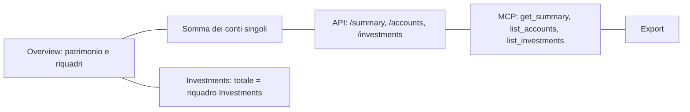

# 6. Dati

Indice del piano: [`../rewrite-plan.md`](../rewrite-plan.md).

Stesso PostgreSQL (`db/`, database `ledgerly`), stesso schema, stessa storia di migrazioni Drizzle (oggi `0000`…`0045`).
Nessun dato si sposta in un altro database. Le migrazioni restano in un posto solo: oggi `drizzle/`, da R0 `packages/domain`.
Le applica il container che serve l'API, all'avvio; il worker aspetta.

## 6.1 Migrazioni previste

I nomi sono indicativi: il numero e il nome definitivi nascono con `npm run db:generate`.

| Rilascio | Migrazione | Tipo | Compatibile con l'immagine precedente |
|---|---|---|---|
| N1 | `integration_connections.instance_key text not null default ''`; `expires_at timestamptz` | Additiva | Sì: default per le righe esistenti |
| N1 | Chiave unica nuova `(user_id, provider, instance_key)`. La chiave vecchia `integration_connections_user_provider_uq` **resta** | Additiva (primo tempo) | Sì: l'immagine precedente usa `ON CONFLICT (user_id, provider)` (`src/platform/integrations/service.ts:149-152`), che funziona finché la chiave vecchia esiste |
| N1 | Tabella `plugins` (id, indirizzo, manifest, versione del contratto, stato, verificato) | Additiva | Sì |
| N1 | Tabella `plugin_user_credentials` (utente, plugin, valore cifrato) con `on delete cascade` | Additiva | Sì |
| N1 | `transactions.raw_text`, `counterparty_name`, `merchant_category_code`, `bank_transaction_code`, tutte nullable | Additiva | Sì |
| N2 | `integration_connections.error_code`, `consecutive_failures int not null default 0`; `sync_runs.origin`, `error_code`, `http_status`, `app_version` | Additiva | Sì |
| N2 | Rimozione di `integration_connections_user_provider_uq` | Contrazione (secondo tempo) | Sì: l'immagine N1 usa già la chiave nuova. Non compatibile con l'immagine prima di N1: per questo è in un rilascio a parte |
| N2 | Dati: righe `running` di `sync_runs` e `job_runs` più vecchie di un'ora → `failed` con motivo `orphaned`; cancellazione delle righe di `sync_runs` oltre 30 giorni | Dati | Sì. Dump prima |
| N3 | `transactions.category_origin` (`user`, `provider`, `memory`, `model`, `table`, null), `category_confidence`, `category_model_version`; valore `manual` per l'origine del movimento | Additiva | Sì |
| N3 | Tabelle `category_memory` e `category_models`, per utente, `on delete cascade` | Additiva | Sì |
| N3 | Dati: `category_origin = 'provider'` per i movimenti con categoria; `'user'` dove `locally_edited` contiene la categoria | Dati | Sì. Dump prima |
| N4 | Nessuna di schema. Dati su richiesta dell'utente: `accounts.provider`, righe di `provider_links` | Dati | Sì; annullabile dall'interfaccia |
| N5 | Nessuna | — | — |
| R0 | Nessuna | — | — |
| R1 | Tabelle `job_queue`, `worker_heartbeats`, `rate_limit_counters` | Additiva | Sì: l'immagine precedente non le usa |
| R2 | Tabella `idempotency_keys` (utente, chiave, rotta, risposta, scadenza); righe dei client OAuth `ledgerly-android` e `ledgerly-windows` | Additiva | Sì |
| R3, R4 | Nessuna | — | — |
| R5a | `user_preferences.modules`, stato del primo avvio | Additiva | Sì |
| R5b | Nessuna (fusione solo di modello di lettura e interfaccia) | — | — |
| R5c | timeoff: colonne di stato esterno generiche (`external_state`, `external_kind`, `external_fraction`) riempite da `trek_*`; connessioni Wallet e Trek marcate come connessioni di plugin | Additiva + dati | Sì: le colonne `trek_*` restano e restano aggiornate fino a R5f |
| R5d | Tabelle `instruments`, `instrument_listings`, `instrument_prices`; `investment_assets.instrument_id` nullable | Additiva | Sì |
| R5e | Preferenze dei canali per evento; coda delle notifiche da leggere | Additiva | Sì |
| R5f | Rimozioni: `user_preferences.default_range` (USR-5); `account_groups` e `accounts.group_id` (ACC-12); `sync_jobs.next_run_at`, kind `documents`, lettura dello schedule D7 (INTG-8); tier `quarter` (JOB-7); tipi `withdrawal` e `adjustment` dei pocket se senza righe (POC-4); colonne `trek_*` di timeoff (TOF-2); `investment_superseded_entries` e motivo `migration` se senza uso (INV-11) | Contrazione | **No.** Dump obbligatorio. Ogni rimozione parte solo dopo un rilascio stabile di chi l'ha resa inutile, e dopo una query di controllo «zero righe, zero usi» |

Nessuna migrazione dei dati dei fondi, in nessun rilascio.

## 6.2 Regola di compatibilità

1. **Solo additive.** Colonne nuove nullable o con default; tabelle nuove; indici nuovi. Nessun `DROP`, nessun `ALTER TYPE`, nessun `NOT NULL` su una colonna esistente dentro un rilascio normale.
2. **Compatibilità N-1.** Lo schema del rilascio N funziona con l'immagine del rilascio N-1. Il rollback dell'immagine non richiede il ripristino del dump.
3. **Due tempi.** Un cambio che non è additivo si divide: prima si aggiunge il nuovo (e il codice scrive nei due posti), poi, in un rilascio successivo, si toglie il vecchio.
4. **Controllo nel gate.** Un test legge le migrazioni nuove del rilascio e fallisce se trova `DROP`, `RENAME`, `ALTER … TYPE`, `SET NOT NULL` o un `DELETE`/`UPDATE` senza `WHERE`, salvo un'eccezione scritta nel piano (N2 e R5f).
5. **Prova di rollback.** Per ogni rilascio con migrazione: sul database di test, applica le migrazioni nuove, avvia l'immagine `pre-<id>`, esegui gli integration test di quella immagine.
6. **Modifiche ai dati**: sempre con `WHERE`, sempre in una transazione, sempre con il conteggio delle righe toccate nel commento di deploy. Dump prima.
7. **Rimozioni**: solo in N2 (una chiave unica) e in R5f. OK di Mattia sul SHA (`git-policy` §6 #1).

## 6.3 Dump dei rilasci

Proposta (ipotesi I1: Mattia conferma il percorso con l'OK al piano).

| Punto | Proposta |
|---|---|
| Percorso | `/home/mattia/docker/projects/Ledgerly-dumps/` |
| Perché lì | Sotto `projects/`, fuori dal repo Ledgerly e fuori dal repo Homelab (`projects/` è escluso). Non ha un file compose: `projects/stack.sh` la salta |
| Struttura | Una cartella per rilascio: `<id>-<sha7>/` con `ledgerly.dump` (`pg_dump -Fc`), `ledgerly.dump.sha256`, `MANIFEST.txt` (rilascio, SHA, tag precedente, data, numero dell'ultima migrazione, nomi delle immagini `pre-*`) |
| Permessi | Cartella `700`, file `600`, proprietario `1000:1000` |
| Verifica | `pg_restore --list` dopo il dump. Per R5f: ripristino di prova in un database temporaneo, cancellato dopo |
| Conservazione | Gli ultimi 5 rilasci con dump. Il dump del rilascio in produzione e del precedente non si cancellano mai. Il dump di R5f resta finché Mattia non dice di toglierlo |
| Chi cancella | L'agente del filone server, alla fine di un deploy riuscito, con l'elenco di ciò che toglie nel commento di deploy |
| Immagini `pre-*` | Stessa finestra: le ultime 5. La pulizia Docker di `git-policy` §10 non le tocca finché un rollback è possibile |
| Segreti | Il dump contiene credenziali cifrate e dati personali: non esce dal server, non entra in allegati o commenti |

Il backup giornaliero dell'app (`database-backup`, su Silo `ledgerly/backups/`) resta com'è: è un'altra cosa.

## 6.4 Test «stessi numeri»

Tre livelli. Tutti nel gate G5.

**1. Parità tra superfici** (integration, sugli utenti di prova `layout` e sull'utente pesante di `npm run perf`):

| Uguaglianza | Da quando |
|---|---|
| Totale di Overview = somma delle righe visibili dei conti = `netWorth` di `GET /summary` = `get_summary` | N0 (esiste in parte: `src/modules/accounts/currency.itest.ts:114-119`, `src/platform/mcp/mcp.itest.ts`) |
| Riquadro di Overview = subtotale del gruppo nella lista | R5b |
| Saldo di un conto: pagina del conto = riga di Overview = `GET /accounts` = `list_accounts` | N0 |
| Valore di un servizio: Investments = saldo `portfolio` del conto = Overview = `GET /investments` | R2 (investments), chiude INV-3 |
| Valore e guadagno di un fondo: pagina del fondo = riga nella home Investments = export | R2 (funds), chiude FND-1, FND-3 |
| Spesa del periodo: testata di Expenses = somma del breakdown = budget = `GET /transactions` | R2 (transactions), chiude TRX-4 |
| Per ogni modulo: valore dell'azione = valore della rotta = valore dello strumento MCP | R2, passo del modulo |
| Per ogni modulo: valore della pagina vecchia = valore della pagina nuova | R3, passo del modulo |
| 10 numeri chiave: valore mostrato da ogni client = valore dell'API | C1 |

**2. Fotografia dei numeri** (script `numbers-snapshot`, nasce in N0):

- Legge, per un utente, un elenco fisso di numeri attraverso i servizi di lettura: patrimonio e riquadri per 24 mesi, saldo di ogni conto a fine mese, entrate, uscite e `net` per mese, spesa per categoria, budget, abbonamenti, pocket, interessi maturati, valore, versato, guadagno e rendimento di ogni servizio e di ogni fondo per anno, residui di ferie, netto delle buste paga.
- Scrive un file JSON ordinato e il suo `sha256`.
- Uso: prima e dopo ogni passo di refactor e ogni deploy. Un numero diverso ferma il rilascio.
- Sugli utenti di prova il file sta nel repo come riferimento dei test.
- In produzione gira in una transazione di sola lettura. Il file resta nella cartella del rilascio in `Ledgerly-dumps/` con permessi `600`. Nei commenti va solo l'esito: «uguale» oppure il numero di differenze e i loro nomi, mai i valori.

**3. Calcoli approvati** (unit):

- I test esistenti di `pnl.ts`, `xirr.ts`, `period.ts`, interessi e Cometa si spostano con il codice, senza cambiare le asserzioni.
- Prima di R2 (funds e investments): un file di riferimento con ingressi e uscite reali, resi anonimi, per Modified Dietz, XIRR, costo medio, taglio a 12 mesi, tre stadi del denaro dei fondi. Il codice nuovo deve dare le stesse uscite.

## 6.5 Client: cache e idempotenza

| Regola | Dettaglio |
|---|---|
| Cache | Solo lettura. Le risposte dell'API già lette, con la data della risposta. Nessun database locale, nessun totale calcolato sul client |
| Scritture | Ogni scrittura dell'API porta una chiave di idempotenza. Il server tiene la chiave e la risposta per 24 ore: un secondo invio restituisce la stessa risposta |
| Senza rete | Nessuna scrittura. Unica eccezione: un file condiviso verso l'app Android resta in coda e parte al ritorno della rete |
| Liste | ETag o `updatedAt`; liste con cursore |
| Importi | Sul filo: stringa decimale, valuta e data come campi separati (`src/platform/api/json.ts:9`) |
