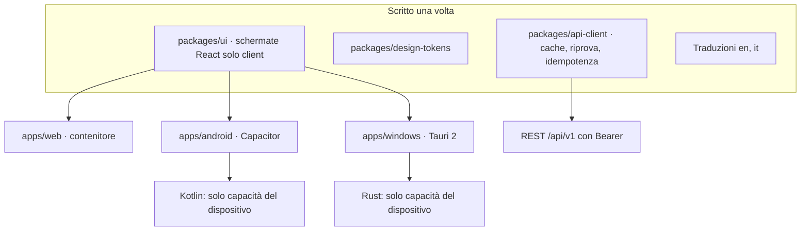

# 7. App Android e Windows

Indice del piano: [`../rewrite-plan.md`](../rewrite-plan.md). Rilasci: C0-C4 in [`03-releases.md`](03-releases.md).

**Nessuna distribuzione.** Nessun canale pubblico e nessun account sviluppatore. Le app si installano solo per sviluppo:
APK installato a mano su Android, build locale su Windows. La distribuzione è una fase futura, fuori da questo piano.

## 7.1 Struttura

Vincoli (valgono per tutti i client):

| # | Vincolo |
|---|---|
| 1 | Un client usa solo `/api/v1`. Vale anche per widget e lavoro in background |
| 2 | Un client non calcola totali, P&L, rendimenti o cambi. Formatta soltanto |
| 3 | Le schermate sono React solo client in pacchetti condivisi: niente Server Components, niente Server Actions, niente moduli di Next.js al loro interno. Fissato prima di R3 |
| 4 | L'interfaccia è inclusa nell'app. L'app parla con l'istanza solo con token `Bearer` |
| 5 | Il codice nativo contiene solo capacità del dispositivo: login, deposito sicuro, condivisione, widget, lavoro in background. Nessuna schermata di prodotto e nessuna regola di dominio in Kotlin o Rust |
| 6 | L'API cambia solo in modo additivo. `GET /api/v1/meta` dà versione, livello API, livello minimo del client, capacità. L'app nasconde ciò che il server non ha; sotto il suo livello minimo di server resta in sola lettura sulla cache |
| 7 | Solo HTTPS con certificato pubblico. Quattro stati distinti: senza rete, istanza non raggiungibile, istanza troppo vecchia, sessione scaduta |
| 8 | I moduli dei plugin si disegnano dal manifest con lo stesso componente. Nessun codice dei plugin nei client |
| 9 | Stesse chiavi di traduzione e stessi token. Formato di numeri e date dalla lingua del profilo |

## 7.2 C0 · passo zero: prove tecniche

Prima azione del filone client. Nulla entra in `main`.

| # | Prova | Chiude | Esito atteso |
|---|---|---|---|
| 0 | **Gate del Security Gatekeeper** su ogni strumento e pacchetto nuovo: Android SDK e strumenti di build, Capacitor e i suoi plugin, Tauri e la toolchain Rust, Electron se serve | Regola G9 | Via libera scritto per ogni voce, prima dell'installazione |
| A | Capacitor: una schermata esistente compilata come pacchetto statico, login OAuth2 + PKCE con schema privato dell'app contro un'istanza di prova, token nel deposito sicuro | Vincoli 3 e 4; forma del contenitore web (decisione I4) | Il pacchetto statico gira; il login torna all'app |
| B | Lavoro in background su Android: rinnovo del token e lettura degli avvisi ogni poche ore, su due telefoni di marche diverse | Notifiche con controllo periodico, widget | Intervallo reale misurato per telefono |
| C | Tauri 2: finestra con lo stesso pacchetto, login su `http://127.0.0.1:<porta>/callback`, build locale su Windows | Involucro Windows (decisione I5) | Build riuscita; se fallisce: Electron con lo stesso pacchetto |
| D | Origini degli involucri: lettura del valore reale dell'origine di Capacitor e di Tauri | CORS di R2 (decisione I10) | Due origini fisse scritte nel contratto |

Uscita di C0: un rapporto con la decisione per punto. Se la prova A fallisce, R3 non parte: il vincolo 3 si rivede con Mattia.

## 7.3 Cosa serve dal server, e quando

| Serve | Rilascio |
|---|---|
| `GET /api/v1/meta` | R2 |
| Due client OAuth pubblici di prima parte con id fisso (`ledgerly-android`, `ledgerly-windows`), senza segreto, PKCE obbligatorio. Redirect: schema privato dell'app (Android), `http://127.0.0.1` (Windows). La registrazione dinamica resta chiusa a `/api/v1` | R2 |
| CORS per le due origini fisse, solo `Bearer`, mai cookie | R2 |
| Elenco dei dispositivi con «Disconnetti» in Settings › Sicurezza; QR «Collega un dispositivo» (contiene solo l'indirizzo dell'istanza) | R2 (rotte), R3 (schermata) |
| Chiave di idempotenza su ogni scrittura | R2 |
| Schermate del modulo nel pacchetto statico | R3, modulo per modulo |
| Rotta di lettura degli avvisi, testi senza importi | R5e |
| `POST /api/v1/imports` per il PDF condiviso | Esiste (`docs/api.md`) |

## 7.4 Android

| Passo | Contenuto |
|---|---|
| C1 · involucro | Progetto `apps/android` (Capacitor). Primo avvio: «Inquadra il codice» o «Scrivi l'indirizzo»; controllo che l'indirizzo sia un'istanza Ledgerly e del livello API; «Accedi» apre il browser di sistema; ritorno all'app. Refresh token in Android Keystore. Cache cifrata di sola lettura: risposte già lette più Overview, conti e 90 giorni di movimenti caricati in anticipo; chiave AES nel Keystore; niente PDF in cache. Barra di stato con la data dei dati. «Apri nel browser» per le funzioni che restano sul web. Logout e «Cambia server» cancellano la cache e lo dicono prima |
| C2 · funzioni native | Sblocco con biometria all'avvio e dopo 5 minuti in secondo piano, con il PIN del dispositivo come alternativa; anteprima coperta nelle app recenti. Controllo periodico degli avvisi (nessun servizio di terzi), due categorie del sistema: «Azioni richieste» e «Promemoria». Ledgerly nel menu «Condividi» per PDF e immagini → «Cosa è questo file?» → `POST /api/v1/imports`. Pulsante «+»: Movimento, Assenza, Aggiorna valore; «Rinnova accesso alla banca» in alto quando serve. Gesto Indietro: chiude il foglio, poi la pagina, poi torna a Overview |
| C3 · widget | «Da fare» e «Questo mese». Importi nascosti di default. Dati dal lavoro in background. Kotlin nativo |

Cosa fa l'app Android («compagno»):

| Su Android | Solo web e Windows, con «Apri nel browser» |
|---|---|
| Consultazione completa di tutti i moduli attivi | Revisione delle buste paga con il PDF accanto |
| Movimento manuale, cambio di categoria, assenza, «Aggiorna valore» | Chiavi: eToro, Binance, applicazione Enable Banking |
| Collegare una banca, scegliere i conti, «Rinnova accesso» | Import di estratti e CSV; modifica in blocco |
| Budget, abbonamenti, pocket: creazione e modifica | Admin: Utenti, Server, diagnostica, installazione dei plugin |
| Profilo, moduli attivi, dispositivi collegati | Password, 2FA, esportazione dei dati, impostazioni di Payroll e Time Off |

Build e installazione, senza distribuzione:

1. Build dell'APK sul server, dopo il gate di C0. Firma con una chiave locale di sviluppo, tenuta fuori dal repo.
2. L'APK si copia sul telefono (cavo o trasferimento di file) e si installa a mano.
3. Un APK nuovo sostituisce il vecchio. Nessun aggiornamento automatico.
4. Nessun file binario nel repo: solo il codice e lo script di build.

## 7.5 Windows

| Punto | Contenuto |
|---|---|
| Quando | Dopo C2 |
| Forma | Guscio (`apps/windows`, Tauri 2) con la stessa interfaccia del web. Nessuna schermata solo per Windows, salvo primo avvio e preferenze dell'app |
| Aggiunte | Login su `127.0.0.1`, refresh token in DPAPI, cache con data, avvisi di sistema ad app aperta, trascinamento sull'icona e «Apri con» (con conferma del tipo di file), scorciatoia globale «Nuovo movimento» (spenta finché l'utente non la attiva), area di notifica e avvio con Windows (facoltativi, spenti di default) |
| Fuori | Widget, cartella sorvegliata, sblocco obbligatorio |
| Build | Locale, su un PC Windows (decisione I5). Nessun pacchetto firmato, nessun installer pubblicato |
| Alternativa | Electron con lo stesso pacchetto web, se la prova C di C0 fallisce |

## 7.6 Interfaccia su più larghezze

Vale per web, Android e Windows: dipende dalla larghezza della finestra, non dal dispositivo.

| Larghezza | Navigazione | Tabelle | Riga | Area minima |
|---|---|---|---|---|
| < 600 px | Barra in basso: Overview · Accounts · Expenses · Investments · More (Budgets al quarto posto se il modulo Investimenti è spento) | Scheda per riga | 56 px | 48 px |
| 600-1023 px | Barra verticale a icone | Colonne per priorità | 48 px | 48 px |
| ≥ 1024 px | Menu laterale a 3 gruppi | Tabella completa | 40 px | 32 px (mai sotto 24) |

- `DataTable` disegna le tre forme da una sola dichiarazione delle colonne (UI-DS-3).
- Grafici: stesso disegno semplificato; «Mostra i dati» apre la serie come lista.
- «Aggiorna» è un pulsante visibile, con la data dell'ultimo aggiornamento.
- «Nascondi importi» su tutti i client.
- WCAG 2.2 AA su tutti i client; nessuna funzione solo con trascinamento, pressione lunga o tasto destro.

## 7.7 Controlli di coerenza

1. Una pagina di riferimento elenca ogni componente con i suoi stati. Ogni client la riproduce.
2. Per 10 numeri chiave (patrimonio, speso nel mese, guadagno del periodo, ferie residue…) un test confronta il valore mostrato da ogni client con quello dell'API.
3. Una chiave di traduzione usata e mancante nel glossario blocca la build.
4. Il test di contratto gira il client attuale contro il server del livello API minimo sostenuto.
