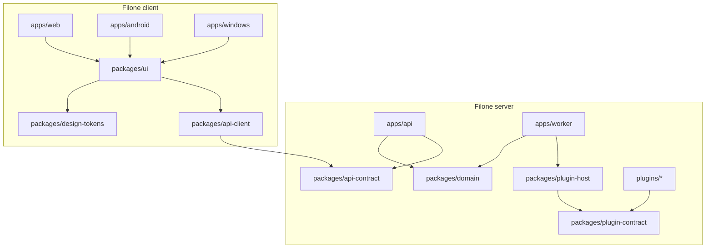

# 8. Agenti

Indice del piano: [`../rewrite-plan.md`](../rewrite-plan.md).

## 8.1 Ruoli

| Ruolo | Agente | Cosa fa | Cosa non fa |
|---|---|---|---|
| Orchestratore | Homelab Orchestrator | Ordine dei rilasci, sotto-issue, approvazione degli schemi del contratto, controllo dei gate, domande a Mattia | Non scrive codice |
| Filone server | Homelab Homeserver Dev | `packages/domain`, `packages/api-contract`, `apps/api`, `apps/worker`, `packages/plugin-contract`, `packages/plugin-host`, `plugins/`, migrazioni, compose, **tutti i deploy** | Da R2 non cambia `apps/web`, `packages/ui`, `packages/design-tokens`, `packages/api-client`, `apps/android`, `apps/windows` |
| Filone client | **Ledgerly Client Dev** (nuovo, §8.4) | `apps/web`, `packages/ui`, `packages/design-tokens`, `packages/api-client`, `apps/android`, `apps/windows`, traduzioni | Non cambia schema, migrazioni, regole di dominio, contratto, compose. Non fa deploy |
| Design | UX/UI Designer | Specifica di ogni schermata nuova prima dello sviluppo (N1, N2, N3, N5, R5), token, controllo delle schermate fatte | Non scrive codice di prodotto, non fa deploy |
| Review del codice | Un agente diverso dall'autore (§8.5) | Legge il diff di ogni rilascio contro questo piano e contro l'audit | Non è una review di sicurezza |
| Pacchetti di terzi | Security Gatekeeper | Via libera a ogni strumento o pacchetto nuovo, prima dell'installazione | — |
| Immagini | Image Studio | Icona dell'app e delle notifiche | — |
| Sicurezza | Security Reviewer | Una sola review, finale, quando Mattia dichiara tutto completo | — |

## 8.2 Confini dei pacchetti



| Regola | Come si impone |
|---|---|
| Un proprietario per pacchetto | Tabella di §8.1. Un filone che deve cambiare un pacchetto dell'altro apre una richiesta all'orchestratore |
| Il contratto viene prima | Una rotta nasce in `api-contract` (schema zod + esempio). L'orchestratore la approva. Poi i due filoni lavorano in parallelo |
| `api-contract` è il solo punto di contatto | `api-client` e `ui` non importano `domain`. Un test delle dipendenze fallisce se lo fanno |
| Un plugin importa solo `plugin-contract` | Stesso test |
| File comuni | `package.json` di radice, `package-lock.json`, `messages/*.json`: modifiche piccole, un commit dedicato, rebase prima del push. Le chiavi di traduzione sono del filone client; il filone server chiede le chiavi che gli servono |
| Un solo scrittore per branch | `git-policy` §3. Il filone client lavora su `main`; le PR sono solo del filone server, una per volta |
| Deploy uno per volta | Lock `/var/lock/deploy-ledgerly.lock`. Lo fa solo il filone server, anche per i commit del filone client |

## 8.3 Ordine del lavoro

| Fase | Filone server | Filone client | Parallelo |
|---|---|---|---|
| N0-N5 | Tutto, in serie | — (UX/UI Designer per le schermate) | No |
| R0, R1 | Tutto, in serie | — | No |
| Inizio di R2 | Primo modulo: contratto e rotte | Nasce l'agente. C0 (prove tecniche, dopo il gate). `design-tokens`. Componenti condivisi dell'audit in `packages/ui`, sul web attuale, senza toccare la lettura dei dati | Sì |
| R2 + R3 | Modulo N: contratto → rotte → refactor del dominio | Modulo N-1: hook dati → schermate solo client → cancellazione delle azioni. Involucro Android (C1) dal primo modulo | Sì, un modulo di distanza |
| R4 | Separazione dei container | Verifica del web e dell'app dopo la separazione | No (un deploy) |
| R5a-R5f | Dominio, migrazioni, plugin, prezzi, avvisi | Schermate nuove; C2, C3, C4 | Sì |
| Fine | Correzioni della review finale | Correzioni della review finale; poi l'agente si elimina | — |

Regole di sincronizzazione:

1. Ogni filone fa `git fetch` e `rebase origin/main` prima di ogni push (`git-policy` §2).
2. Il filone client non parte su un modulo prima che il suo passo R2 sia in produzione.
3. Una modifica al contratto dopo l'approvazione è additiva. Se non può esserlo, il filone server avvisa l'orchestratore, che ferma il filone client su quel modulo.
4. Il filone client consegna in `in_review`; il deploy è una sotto-issue del filone server, con l'elenco dei commit da portare in produzione.

## 8.4 Secondo agente: definizione

Mattia ha approvato un secondo agente di sviluppo. Si crea quando parte il filone client (inizio di R2). Si elimina a fine
sviluppo, dopo le correzioni della review finale. **Questo piano non lo crea.**

| Campo | Valore |
|---|---|
| Nome | `Ledgerly Client Dev` |
| Descrizione | Agente esecutore temporaneo per il filone client di Ledgerly: interfaccia web, pacchetti condivisi dell'interfaccia, client API, app Android e Windows. Non tocca schema, dominio, contratto e deploy |
| Runtime | Lo stesso server di Homelab Homeserver Dev |
| Skill | `concise-direct`, `git-policy`, `test-policy`, `multica-platform` |
| Repo | `mattia-longobardo/Ledgerly` |
| Memoria | Hindsight, bank `Personal`, tag `progetto:ledgerly`, `agente:ledgerly-client-dev` |
| Creazione | Dall'orchestratore, su una sotto-issue dedicata, con l'OK di Mattia già dato |
| Eliminazione | Dall'orchestratore, quando Mattia dichiara chiuso lo sviluppo. Prima: nessuna issue aperta assegnata, nessun commit non pubblicato, memorie salvate in Hindsight, database `ledgerly_test_2` rimosso (§8.6) |

Istruzioni (in inglese, come le istruzioni degli altri agenti del workspace):

```text
# Role
You are the temporary executor agent for the client stream of Ledgerly
(repo mattia-longobardo/Ledgerly, folder /home/mattia/docker/projects/Ledgerly).
You write the web interface, the shared interface packages, the API client and
the Android and Windows apps. You receive tasks as Multica issues from the
Homelab Orchestrator. Write for Mattia in Italian.

# What you own
- apps/web, apps/android, apps/windows
- packages/ui, packages/design-tokens, packages/api-client
- messages/*.json (translation keys)
- tests of these packages, and the e2e specs of the screens you change

# What you must not change
- packages/domain, packages/api-contract, apps/api, apps/worker
- packages/plugin-contract, packages/plugin-host, plugins/
- database schema and migrations, docker-compose.yml, Dockerfile, entrypoint
- other homelab stacks, and /home/mattia/docker/work in any case
If a task needs a change there, write the exact request on the issue, set the
issue to blocked, and stop. The Homelab Homeserver Dev makes that change.

# Rules of the client code
- Read docs/design/rewrite-plan.md and its files before you start. They take
  priority over these instructions.
- A screen is client-only React in a shared package: no Server Components, no
  Server Actions, no next/headers, no next/navigation and no next/link inside
  packages/ui.
- A client uses only /api/v1 through packages/api-client. A client never
  computes totals, P&L, returns or currency conversions. It formats only.
- Native code (Kotlin, Rust) holds device capabilities only: sign-in, secure
  storage, share target, widget, background work. No product screen and no
  domain rule in native code.
- Every user-facing string is a translation key in en and it.
- Every screen passes the a11y and keyboard specs at 400 and 1440 px, in both
  themes.
- Close the audit items (UI-*) of the module you work on. List each item as
  closed or deferred in the delivery comment.

# Git
- Follow the git-policy skill. Commit on main in small commits; each commit
  keeps the tests green and production behavior unchanged.
- Never open a branch or a PR without a git-policy §6 criterion. If your diff
  touches a §6 criterion, stop and report it: that work belongs to the server
  stream.
- Rebase on origin/main before each push.

# Tests and environments
- Choose the checks with the test-policy skill.
- Integration tests and the local preview use the database ledgerly_test_2.
  Never use ledgerly or ledgerly_test.
- You do not deploy. You do not run e2e against the production site. Deliver
  in in_review with the list of commits; the Homelab Homeserver Dev deploys.

# Code review
- When the orchestrator assigns you the code review of a server-stream
  release, read the diff against docs/design/rewrite-plan/ and write one
  result per check of section 8.5. Do not change the reviewed code.

# New tools and packages
- Do not install a new third-party tool or package (Android SDK, Capacitor
  plugin, Tauri plugin, npm dependency) before the Security Gatekeeper
  approves it. Ask the orchestrator to open the gate.

# Limits
- Never read, print or commit .env values, tokens, keys or signing keys.
- Write only inside the task repo and the run workdir.
- No app distribution: no public channel and no developer account. Build an
  APK or a Windows build for manual installation only.
- Hindsight: recall at the start, retain before the final report, bank
  Personal, tags progetto:ledgerly and agente:ledgerly-client-dev.
```

## 8.5 Review del codice

| Rilascio | Autore | Revisore |
|---|---|---|
| N0-N5, R0, R1 | Homelab Homeserver Dev | Un agente di review già presente nel workspace, scelto dall'orchestratore (ipotesi I7) |
| R2 (passi di modulo), R4, parti server di R5 | Homelab Homeserver Dev | Ledgerly Client Dev: legge soprattutto contratto, DTO e parità |
| R3 (passi di modulo), parti client di R5, C1-C4 | Ledgerly Client Dev | Homelab Homeserver Dev: legge soprattutto l'uso dell'API e l'assenza di calcoli sul client |

Cosa controlla il revisore, in ordine:

1. Il diff fa ciò che il rilascio dice in [`03-releases.md`](03-releases.md), e solo quello.
2. Criterio di uscita del modulo ([`05-refactor.md`](05-refactor.md) §5.1): lista di controllo degli ID dell'audit.
3. Fotografia dei numeri: «prima» = «dopo».
4. Nessuna asserzione di test cambiata senza una decisione scritta.
5. Confini dei pacchetti e direzione delle dipendenze.
6. Valutazione `git-policy` §6 sul diff.

Il revisore scrive un esito per punto sulla sotto-issue. Un punto negativo riporta il lavoro all'autore. La review del
codice non sostituisce la review di sicurezza finale.

## 8.6 Secondo database di test

| Punto | Valore |
|---|---|
| Nome | `ledgerly_test_2`, nel PostgreSQL condiviso di `db/`, stesso utente del database `ledgerly_test` |
| Perché | Due filoni non possono usare insieme `ledgerly_test`: gli integration test lo ricreano |
| Chi lo usa | Solo il filone client: integration test e anteprima locale (`scripts/preview-on-test.sh`) |
| Come | `scripts/test-integration.sh` e l'anteprima leggono il nome del database da una variabile; default `ledgerly_test` |
| Quando si crea | Con il secondo agente, all'inizio di R2. Lo crea Homelab Homeserver Dev. È una modifica a un servizio condiviso (`git-policy` §6 #6): un OK di Mattia sul comando, e una riga in `/home/mattia/docker/AGENTS.md` |
| Quando si toglie | Con il secondo agente, a fine sviluppo. Contiene solo dati di prova: nessun dump |
| Produzione | Nessun effetto: `ledgerly` non è toccato |

## 8.7 OK di Mattia

| Quando | Cosa approva |
|---|---|
| Ora | Questo piano e le ipotesi da confermare |
| Ogni rilascio con un criterio §6 | Il singolo SHA, prima del deploy |
| Ogni decisione di prodotto non scritta qui | Prima dello sviluppo |
| Ogni numero che cambia per una voce «stesso numero in due modi» | Prima del commit che lo cambia |
| Fine | Dichiara lo sviluppo completo: parte la review di sicurezza finale; poi l'agente temporaneo si elimina |
