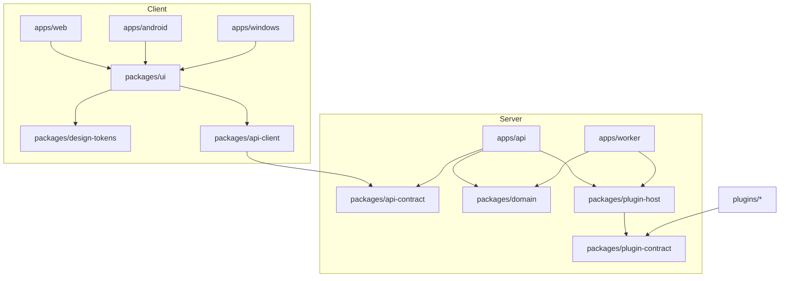
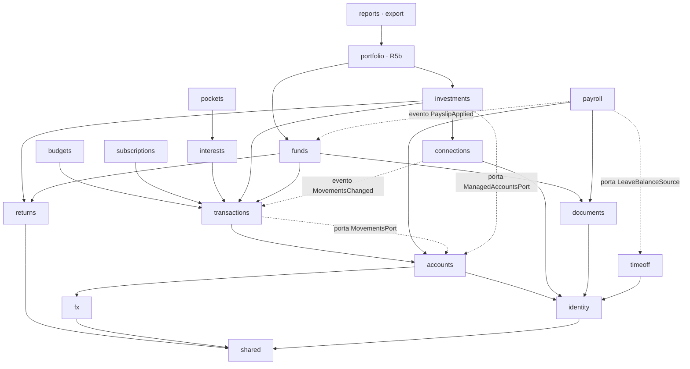

# 10. Obiettivo del refactor, architettura modulare e regole di qualità

Indice del piano: [`../rewrite-plan.md`](../rewrite-plan.md). Ingresso: [`02-audit.md`](02-audit.md) e i tre file di dettaglio.

Questo file è il riferimento del refactor (rilasci R0, R1, R2, R3, R4). Dove un altro file del piano dice una cosa
diversa sulla qualità del codice, vale questo file.

## 10.1 Obiettivo e priorità

Decisione di Mattia del 14/11/2026 (H1, H2, H3 nel [registro](01-decisions.md) §1.0).

Il refactor non è generico. L'obiettivo è l'ottimizzazione del codice, intesa soprattutto come qualità della sua
organizzazione. Le priorità, in ordine:

| # | Priorità | Significato | Dove sono le regole |
|---|---|---|---|
| 1 | **Modularità** | Moduli con una responsabilità singola e ben definita, interfacce chiare, basso accoppiamento, nessuna duplicazione | §10.2-§10.7 |
| 2 | **Pulizia e chiarezza** | Codice leggibile, nomi espliciti, struttura coerente, niente codice morto, niente complessità superflua | §10.8 |
| 3 | **Prestazioni** | Esecuzione più veloce, solo dopo le priorità 1 e 2 | §10.9 |

**Regola di conflitto.** Se due priorità sono in conflitto, vince la più alta. Non si sacrifica la modularità o la
leggibilità per la velocità. Unica eccezione: un guadagno di velocità significativo e misurato. In quel caso lo
sviluppatore lo segnala in modo esplicito a Mattia prima del commit, e decide Mattia (procedura in §10.9.3).

**Vincolo.** Il comportamento funzionale del codice resta invariato. La prova è in §10.10.

Ambito del vincolo:

- Vale per tutto il lavoro di refactor: R0, R1, R2, R3, R4 e le parti di riordino dentro gli altri rilasci.
- Le funzioni nuove approvate il 13/11/2026 (N1-N5, R5, app) restano nel piano. Sono un cambio voluto, con i loro
  criteri di accettazione. Per il codice esistente che toccano vale lo stesso vincolo.
- Le sole differenze di numeri ammesse sono le decisioni D1-D11 ([`09-risks.md`](09-risks.md) §9.5), ognuna con un commit
  separato e un test.
- Revisione sulla standardizzazione (in attesa dell'OK di Mattia): N6 e R5g sono cambi voluti, come N1-N5 e R5. Le
  differenze di numeri in più sono solo X1-X3, dentro N6 ([`11-standardization.md`](11-standardization.md) §11.2.5).
  Punti di estensione e regole M12-M14: §10.11.

## 10.2 Pacchetti di arrivo

Un pacchetto ha una sola responsabilità. La sua interfaccia pubblica è il campo `exports` del suo `package.json`.
Le dipendenze ammesse sono le sole voci del suo `package.json`; ogni altro import fa fallire il gate (regola M1).

| Pacchetto | Responsabilità unica | Interfaccia pubblica | Dipendenze ammesse | Dipendenze vietate |
|---|---|---|---|---|
| `packages/domain` | Le regole e i totali di Ledgerly: ogni numero ha un solo calcolo | Un ingresso per modulo (`domain/<modulo>`, §10.3) e `domain/shared` | `drizzle-orm`, `pg`, `zod` | `next`, `react`, `hono`, `api-contract`, `ui`, `plugin-host`, ogni `apps/*` |
| `packages/api-contract` | La forma dei dati sul filo: schemi, DTO, errori, scope | Primitive zod, schemi delle rotte, DTO, `Result`, codici di errore, scope per risorsa | `zod` | `domain`, `drizzle-orm`, `next`, `react`, `hono` |
| `packages/api-client` | Le chiamate a `/api/v1` da un client | Una funzione tipizzata per rotta, la gestione del token, la chiave di idempotenza | `api-contract` | `domain`, `ui`, `next`, `react` |
| `packages/design-tokens` | I valori visivi: colori, raggi, spazi, ombre, scala `z` | Variabili CSS e costanti TypeScript | Nessuna | Ogni altro pacchetto |
| `packages/ui` | Le schermate e i componenti, solo client | Componenti, schermate, hook dei dati, adattatore di routing come prop | `react`, `design-tokens`, `api-client`, `api-contract` (solo tipi) | `domain`, `next/*`, `hono`, `drizzle-orm`, ogni `apps/*` |
| `packages/plugin-contract` | Il contratto tra il core e un plugin | Schemi di `manifest`, `verify`, `auth/*`, `sync`, `push`; tipi; kit di test | `zod` | Ogni altro pacchetto |
| `packages/plugin-host` | Il lato core che chiama un plugin | `runPass`, client HTTP comune, lettura del manifest, registro dei plugin | `plugin-contract`, le porte di `domain` (solo tipi) | `apps/*`, `ui`, `next`, il codice di un plugin |
| `apps/api` | L'ingresso HTTP: REST `/api/v1`, MCP, login | Nessuna (è un eseguibile) | `domain`, `api-contract`, `plugin-host`, `hono` | `ui`, `api-client`, `next`, `apps/worker` |
| `apps/worker` | L'esecuzione dei job e delle sync | Nessuna (è un eseguibile) | `domain`, `plugin-host` | `ui`, `api-client`, `api-contract`, `next`, `hono`, `apps/api` |
| `apps/web` | Il contenitore web delle schermate | Nessuna | `ui`, `design-tokens`, `api-client` | `domain`, `drizzle-orm`, `plugin-host` |
| `apps/android`, `apps/windows` | Gli involucri nativi: solo capacità del dispositivo | Nessuna | `ui`, `design-tokens`, `api-client` | `domain`, ogni regola di prodotto in codice nativo |
| `plugins/*` | L'adattatore di un provider, senza stato | Le rotte del contratto | `plugin-contract` | Ogni altro pacchetto del repo |

Composizione: solo `apps/api` e `apps/worker` collegano le porte del dominio ai loro adattatori. Nessun pacchetto
collega da solo due moduli.

## 10.3 Moduli di `packages/domain`

Ogni modulo ha un solo ingresso pubblico, `index.ts`, con export nominati (nessun `export *`). I file interni hanno
sempre gli stessi nomi (§10.8). Un modulo possiede le tabelle del suo `schema.ts`: solo lui le legge e le scrive.

Livelli: un modulo importa solo moduli di un livello più basso, e solo quelli della colonna «Dipendenze ammesse».
Due moduli dello stesso livello non si importano: parlano con una porta o con un evento.

| Liv. | Modulo | Responsabilità unica | Interfaccia pubblica (cosa esporta) | Dipendenze ammesse | Dipendenze vietate |
|---|---|---|---|---|---|
| 0 | `shared/money` | Importi: tipo, aritmetica, arrotondamento | `Money`, `Fixed(scale)`, `divideRounded`, `parseAmount`, `percentToFraction` | Nessuna | Ogni modulo, il database |
| 0 | `shared/dates`, `shared/period` | Date civili e periodi | `CivilDate`, `Period`, `parsePeriod`, `daysBetween`, `addMonthsClamped`, `monthEndSeries` | Nessuna | Ogni modulo, il database |
| 0 | `shared/db` | Accesso al database e ambito per utente | `Ctx`, `userScoped`, `enumCheck`, `isUniqueViolation`, `keyRing` | `drizzle-orm`, `pg` | Ogni modulo |
| 0 | `shared/events` | Il bus degli eventi di dominio | `publish`, `subscribe`, i tipi degli eventi | Nessuna | Ogni modulo |
| 0 | `shared/fees` (rev.) | Commissioni generiche (E3) | `FeeRule`, `feesFor` | `shared/money`, `shared/dates` | Ogni modulo, il database |
| 0 | `shared/country` (rev.) | Regole per paese come dati (E4) | `countryRule(paese, chiave, data)`, i file di dati per paese | Nessuna | Ogni modulo, il database |
| 1 | `returns` | Le formule di rendimento | `simple`, `onNetCapital`, `modifiedDietz`, `xirr`, `moneyWeighted` | `shared/money`, `shared/dates` | Il database, ogni altro modulo |
| 1 | `fx` | Cambi BCE: download e conversione | `convert`, `ensureRange`, `rateOn` | `shared/*` | Ogni altro modulo |
| 1 | `identity` | Utenti, persone, preferenze | `changePreferences`, `preferencesOf`, `forEachUser`, `buildCtx`, evento `TimeZoneChanged` | `shared/*` | Il codice di login di `apps/api`, ogni modulo di livello più alto |
| 1 | `settings` | Impostazioni del server e valori sigillati | `sealedSetting`, `serverSettings` | `shared/*` | Ogni modulo di livello più alto |
| 2 | `accounts` | Conti, letture del saldo, patrimonio | `balanceAt`, `netWorth`, `writeBalanceEntry`, `requireAccount`, `accountNames`, `accountOptions`; porte `MovementsPort`, `ManagedAccountsPort` | `shared/*`, `fx`, `identity` | `transactions`, `investments`, `funds` (oggi importati: ACC-8) |
| 3 | `transactions` | Movimenti, categorie, etichette, ricorrenze | `spending(filters, groupBy)`, `findMovements`, `upsertMovements`, `recurrences`, `payeeKey`, `requireCategory`; porta `TransactionsProvider`; evento `MovementsChanged` | `shared/*`, `fx`, `identity`, `accounts` | Ogni integrazione (Wallet: TRX-6), ogni modulo di livello 4 o più alto |
| 3 | `connections` | Collegamenti con i provider: stato, credenziali cifrate, cronologia delle sync | `connect`, `test`, `syncNow`, `disconnect`, `connectionStatus`; porta `MovementsSource`; evento `SyncFailed` | `shared/*`, `identity`, `settings` | Il codice di un provider, `plugin-host` (lo collega l'app) |
| 4 | `budgets` | Limiti di spesa e confronto con la spesa | `ratio`, `budgetsView`, `stopLimit`, `budgetName` | `shared/*`, `identity`, `accounts`, `transactions` | Ogni altro modulo, lo strato dell'interfaccia (BUD-6) |
| 4 | `subscriptions` | Abbonamenti e addebiti previsti | `upcomingCharges`, `monthlyCost`, `subscriptionsView` | `shared/*`, `identity`, `accounts`, `transactions` (solo `recurrences`) | Le tabelle di `transactions` (SUB-8) |
| 4 | `interests` | Regole di interesse e maturazione | `sumAccruals`, `accruedInterest`, `settleDue`; porta `LedgerPosting` | `shared/*`, `identity`, `accounts`, `transactions` | Wallet (INT-1, INT-2) |
| 5 | `pockets` | Salvadanai dentro un conto | `pocketBalances`, `pocketsView`, `splitInterest` | `shared/*`, `identity`, `accounts`, `transactions`, `interests` | Ogni altro modulo |
| 4 | `documents` (oggi `imports`) | Il percorso di un documento caricato | `uploadDocuments(kind, files)`, `registerDocumentKind`, `saveEvidence`; evento `DocumentParsed` | `shared/*`, `identity` | `payroll`, `funds` (oggi importati: IMP-1, IMP-2) |
| 4 | `timeoff` | Assenze, residui, calendario | `timeOffView`, `addAbsence`, `removeAbsence`; porte `LeaveCalendarSync`, `LeaveBalanceSource`; evento `LeaveChanged` | `shared/*`, `identity` | Trek (TOF-1), `payroll` (PAY-6) |
| 5 | `payroll` | Buste paga: estrazione, revisione, applicazione | `payrollView`, `applyPayslip`; evento `PayslipApplied`; adattatore di `LeaveBalanceSource` | `shared/*`, `identity`, `documents`, `accounts` | `funds` e le sue tabelle (PAY-5), `timeoff` |
| 5 | `funds` (rev.) | Fondi pensione: sorgenti di contributo, commissioni, versato, valore, rendimento di periodo. Un solo tipo di fondo | `createFund`, `fundValueAt`, `fundFlows`, `fundsHome`, `fundDetail`; lettori dei documenti del fondo registrati in `documents` | `shared/*`, `returns`, `fx`, `identity`, `accounts`, `transactions` (anche l'abbinatore E7), `documents` | `investments`, `payroll` (riceve `PayslipApplied`), il nome di un gestore nel codice (M12) |
| 5 | `investments` | Servizi di investimento: posizioni, valore, P&L. (rev.) Da R5d: Portafoglio manuale e piani di acquisto | `InvestmentsSnapshot`, `valueAt`, `pnlOf`; adattatore di `ManagedAccountsPort`; da R5d secondo passo `plansOf`, `recordPlanRun` | `shared/*`, `returns`, `fx`, `identity`, `accounts`, `transactions`, `connections` | `funds` (INV-9), il download BCE diretto (INV-10) |
| 6 | `portfolio` (da R5b) | Il modello di lettura unico di Investments: servizi, portafogli manuali, fondi pensione (`kind`: `service`, `manual_portfolio`, `pension_fund`) | `portfolioHome`, `portfolioTotals` | `investments`, `funds`, `accounts` | Scritture. Nessun modulo lo importa |
| 6 | `notifications` (da R5e) | Un evento, più canali | `notify(event)`, preferenze per evento | `shared/*`, `identity` | Ogni modulo di prodotto: riceve eventi |
| 6 | `reports`, `export` | Mail mensile ed esportazione completa | `monthlyFigures`, `exportSections` | I moduli, solo dal loro ingresso pubblico | Query proprie sulle tabelle dei moduli (API-7) |

Porte ed eventi sciolgono i cicli. La porta è dichiarata dal modulo che la usa. L'adattatore è nel modulo che la
realizza. Il collegamento è in `apps/api` e `apps/worker`.

Un evento di dominio gira nella stessa transazione di chi lo emette: una scrittura che oggi è atomica resta atomica
(esempio: applicare una busta paga e registrare la competenza del fondo). Solo i job passano dalla coda.

## 10.4 Mappa delle dipendenze

Una freccia significa «importa». Ogni freccia assente è vietata.

Moduli di `packages/domain`, dal livello più alto al più basso:

Le frecce tratteggiate non sono import: sono un evento o l'adattatore di una porta, collegati dall'app.

## 10.5 Accoppiamenti di oggi da sciogliere

Misura di partenza (`main` a `5fbbdbc`, file non di test): 155 import tra moduli, nessun `index.ts`, 6 coppie di
moduli che si importano a vicenda, 80 import `platform → modules` in 21 file.

**Misura di N0** (`main` dopo `v0.10.2`, `npm run modularity`, file `baselines/modularity.json`): 154 import tra
moduli, tutti profondi (0 `index.ts`); 6 coppie di moduli che si importano a vicenda; 1 gruppo di cicli tra moduli,
con 7 moduli (`accounts`, `funds`, `imports`, `interests`, `investments`, `payroll`, `transactions`); 54 coppie di
unità che si importano a vicenda contando anche le aree di `platform` (tra queste `users ↔ platform/auth` e
`timeoff ↔ platform/integrations/trek`); 79 import `platform → modules` in 21 file; 5 import `ui → platform`.
Un'unità è `modules/<nome>`, `platform/<area>` o `platform/integrations/<provider>`. Da N0 `src/architecture.test.ts`
tiene il codice a queste liste: una violazione nuova fallisce, e fallisce una voce che non esiste più.

| # | Accoppiamento di oggi | Dove (`percorso:riga`) | Come si scioglie | Rilascio | Voci |
|---|---|---|---|---|---|
| C1 | Ciclo `accounts ↔ transactions` | `src/modules/accounts/service.ts:23-24`, `src/modules/accounts/actions.ts:10`, `src/modules/transactions/service.ts:11`, `src/modules/transactions/queries.ts:25` | Porta `MovementsPort` dichiarata da `accounts`; `transactions` la realizza | R2 (accounts) | ACC-8, TR-7 |
| C2 | `accounts → investments`: il modulo base dipende da un modulo facoltativo | `src/modules/accounts/service.ts:23-24` | Porta `ManagedAccountsPort` | R2 (accounts) | ACC-8 |
| C3 | Ciclo tra le cartelle `ui/` di accounts e transactions | `src/modules/accounts/ui/period.ts:17`, `src/modules/accounts/ui/period-bar.tsx:2-4`, `src/modules/transactions/ui/filters.ts:10`, `src/modules/transactions/ui/display.ts:7` | Controlli generici in `packages/ui` | R3 (accounts) | ACC-11 |
| C4 | Wallet dentro `transactions` | `src/modules/transactions/jobs.ts:26` e `:150-314`, `src/modules/transactions/actions.ts:11`, `src/modules/transactions/service.ts:16`, `src/modules/transactions/taxonomy.ts:11` | Porta `TransactionsProvider`; il chiamante passa sempre `provider` | R1 (`runPass`), R2 (porta), R5c (plugin) | TRX-6 |
| C5 | `subscriptions` legge tabelle e costanti di `transactions` | `src/modules/subscriptions/queries.ts:4`, `src/modules/subscriptions/rules.ts:2` e `:325-329` | Servizio pubblico `recurrences` | R2 (transactions) | SUB-8 |
| C6 | Wallet dentro `interests` | `src/modules/interests/posting.ts:8`, `:15`, `:35-40`; `src/modules/interests/freshness.ts:23-25`, `:125-151` | Porta `LedgerPosting`; «sync poi maturazione» come due passi del worker | R1, R2 (interests) | INT-1, INT-2 |
| C7 | Catena `pockets → interests → accounts → transactions` dentro una query di vista | `src/modules/pockets/queries.ts:4`, `:232-239`; `src/modules/interests/service.ts:5` | Regola `splitInterest` con un nome suo, sopra `accruedInterest` pubblico | R2 (pockets) | POC-5 |
| C8 | Ciclo `imports ↔ payroll` e `imports ↔ funds` | `src/modules/imports/api.ts:5-6`, `:33-34`, `:64-67`; `src/modules/imports/rules.ts:3`, `:92-96` | Registro `DocumentKind → parser`: payroll e funds si registrano. (rev.) Il registro è il punto di estensione E1: tipo generico più lettore | N6 (tipo `fund_statement`), R2 (imports) | IMP-1, IMP-2 |
| C9 | `after()` di Next come secondo canale dei job | `src/modules/imports/api.ts:2`, `:30-40`; `src/modules/payroll/actions.ts:55`; `src/modules/funds/pension/actions.ts:64`; `src/modules/investments/actions.ts:313`, `:326` | Coda persistente del worker | R1 | IMP-3, JOB-6 |
| C10 | Ciclo `users ↔ platform/auth` | `src/platform/auth/session.ts:6-7`, `src/platform/auth/access-token.ts:4`, `src/platform/auth/auth.ts:10`, `src/modules/users/admin.ts:4-18`, `src/modules/users/service.ts:3` | `identity` non conosce il login; il login importa `identity` | R2 (users) | USR-1 |
| C11 | Infrastruttura dei job dentro `users`, importata da 15 file | `src/modules/users/jobs.ts:30-40`, `:46-61` | `forEachUser` nel worker | R1 | USR-2 |
| C12 | Preferenze di `timeoff` nella riga di `users` | `src/modules/users/rules.ts:39-40`, `:46-50`; `src/modules/users/service.ts:73-93` | Preferenze per area, con aggiornamento parziale | R2 (users) | USR-6 |
| C13 | Un job importa dallo strato dell'interfaccia | `src/modules/budgets/jobs.ts:14`, `src/modules/budgets/ui/present.ts:9-15` | `budgetName` nel dominio | R2 (budgets) | BUD-6 |
| C14 | Ciclo `investments ↔ funds` | `src/modules/investments/queries.ts:5` e `:406`, `src/modules/investments/service.ts:7`, `src/modules/funds/queries.ts:10`, `src/modules/funds/period.ts:11-12`, `src/modules/funds/home.ts:13-14` | `returns`, `period` e dati dei grafici fuori dai due moduli; lettura comune in `portfolio` | R2 (funds, investments), R5b | INV-9 |
| C15 | `investments` chiama la BCE da solo | `src/modules/investments/sync.ts:12-17`, `:485-491`, `:494-500` | Solo `fx` scarica e converte | R2 (investments) | INV-10, PLT-1, PLT-2 |
| C16 | Ciclo `funds ↔ payroll`; `payroll` scrive nelle tabelle pensione | `src/modules/funds/pension/queries.ts:5-6`, `src/modules/payroll/service.ts:21` e `:581-584`, `src/modules/payroll/pension.ts:3` e `:50-80`, `src/app/(app)/funds/pension-setup.ts:33` | Evento `PayslipApplied`: payroll emette le righe per ruolo, la sorgente `payroll` del fondo assegna componente e periodo e scrive (E2) | N6 (sorgente), R2 (payroll) | FND-11, PAY-5 |
| C17 | Tipi di ferie doppi tra `payroll` e `timeoff` | `src/modules/timeoff/queries.ts:2` e `:129-130`, `src/modules/payroll/service.ts:768-858`, `src/modules/timeoff/rules.ts:23` | Contratto `LeaveBalanceSource`, un solo vocabolario | R2 (payroll) | PAY-6 |
| C18 | Ciclo `timeoff ↔ Trek`; Trek nello schema e nelle regole | `src/modules/timeoff/jobs.ts:14`, `src/modules/timeoff/queries.ts:4` e `:131`, `src/modules/timeoff/actions.ts:43`, `src/modules/timeoff/day-actions.ts:48`, `src/platform/integrations/trek/sync.ts:19` e `:29`, `src/modules/timeoff/schema.ts:100-101` | Porta `LeaveCalendarSync`; stato esterno generico | R2 (timeoff), R5c, R5f | TOF-1, TOF-2 |
| C19 | 18 import di Wallet o Trek da fuori le loro cartelle | `src/app/(app)/settings/categories/actions.ts:21`, `src/app/(app)/expenses/page.tsx:35`, `src/app/(app)/settings/integrations/actions.ts:16-17`, `:33`, `:38-39` (elenco completo: INTG-1) | Porte del dominio; azioni generiche di connessione | R2 (users), R5c | INTG-1, INTG-7 |
| C20 | Wallet e Trek importano i moduli (15 import) | `src/platform/integrations/wallet/sync.ts:20-30`, `src/platform/integrations/wallet/mapping.ts:11`, `src/platform/integrations/wallet/records.ts:30-33`, `src/platform/integrations/trek/sync.ts:19` | Il plugin parla solo con `plugin-contract` | R1, R5c | INTG-2 |
| C21 | Un provider registrato in 5 posti (9 con messaggi e capacità: §10.11, E5) | `src/platform/integrations/rules.ts:37-65`, `src/platform/integrations/registry.ts:7-9` e `:32-47`, `src/modules/investments/catalog.ts:65-146`, `src/modules/investments/sync.ts:135-138` | Un solo registro, dal manifest | R1, R5c | INTG-3 |
| C22 | Il barrel delle tabelle importa lo schema di 12 moduli; 80 import `platform → modules` | `src/platform/db/tables.ts:5-22`, `src/architecture.test.ts:39-61` | `platform` sparisce: il suo codice va in `shared`, in un modulo o in un'app | R0-R2 | PLT-3 |
| C23 | Tutti i job nel processo web | `src/app/api/jobs/tick/route.ts:11-17`, `src/platform/jobs/tick.ts:15-35` | `apps/worker` | R1 | JOB-1 |
| C24 | L'export è un terzo contratto, con 13 import di moduli | `src/platform/export/service.ts:2-14` e `:119-349` | Le sezioni derivano dai DTO del contratto | R2 (ultimo passo) | API-7 |
| C25 | `src/ui` dipende da Next e da `@/platform` | `src/ui/button.tsx:2`, `src/ui/tab-links.tsx:2`, `src/ui/date-range-picker.tsx:5-9`, `src/ui/shell/sidebar.tsx:4-5`, `src/ui/theme-provider.tsx:4` | Adattatore di routing come prop; token e preferenze nel client | Passo zero del filone client, R3 | UI-DS-20 |
| C26 | Componenti condivisi nella cartella di una route | `src/app/(app)/timeoff/settings/page.tsx:9-12`, `src/app/(app)/investments/[accountId]/connection/page.tsx:26-28` | `ScheduleControl` e `ConnectionRow` in `packages/ui` | R3 (users) | UI-INV-10 |

## 10.6 Regole di modularità con controllo automatico

Tutti i controlli partono da `src/architecture.test.ts`, che oggi verifica due regole (chi importa lo schema di un
modulo, chi importa il barrel delle tabelle). Il test cresce: stesso metodo (lettura degli import), nessun pacchetto
nuovo. Con il monorepo diventa `tools/architecture.test.ts` alla radice. Gate: G4 ([`03-releases.md`](03-releases.md) §3.1).

**Lista che può solo accorciarsi.** Dove oggi ci sono violazioni, il test ha una lista scritta delle violazioni note.
Una violazione nuova fa fallire il test. Una voce della lista che non esiste più fa fallire il test finché non è tolta.

| # | Regola | Controllo automatico | Valore di oggi | Obiettivo | Entra nel gate |
|---|---|---|---|---|---|
| M1 | **Confini tra pacchetti.** Un pacchetto importa solo i pacchetti del suo `package.json`, e solo quelli ammessi in §10.2 | Test: tabella delle dipendenze ammesse contro gli import reali e contro i `package.json` | — (non ci sono pacchetti) | 0 violazioni | R0 |
| M2 | **Confini tra moduli.** Un modulo importa solo i moduli ammessi in §10.3 | Test: matrice delle dipendenze ammesse contro gli import reali | 155 import tra moduli, 6 coppie reciproche. N0: 154 e 6, lista nota in `baselines/modularity.json` | 0 import fuori matrice | N0 con la lista nota; R0 con la matrice; lista vuota a fine R2 |
| M3 | **Nessun import profondo.** Da fuori, un modulo si importa solo dal suo `index.ts`; un pacchetto solo dai suoi `exports` | Test (stesso scanner) e regola ESLint `no-restricted-imports`, già in uso | 155 su 155 sono profondi (nessun `index.ts`) | 0 | R0 |
| M4 | **Nessun ciclo** tra moduli e tra pacchetti | Test: grafo degli import, ricerca dei componenti fortemente connessi | 7 gruppi di cicli (`02-audit.md` §2.1). N0: 1 gruppo di 7 moduli; 54 coppie reciproche tra unità (6 tra moduli), lista nota | 0 tra pacchetti da R0; 0 tra moduli a fine R2; Trek e Wallet a R5c | N0 con la lista nota; R0 |
| M5 | **Nessun accesso alle tabelle di un altro modulo.** Solo il modulo proprietario importa il suo `schema.ts` | Test esistente (regola 1), più due aggiunte: nessun nome di tabella di un altro modulo dentro `getDb().query.*` o SQL scritto a mano; il barrel delle tabelle resta solo per le migrazioni | 0 violazioni per import; accesso indiretto non controllato («parked», `src/architecture.test.ts:37`) | 0 anche per l'accesso indiretto | Oggi (import); R0 (accesso indiretto, con lista nota); lista vuota a fine R2 |
| M6 | **Direzione degli strati.** `domain` non importa `next`, `react`, `hono`. `ui` non importa `domain` né `next/*`. `api-contract` importa solo `zod` | Test M1, più una lista di pacchetti esterni vietati per pacchetto | `src/ui`: 19 import di Next, 5 di `@/platform`; `platform → modules`: 80 | 0 | R0 (`domain`, `api-contract`); passo zero del filone client (`ui`) |
| M7 | **Interfaccia pubblica esplicita.** `index.ts` ha solo export nominati. L'elenco dei nomi esportati di ogni modulo è in un file di riferimento | Test: confronto tra gli export reali e il file di riferimento. Una modifica all'interfaccia cambia il file nello stesso commit | — | Ogni modulo ha il suo file; nessun `export *` | R0 |
| M8 | **Una sola via di collegamento.** Solo `apps/api` e `apps/worker` importano insieme una porta e il suo adattatore | Test: un modulo non importa l'adattatore di una sua porta | — | 0 violazioni | R2, dal primo modulo |
| M9 | **Un plugin è isolato.** `plugins/*` importa solo `plugin-contract` | Test M1 | 15 import dei moduli da Wallet e Trek | 0 | N1 (plugin Enable Banking); R5c (Wallet, Trek) |
| M10 | **Schermate solo client.** Nessun file `"use server"` di dominio; nessun Server Component che legge dati | Test: ricerca di `"use server"` e di componenti `async` nel pacchetto delle schermate | 21 file `"use server"`, 61 file con Server Component async | 0 | R3, per modulo; lista vuota a fine R3 |
| M11 | **Nessuna duplicazione** (§10.7) | Lista di controllo dell'audit, misura dei cloni, conteggio delle strutture doppie | §10.7.3 | §10.7.4 | N0 (misura, senza soglia); R0 (non cresce); R2 e R3 per modulo (obiettivo) |

## 10.7 Duplicazione

### 10.7.1 Cosa conta come duplicato

| Tipo | Definizione | Esempio dall'audit |
|---|---|---|
| D-a Clone di codice | Due o più blocchi uguali per almeno 50 token e 6 righe, dopo aver tolto spazi e commenti e aver reso uguali i nomi e i valori letterali | 4 upsert dei saldi (ACC-6) |
| D-b Regola doppia | La stessa regola o lo stesso numero calcolati in due punti, anche con un testo diverso | Spesa del periodo da 4 query (TRX-4) |
| D-c Struttura doppia | Lo stesso tipo, schema o costante dichiarato più di una volta | 26 tipi `ActionResult`, 14 `civilDate` |
| D-d Componente simile | Due componenti con la stessa struttura e gli stessi stati, diversi solo per dati o etichette | 28 tabelle scritte due volte (UI-DS-3) |

Non contano: i file di test e le loro fixture, le migrazioni SQL, il codice generato, i due cataloghi `messages/*.json`
tra loro, le righe di `import`.

### 10.7.2 Come si misura

| Misura | Copre | Come | Uscita |
|---|---|---|---|
| Lista di controllo dell'audit | D-a, D-b, D-c, D-d | Ogni voce dell'audit di tipo «doppione», «stesso numero in due modi», «componente simile» è «aperta», «chiusa» (con il commit) o «rinviata» (con il rilascio) | Voci aperte per modulo |
| Misura dei cloni | D-a | Script `scripts/duplication.ts` (§10.7.5), su tutto il codice non di test | Righe duplicate e percentuale, per modulo e per pacchetto, in un file JSON nel repo |
| Conteggio delle strutture | D-c | Test: un nome dichiarato una sola volta, per l'elenco delle strutture di §10.7.4 | Numero di dichiarazioni |
| Test di parità | D-b | [`06-data.md`](06-data.md) §6.4: un numero ha lo stesso valore su ogni superficie | Uguale o diverso |

### 10.7.3 Valore di partenza, dall'audit

Voci aperte di tipo duplicato (D-a, D-b, D-c, D-d) per modulo. Tra parentesi quelle di tipo «stesso numero in due modi».

| Dominio e platform | Voci | | Interfaccia | Voci |
|---|---|---|---|---|
| accounts (`ACC`) | 8 (4) | | Design system (`UI-DS`) | 16 |
| transactions (`TRX`) | 9 (4) | | Accounts (`UI-ACC`) | 6 |
| budgets (`BUD`) | 5 (1) | | Investments (`UI-INV`) | 6 |
| subscriptions (`SUB`) | 8 (3) | | Settings (`UI-SET`) | 4 |
| pockets (`POC`) | 5 (2) | | Shell e navigazione (`UI-NAV`) | 3 |
| interests (`INT`) | 5 (2) | | Time Off (`UI-TOF`) | 3 |
| imports (`IMP`) | 3 | | Overview (`UI-OVR`) | 2 |
| users (`USR`) | 2 | | Expenses (`UI-EXP`) | 2 |
| trasversali (`TR`) | 6 (1) | | Funds (`UI-FND`) | 2 |
| investments (`INV`) | 7 (3) | | Payroll (`UI-PAY`) | 2 |
| funds (`FND`) | 9 (3) | | Messaggi (`UI-MSG`) | 2 |
| payroll (`PAY`) | 4 | | Budgets (`UI-BUD`) | 1 |
| timeoff (`TOF`) | 3 (1) | | Pockets (`UI-PCK`) | 1 |
| integrations (`INTG`) | 3 | | Interests (`UI-INT`) | 1 |
| jobs (`JOB`) | 1 | | Subscriptions, Auth | 0 |
| API (`API`), MCP (`MCP`) | 3 (1), 1 (1) | | | |
| platform (`PLT`) | 6 (1) | | | |
| **Totale** | **88** (27) | | **Totale** | **51** |

**Righe duplicate (D-a), misura di N0** (`npm run duplication`, file `baselines/duplication.json`; `main` dopo
`v0.10.2`). Definizione di §10.7.1: 50 token e 6 righe, nomi e valori letterali resi uguali; senza test e senza righe
di `import`. Le righe sono quelle con almeno un token.

| Unità | Righe | Righe duplicate | % | Blocchi |
|---|---|---|---|---|
| `app` | 15.306 | 3.915 | 25,6% | 280 |
| `modules/accounts` | 3.524 | 1.069 | 30,3% | 72 |
| `modules/budgets` | 1.212 | 238 | 19,6% | 19 |
| `modules/funds` | 9.573 | 2.719 | 28,4% | 176 |
| `modules/imports` | 856 | 252 | 29,4% | 14 |
| `modules/interests` | 2.084 | 525 | 25,2% | 36 |
| `modules/investments` | 10.466 | 2.028 | 19,4% | 134 |
| `modules/payroll` | 3.461 | 951 | 27,5% | 53 |
| `modules/pockets` | 1.655 | 754 | 45,6% | 40 |
| `modules/subscriptions` | 1.877 | 518 | 27,6% | 34 |
| `modules/timeoff` | 2.355 | 324 | 13,8% | 27 |
| `modules/transactions` | 5.291 | 981 | 18,5% | 74 |
| `modules/users` | 1.271 | 317 | 24,9% | 24 |
| `platform` (tutte le aree) | 12.249 | 1.799 | 14,7% | 133 |
| `ui` | 3.517 | 382 | 10,9% | 22 |
| **Totale** | **74.744** | **16.772** | **22,4%** | **1.138** |

Il valore per ogni area di `platform` e per file è nel file JSON. Con i nomi e i valori letterali resi uguali la
misura conta anche le strutture ripetute (schemi di tabelle, moduli di form, JSX con la stessa forma): per questo è
molto sopra il 3% di §10.7.4. La soglia del 3% è da rivedere con questo valore (decisione I15: «altri valori, dopo la
prima misura»).

### 10.7.4 Obiettivo

| Misura | Obiettivo | Quando |
|---|---|---|
| Voci aperte di tipo duplicato | 0 per modulo. «Rinviata» solo se la voce dipende da R5 | Uscita del modulo: dominio a R2, interfaccia a R3 |
| Righe duplicate (D-a) | Non crescono mai, per pacchetto. A fine R3: al massimo il 3% delle righe non di test di ogni pacchetto (decisione I15) | Da R0 (non cresce); fine R3 (soglia) |
| Strutture doppie note | 1 dichiarazione ciascuna: `ActionResult` 26 → 1 (`Result` nel contratto), `failed()` 14 → 1, `revalidate()` 14 → 0, `civilDate` 14 → 1, conversione valutaria 2 → 1, `requireAdminCtx` 3 → 1, costruzione di `Ctx` 3 → 1, calcoli di rendimento 8 → 5 definizioni nominate, calcoli di periodo 6 → 1, serie di fine mese 3 → 1 | R0 (primitive), R2 (per modulo) |
| Tabelle scritte due volte | 28 → 0, su `DataTable` | R3 |
| Serializzatori doppi tra REST e MCP | 4 risposte → 0 | R2 |

### 10.7.5 Strumenti

Nessuno strumento di terzi è installato da questo piano. Per ogni misura c'è una via senza pacchetti nuovi, che è il
default. Uno strumento di terzi entra solo dopo il gate del Security Gatekeeper, prima dell'installazione.

| Misura | Default: senza pacchetti nuovi | Alternativa: strumento di terzi (gate del Security Gatekeeper prima dell'installazione) |
|---|---|---|
| Cloni di codice | `scripts/duplication.ts`: usa lo scanner di `typescript`, già presente. Rende uguali nomi e valori letterali, confronta finestre di 50 token con un hash, scrive un JSON ordinato | `jscpd` come `devDependency` |
| Codice morto | `tsc` con `noUnusedLocals` e `noUnusedParameters`; test «export senza uso» sullo stesso scanner di `architecture.test.ts`; test delle chiavi di traduzione senza uso | `knip` come `devDependency` |
| Complessità e dimensione | Regole del nucleo di ESLint, già presente: `complexity`, `max-lines`, `max-lines-per-function`, `max-depth`, `max-params` | `eslint-plugin-sonarjs` (complessità cognitiva) |
| Cicli e confini | `architecture.test.ts` esteso | `dependency-cruiser` come `devDependency` |

## 10.8 Pulizia e chiarezza

Ogni regola ha un controllo. Dove oggi ci sono violazioni vale la lista che può solo accorciarsi (§10.6).
Le soglie numeriche sono confermate da Mattia (decisione I15).

| # | Regola | Controllo | Gate | Valore di oggi | Entra nel gate |
|---|---|---|---|---|---|
| Q1 | **Nomi dei file di un modulo.** Solo questi: `index.ts`, `schema.ts`, `rules.ts` (funzioni pure, senza database), `queries.ts` (letture), `service.ts` (scritture), `ports.ts`, `events.ts`, `jobs.ts`. Un file che cresce diventa una cartella con lo stesso nome (`queries/spending.ts`) | Test di struttura: nomi ammessi per cartella | G4 | Nomi in gran parte già uguali; in più `actions.ts`, `api.ts`, `ui/` dentro i moduli | R0 |
| Q2 | **Nessun file generico.** Vietati `utils`, `helpers`, `common`, `misc`, `lib` come nome di file o cartella. Un file ha il nome di ciò che contiene | Test di struttura | G4 | Da misurare in R0 | R0 |
| Q3 | **`rules.ts` è puro.** Non importa il database, la rete, l'orologio | Test sugli import dei file `rules` | G4 | Da misurare in R0 | R0, con lista nota |
| Q4 | **Un nome, una cosa.** Un concetto ha un solo nome nel codice, nell'API e nei messaggi (glossario unico). Un nome non ha due significati (`shareOf` ne ha tre: POC-5) | Test: i nomi del glossario sono dichiarati una sola volta; conteggio delle strutture (§10.7.2) | G4 | 381 valori di traduzione ripetuti (UI-MSG-1) | R0 (dominio), R3 e R5a (messaggi) |
| Q5 | **Nomi espliciti.** Funzione: verbo e oggetto (`writeBalanceEntry`). Booleano: `is`, `has`, `can`. Nessuna abbreviazione fuori dal glossario. File in `kebab-case` | ESLint `id-length` (minimo 3, con le eccezioni `id`, `to`, `x`, `y`) e `id-denylist`; test sui nomi dei file | G1 | Da misurare in R0 | R0, con lista nota |
| Q6 | **Dimensione di un file.** Al massimo 400 righe, senza righe vuote e commenti. I test sono esclusi | ESLint `max-lines` | G1 | 42 file oltre 500 righe (dominio e platform); 19 componenti oltre 400 | R0, con lista nota; lista vuota per modulo all'uscita |
| Q7 | **Dimensione di una funzione.** Al massimo 60 righe e 4 parametri (oltre: un oggetto) | ESLint `max-lines-per-function`, `max-params` | G1 | `upsertFromProvider` 186 righe (TRX-7), `checkSubscriptions` 123 (SUB-9) | R0, con lista nota |
| Q8 | **Complessità.** Complessità ciclomatica al massimo 12; annidamento al massimo 4 | ESLint `complexity`, `max-depth` | G1 | Da misurare in R0 | R0, con lista nota |
| Q9 | **Niente codice morto.** Nessun export senza uso, nessun file senza uso, nessun parametro o variabile senza uso, nessun codice commentato, nessuna dipendenza senza uso, nessuna chiave di traduzione senza uso | `tsc` con `noUnusedLocals` e `noUnusedParameters`; test «export senza uso»; test delle chiavi | G1, G4 | 14 voci «residuo» nell'audit | R0 (codice); R5f (schema) |
| Q10 | **Tipi chiari.** Nessun `any`. Nessun cast `as` su dati esterni: si valida con zod | ESLint `no-explicit-any` (già attivo); `no-restricted-syntax` sui cast, con lista nota | G1 | Cast `input as object` (USR-6) | R0, con lista nota |
| Q11 | **Formato unico** | `npm run format:check`, già nel gate | G1 | Verde | Oggi |

## 10.9 Prestazioni

Ultimo livello. Nessun lavoro di prestazioni parte su un modulo prima della sua uscita per le priorità 1 e 2.

### 10.9.1 Misure di partenza

Si prendono in N0, prima di ogni refactor, sul database di test con l'utente pesante di `npm run perf`
(`scripts/perf-probe.ts`: 12 conti, 60.000 movimenti, 14.000 letture). Lo script oggi misura tre viste; N0 lo estende.
I valori vanno in un file JSON nel repo. In produzione si leggono solo le durate dei job, già salvate.

| Cosa | Elenco | Misura |
|---|---|---|
| Viste di lettura | `accountsView` (12 mesi), `expensesView` (mese e tre anni): già misurate. In più: Overview, dettaglio di un conto, home e dettaglio di Investments, home e dettaglio di Funds, Pockets, Budgets, Subscriptions, Time Off (anno) | Tempo mediano su 5 esecuzioni; numero di query per vista |
| Rotte `/api/v1` | Quelle di oggi: `GET /accounts`, `GET /accounts/:id/balances`, `POST /accounts/:id/balances`, `GET /transactions`, `GET /summary`, `GET /investments`, `GET /investments/:accountId/holdings`, `POST /imports`. Da R2 ogni rotta nuova | Tempo mediano e 95° percentile; numero di query |
| Pagine | Overview, Accounts, Expenses, Investments, Funds, Time Off | Tempo di risposta del server; da R3: peso del JavaScript iniziale per schermata |
| Job | I 20 del registro; i più lunghi: sync Wallet, sync Investments, gruppo `daily`, backup | Durata, dalle righe già salvate dei job |
| Build | Immagine e avvio | Dimensione dell'immagine, tempo fino a `GET /api/health` |

**Valori di partenza, misura di N0** (`npm run perf -- --write`, file `baselines/performance.json`; `main` dopo
`v0.10.2`; utente pesante su `ledgerly_test`). Tempo in ms: mediana e 95° percentile su 5 esecuzioni per le viste e
su 20 per le rotte. Le query sono quelle di una esecuzione.

| Vista | Mediana | p95 | Query |
|---|---|---|---|
| expensesView (mese corrente) | 11.1 | 13.1 | 14 |
| expensesView (tre anni) | 46.1 | 51.7 | 14 |
| accountsView (24 mesi) | 28.8 | 30.4 | 5 |
| Overview | 54.6 | 59.7 | 25 |
| Account (dettaglio) | 30.4 | 33.4 | 9 |
| Investments (home) | 55.1 | 57.1 | 82 |
| Investments (servizio) | 18.8 | 20.9 | 33 |
| Funds (home) | 1.7 | 2.8 | 5 |
| Funds (fondo) | 31.8 | 32.8 | 17 |
| Pockets | 24.7 | 26.2 | 14 |
| Budgets | 1.5 | 2.8 | 6 |
| Subscriptions | 3 | 3.4 | 9 |
| Time Off (anno) | 3.8 | 4.7 | 9 |

| Rotta `/api/v1` | Mediana | p95 | Query |
|---|---|---|---|
| GET /accounts | 6 | 6.5 | 5 |
| GET /accounts/:id/balances | 2.5 | 2.8 | 5 |
| POST /accounts/:id/balances | 2.7 | 3.2 | 7 |
| GET /transactions | 9.6 | 11.6 | 7 |
| GET /summary | 36.4 | 36.9 | 9 |
| GET /investments | 21.9 | 24.3 | 73 |
| GET /investments/:accountId/holdings | 4.9 | 5.4 | 16 |

`POST /imports` non è misurata: chiede un documento, il bucket e `after()` di Next. Le pagine (tempo di risposta del
server) non sono misurate in N0: l'utente pesante esiste solo in `ledgerly_test` e l'anteprima locale non accetta il
login con password. Ogni «pagina» della tabella è l'insieme delle letture del suo `page.tsx`.

Job in produzione (`v0.10.2`, esecuzioni riuscite degli ultimi 30 giorni, lette dalle righe già salvate):

| Job | Esecuzioni | Mediana (ms) | Massimo (ms) |
|---|---|---|---|
| `integrations-sync` | 509 | 151727 | 195717 |
| `interests-rematch` | 30 | 3322 | 4866 |
| `wallet-sync` | 277 | 1063 | 1703 |
| `trek-sync` | 277 | 455 | 52027 |
| `database-backup` | 30 | 267 | 357 |
| `fx-rates-refresh` | 18 | 159 | 1839 |
| `holidays-refresh` | 30 | 159 | 2291 |
| `subscriptions-check` | 435 | 104 | 261 |
| `monthly-summary` | 1 | 73 | 73 |
| `funds-deposits` | 419 | 32 | 182 |
| `housekeeping` | 30 | 24 | 136 |
| `accounts-alerts` | 30 | 23 | 87 |
| `recurrences-refresh` | 142 | 15 | 141 |
| `accounts-snapshot` | 1 | 13 | 13 |
| `budgets-alerts` | 313 | 13 | 338 |
| `pockets-accrual` | 1 | 5 | 5 |
| `payslips-sweep` | 721 | 3 | 100 |
| `pockets-planned-cleanup` | 30 | 2 | 12 |
| `interests-accrual` | 373 | 2 | 2701 |
| `documents-retention` | 30 | 2 | 27 |
| `cometa-sweep` | 721 | 1 | 77 |

`npm run perf` (gate G9) fallisce se una vista o una rotta fa più query della partenza, o se la sua mediana peggiora
di oltre il 10% e di oltre 3 ms (sotto 3 ms la differenza è rumore di misura).

### 10.9.2 Obiettivi

| Obiettivo | Misura | Quando |
|---|---|---|
| **Non peggiora.** Nessuna misura peggiora di oltre il 10% rispetto alla partenza | Tempo, sull'utente pesante | Ogni passo di R0-R4 |
| **Le query non crescono.** Il numero di query di una vista o di una rotta non aumenta | Conteggio nel test, senza rumore di misura | Ogni passo di R0-R4 |
| **Le voci di priorità 3 dell'audit sono chiuse** (9 voci: INV-4, POC-3, IMP-5, INT-7, SUB-9, TRX-11, UI-ACC-7, UI-TOF-2, UI-PAY-1). Esempio: Pockets non fa più una query per conto | Numero di query costante al crescere dei conti | Uscita del modulo |
| Obiettivi assoluti (tempo per vista) | Non fissati ora: mancano i valori di partenza. Dopo la misura di N0 l'orchestratore porta a Mattia una proposta (decisione I16) | Dopo N0 |

Un miglioramento di velocità che non tocca modularità e leggibilità è sempre ammesso: non chiede un'eccezione.

### 10.9.3 Procedura per un'eccezione

Vale quando una modifica rende il codice più veloce ma viola una regola di §10.6 o §10.8, o aggiunge una copia.

1. Lo sviluppatore misura prima e dopo, sull'utente pesante, con lo stesso script.
2. Il guadagno è «significativo» se riduce di almeno il 30% il tempo di una vista o di una rotta, o di almeno 200 ms
   il 95° percentile di una pagina (decisione I16). Sotto questa soglia la modifica non si fa.
3. Lo sviluppatore non fa il commit. Scrive sulla sotto-issue: guadagno misurato (prima, dopo), regola violata, costo
   in modularità o leggibilità, alternativa che rispetta le regole e il suo guadagno.
4. L'orchestratore porta la richiesta a Mattia. Decide Mattia.
5. Con il sì: commit separato, di tipo `perf`. La violazione entra in una lista di eccezioni nel repo, con la data
   della decisione. Un commento nel codice dice perché. Il controllo automatico accetta solo le voci di quella lista.
6. Con il no: resta la versione che rispetta le regole.

## 10.10 Prova di «comportamento invariato»

Ogni passo di refactor porta queste prove. Sono tutte automatiche. Gate: G2, G3, G5, G6.

| # | Prova | Come | Quando |
|---|---|---|---|
| B1 | **Test esistenti verdi senza asserzioni adattate** | Unit e integration. Script `scripts/assertions-diff.ts`: nei commit di refactor un file di test può solo spostarsi o cambiare le righe di `import`. Ogni altra riga cambiata ferma il gate, salvo una voce nella lista delle decisioni (D1-D11) | Ogni commit di R0-R4 |
| B2 | **Stessi numeri** | Fotografia dei numeri «prima» = «dopo», sugli utenti di prova e in produzione; test di parità tra superfici ([`06-data.md`](06-data.md) §6.4) | Prima e dopo ogni passo; prima e dopo ogni deploy |
| B3 | **Calcoli approvati** | File di riferimento con ingressi e uscite per Modified Dietz, XIRR, costo medio, interessi, Cometa: stesse uscite. (rev.) Da N6 con i due fondi di prova del modello unico | N6, R0, R2 (funds, investments) |
| B4 | **Stesso contratto** | Risposte di ogni rotta `/api/v1` e di ogni strumento MCP sugli utenti di prova, salvate come file di riferimento: uguali byte per byte. Documento OpenAPI: solo aggiunte | Da N0 (file di riferimento); ogni passo di R2 |
| B5 | **Stessa esportazione** | Contenuto dell'export degli utenti di prova uguale al riferimento, salvo D8 e D10. (rev.) Da N6 anche salvo X3: `kind` del fondo e sezioni nuove `fund-sources`, `fund-fees` | R2 (ultimo passo) |
| B6 | **E2E** | Le specifiche e2e esistenti passano senza modifiche alle attese, comprese `a11y`, `keyboard`, `security` | Dopo ogni deploy |
| B7 | **Stesso schema** | R0 e R3 applicano 0 migrazioni. R1 e R2 solo migrazioni additive | Ogni deploy |

Un test che deve cambiare non si adatta in silenzio: lo sviluppatore lo scrive nel commento di consegna, con il motivo.

## 10.11 Punti di estensione comuni (E1-E8)

Revisione sulla standardizzazione, in attesa dell'OK di Mattia (decisione H16). Otto meccanismi coprono tutta la
logica su misura trovata ([`11-standardization.md`](11-standardization.md) §11.5). Ognuno ha un'interfaccia, un
pacchetto di arrivo e un rilascio. Nessuno aggiunge un pacchetto di terzi.

| # | Meccanismo | Interfaccia (sintesi) | Pacchetto e modulo di arrivo | Voci coperte | Rilascio |
|---|---|---|---|---|---|
| E1 | **Registro dei lettori di documenti**, con profili dichiarativi | `DocumentReader { id, kind, label, detect(file) → confidenza, read(file, profile?) → dati normalizzati + evidenze }`. Un profilo è un file di dati: etichette, colonne, formati, codici, controlli. Estende `registerDocumentKind` | Registro in `domain/documents`. Lettori e profili del core nel modulo che possiede il dato (`funds`, `payroll`). Lettori che chiedono codice esterno: capacità `documents.read` in `plugin-contract` (ipotesi ST-6) | Lettori, tipi `cometa_*`, pulsante e job dei documenti del fondo; lettore, profilo, geometria, controlli e prompt della busta paga; cartelle e cancellazione dai tipi registrati | N6 (tipo `fund_statement`, lettore dietro l'interfaccia nel modulo); R1 (job `documents-sweep`); R2 (registro in `documents`); R5c (`documents.read`); R5g (profili delle buste paga) |
| E2 | **Sorgenti di contributo** | `ContributionSource { kind, configSchema, flowsFrom(evento o movimento) → operazioni }`; tipi `payroll`, `bank_debit`, `manual`. Il datore di lavoro è una componente di `payroll` | `domain/funds` (tabella `fund_contribution_sources`). `payroll` arriva con l'evento `PayslipApplied` | Due creazioni, due registri, due motori dei flussi; versamento volontario senza riconoscimento; calendario di un gestore come ripiego; legame fisso con la busta paga; regole del fondo dentro payroll | N6 (tabella, sorgenti, `fundFlows`); R2 (evento con righe per ruolo) |
| E3 | **Commissioni generiche** | Tipo `FeeRule { label, basis, amount \| rate, period, validità }` e funzione pura `feesFor(regole, evento)` | Tipo e funzione in `domain/shared/fees` (livello 0). Tabelle nel modulo: `fund_fees` in `funds`; commissione dei piani in `investments` | Colonne di commissione sul fondo e sulla regola; tariffario per gestore; costo di gestione cercato per nome del comparto; commissione dei piani di acquisto | N6 (`fund_fees`; il tipo nasce in un file senza import dal modulo); R0 (`shared/fees`); R5d secondo passo |
| E4 | **Pacchetto paese: regole come dati** | File di dati per paese (`country/it`): calendario festivo proposto, tipi di assenza predefiniti, limiti fiscali con validità, tassa di default sugli interessi, campi, ruoli e controlli della busta paga, formati di numeri e date. API: `countryRule(paese, chiave, data)`. L'utente può sostituire ogni valore. Senza paese i campi sono vuoti | `domain/shared/country` (livello 0, senza database). Un modulo riceve le sue regole come parametro | Limite di deducibilità; campi, ruoli, controlli e formati della busta paga; festività nel codice; tassa sugli interessi; tipi di assenza predefiniti | N6 (limite come dato, nel modulo); R0 (`shared/country`, valori di oggi come dati `IT`); R5a (scelta al primo avvio); R5g (busta paga, assenze, festività, interessi) |
| E5 | **Descrittore del fornitore con capacità** | Lo schema del manifest dei plugin vale anche per i fornitori del core: id, nome, campi delle credenziali, passi, prodotti, valute, orari, intervallo minimo, etichette, capacità (`editRecord`, `ledgerPosting`, `dailyRates`, `costMethod`, …). Lo stesso schema per le fonti di cambio e di festività | Schema in `plugin-contract`. Registro unico in `plugin-host`. Descrittori di eToro e Binance in `domain/investments` | Fornitore registrato in 9 punti; rami per fornitore in pagine e codice generico; capacità di Wallet in interests e transactions; chiavi di notifica con il nome del fornitore; elenchi chiusi di tipi di sync e di fonti; schede per fornitore | N1 (schema del manifest, anticipo AN2); N2 (chiavi di notifica, anticipo AN3); R1 (registro, `runPass`); R2 (descrittori del core, registri delle fonti); R5c (Wallet, Trek) |
| E6 | **Tipi come dati dell'utente** | Tabelle di configurazione al posto degli enum: `leave_types`, monte per tipo, giorni non lavorativi personali, configurazione del datore (mensilità, frequenza), convenzioni della regola di interesse | Nel modulo proprietario (`timeoff`, `payroll`, `interests`) | Tipi di assenza e monte fissi; residuo legato alla busta paga; anno ferie, settimana, patrono; mensilità 13ª-15ª; basi e finestre fisse degli interessi; `rolDays` nell'export | N5 (il pannello legge un elenco, anticipo AN1); R2 (interests: struttura); R5g |
| E7 | **Abbinatore di movimenti** | `matchMovements(regola { conto, testo o identificativo, importo, finestra }) → movimenti`. Una regola, più usi. Strategie: IBAN, numero di conto, testo del beneficiario, importo e data | Servizio pubblico di `domain/transactions`. Lo usano `funds`, `investments`, `interests`, `subscriptions` | Riconoscimento del versamento al fondo; addebito del piano di acquisto; giroconti solo per IBAN; tre regole «il beneficiario contiene…» | R2 (transactions); R5d secondo passo |
| E8 | **Default di istanza e `Money` con valuta** | Impostazioni del server: paese, lingua, fuso, valuta, nome dell'accesso, servizio AI. `Money { cents, currency }` obbligatorio, esponente dalla valuta | `domain/settings` e `domain/shared/money` | Conti e abbonamenti solo in EUR; importi senza valuta; default italiani per ogni utente; «Authentik» in codice e testi; servizio AI fisso | R0 (`Money`); R2 (per modulo; users e impostazioni); R5a (primo avvio) |

Prima di R0 il codice dei meccanismi sta nel modulo che lo usa, in file senza import da Next.js e dal resto del
modulo. R0 lo sposta nel pacchetto di arrivo senza riscrittura (stessa regola di [`04-now.md`](04-now.md)).

### 10.11.1 Regole comuni ai meccanismi

| # | Regola | Controllo automatico | Valore di oggi | Obiettivo | Entra nel gate |
|---|---|---|---|---|---|
| M12 | **Nomi vietati.** Fuori dalle cartelle dei fornitori, dei profili e dei pacchetti paese non compare il nome di un fornitore, di un fondo o di un datore: `cometa`, `fideuram`, `reply`, `teamsystem`, `etoro`, `binance`, `wallet`, `trek`, `authentik`. Vale per codice, schema, nomi dei job e chiavi di traduzione | `architecture.test.ts`: ricerca dei nomi, con la lista nota per file. La lista può solo accorciarsi; un nome nuovo nell'elenco dei vietati è una decisione scritta | Da misurare all'ingresso | 0 fuori dalle cartelle ammesse a fine R5g. Eccezione scritta: eToro e Binance nel loro descrittore (C1b) | **N6**, con la lista nota. N0 è già chiuso: se un rilascio di fase A parte prima di N6 dopo l'OK a questa revisione, la regola entra con quello. Lista vuota per modulo: `funds` a N6 (salvo il lettore e il modello); `payroll` e `timeoff` a R5g; Wallet e Trek a R5c |
| M13 | **Un vocabolario aperto non ha un check DB con l'elenco dei valori.** Il check controlla il formato; il registro controlla il valore. Un vocabolario è aperto se un'estensione (lettore, plugin, pacchetto paese, utente) lo può allargare | Test: per l'elenco dei vocabolari aperti, lo schema non contiene un check generato da una lista TypeScript | 75 check in 13 file `schema.ts` sono generati da liste; i vocabolari aperti sono una parte (tipo di documento, fonte festiva, fonte di cambio, tipi di sync ed entità, prodotti, tipi di assenza) | 0 check con elenco sui vocabolari aperti | N6 (tipo di documento: check allargato); R2 per modulo, con lista nota; rimozione dei check vecchi in R5f |
| M14 | **Nessun nome di fornitore in una chiave di traduzione.** I testi del fornitore arrivano dal descrittore o dal profilo. Nessuna chiave costruita a runtime con lo slug di un fornitore | Test sulle chiavi dei cataloghi `messages/*.json`, con la stessa lista di M12 | `connect.steps.<slug>`, chiavi `wallet_*`, `cometa*` | 0 | Con M12: N6 con la lista nota; lista vuota a fine R3 per i fornitori del core, a R5c per Wallet e Trek |

Un vocabolario **chiuso** resta un enum con il suo check: gli stati (`active`, `paused`), i tipi di sorgente di
contributo, le basi di una commissione. Lo decide il modulo proprietario; l'elenco dei vocabolari aperti è nel test.
