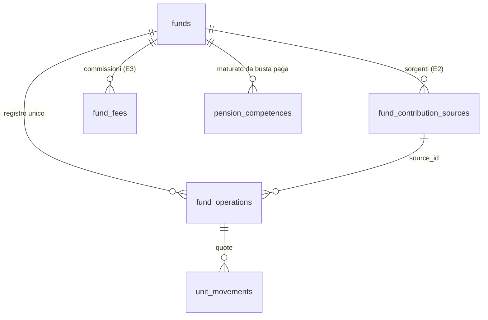

# 11. Standardizzazione delle funzioni

Indice del piano: [`../rewrite-plan.md`](../rewrite-plan.md). Decisioni: [`01-decisions.md`](01-decisions.md) §1.0, H12-H20.

Stato: **revisione approvata da Mattia il 14/11/2026** (decisione H21). Le decisioni H12-H20 sono di Mattia
(14/11/2026). Rilasci, modelli e default di questo file le applicano. Mattia ha risposto alle ipotesi ST-1…ST-24 con
le sole eccezioni: ST-4, ST-6 e ST-7 sono le decisioni H18-H20; le altre sono decisioni, con il default. Ipotesi
nuove ([`09-risks.md`](09-risks.md) §9.6): ST-26 e ST-27 sono decisioni, con il default (H22, H23). ST-25 è una
decisione di Mattia del 14/11/2026 (H24): i file dei documenti di Cometa già salvati e le loro righe `documents` si
cancellano in N6, con dump e copia dei file prima (§11.2.4, passo A4).

Base dell'analisi: `main` a `9be59db`, sola lettura. Sul database di produzione: solo conteggi.

## 11.1 Regola

**Nessuna funzione richiede codice o una pagina su misura per un fornitore, una banca, un fondo o un datore di
lavoro** (H16). Un fondo nuovo, una busta paga di un altro datore o un contratto diverso si configurano dall'interfaccia.

Ogni cosa che oggi è su misura passa a una di queste classi:

| Classe | Significato |
|---|---|
| **Fisso** | Resta nel core, uguale per tutti |
| **Configurazione** | L'utente o l'admin lo imposta dall'interfaccia, senza codice |
| **Dati** | Un file di dati nel core (profilo, pacchetto paese, modello di fondo). Aggiungere una voce non chiede codice |
| **Plugin** | Esce dal core. Chi lo usa lo installa |
| **Via** | Si toglie |

I meccanismi comuni sono 8 punti di estensione, E1-E8: [`10-modularity.md`](10-modularity.md) §10.11.

Stato di oggi, in sintesi:

- **Funds ha due prodotti in un modulo.** Il tipo (`pac` o `pension`) sceglie tabelle, flussi, form, tab e pagine. Il
  nome «Cometa» sceglie scadenze, commissioni, tariffa, lettori dei documenti e un job. Un fondo pensione nuovo di un
  altro gestore riceve le scadenze e le commissioni di Cometa.
- **Payroll ha un solo lettore** (il modulo «Cedolino TS» del datore di Mattia) e nessun inserimento a mano.
- **Time Off ha i tipi di assenza e le regole di un contratto italiano** (`vacation`, `rol`, festività italiane).
- **I movimenti arrivano solo da Wallet.** Il resto è formato da default italiani (EUR, 26%, limite di deducibilità) e
  da nomi di fornitori in codice, schema e testi.

Dati di produzione (conteggi, 14/11/2026): 1 utente; 2 fondi (Fideuram `pac` su un conto `investment`, Cometa
`pension` su un conto `pension`); Fideuram: 10 versamenti (9 da regola, 1 manuale), 1 regola attiva, 11 valutazioni;
Cometa: 4 operazioni importate, 14 competenze da busta paga, 1 regola con le scadenze, 10 valutazioni; 13 righe di
tariffa, tutte `cometa`; 15 buste paga (14 applicate); 36 giorni di assenza (solo `vacation` e `rol`).

## 11.2 Fondo pensione standard

Decisioni: H12, H14, H15. Rilascio: **N6** ([`03-releases.md`](03-releases.md)).

### 11.2.1 Modello unico

Un fondo pensione è: un'anagrafica, un conto che tiene il valore, e parti configurabili. Il tipo non esiste più.

**Anagrafica.** Nome (obbligatorio), gestore (testo libero: non sceglie regole), linea o comparto, data di adesione
(obbligatoria), valuta (default: valuta di visualizzazione), valore di oggi e data (facoltativi), codice (sotto
«Avanzate»). Il conto che tiene il valore nasce da solo, di tipo `pension`.

**Sorgenti di contributo** (`fund_contribution_sources`, 0 o più per fondo; meccanismo E2):

| `kind` | Cosa descrive | Configurazione | Sostituisce |
|---|---|---|---|
| `payroll` | Contributi trattenuti in busta paga | Componenti attive: lavoratore, datore di lavoro, TFR; periodo di competenza (`month`, `quarter`); scadenze del versamento (facoltative); tolleranza in giorni; datore | `funds.receives_payroll`, la regola `payment_schedule`, il calendario di Cometa come ripiego |
| `bank_debit` | Contributo volontario ricorrente da un conto | Conto di addebito, testo del beneficiario, importo previsto, giorno, frequenza | `fund_deposit_rules`, `funds.debit_account_id`, `debit_day`, `monthly_cents` |
| `manual` | Contributo volontario inserito a mano | Nessuna | Il versamento manuale del PAC e il contributo volontario della pensione |

- Le parole di Mattia nel modello: il **TFR** è una componente della sorgente `payroll`; il **contributo volontario** è
  una sorgente `bank_debit` o `manual`.
- **Contributo del datore di lavoro:** è una componente della sorgente `payroll`, non una sorgente a parte (ipotesi
  ST-1). Arriva con lo stesso bonifico e dalla stessa busta paga. L'interfaccia mostra ogni componente con la sua
  origine: «Il mio contributo», «Datore di lavoro», «TFR», «Volontario».
- Più fondi possono avere una sorgente `payroll`. Vincolo: una voce di busta paga va a un solo fondo.
- «Dalla busta paga» compare solo con il modulo Payroll attivo. Senza Payroll le stesse voci si registrano a mano.
- Una sorgente descrive il piano. Il «versato» viene sempre dalle operazioni registrate, mai dal piano.

**Commissioni** (`fund_fees`, 0 o più per fondo; meccanismo E3). Sostituiscono 4 colonne e il tariffario per gestore.

| Campo | Valori |
|---|---|
| `label` | Testo dell'utente («Quota associativa») |
| `basis` | `one_off` (ingresso) · `per_contribution` · `periodic` · `on_assets` (gestione annua) · `per_request` |
| `amount_cents` oppure `rate` | Importo fisso oppure percentuale |
| `period` | `month` · `quarter` · `year` (per `periodic` e `on_assets`) |
| `source_id`, `component` | Facoltativi: la commissione vale solo per una sorgente o una componente |
| `valid_from`, `valid_to` | Validità, per i cambi di tariffa |
| Nota e fonte | Testo libero o indirizzo web |

- La commissione configurata spiega e stima. Quella scritta dall'utente su un'operazione è il dato che conta. Vale
  anche per le commissioni già lette da un documento prima di N6. È la regola di oggi.
- Le commissioni prelevate dal versamento danno l'investito. Le commissioni sul patrimonio sono già dentro il valore:
  l'app le mostra come costo annuo stimato e non le sottrae.
- Nessun tariffario per gestore nel codice.

**Registro unico** (`fund_operations`). Ogni entrata e uscita è un'operazione, con `classification` (lista di oggi) e
`source_id`. Un versamento da regola bancaria è un'operazione `voluntary` con `source = rule`. Una sola funzione
`fundFlows` sostituisce `pacFlows` e `pensionFlows`. Chiude FND-1, FND-2 e FND-3.

**Calendario dei versamenti** (facoltativo, nella sorgente). Frequenza, giorno e mesi di scadenza, tolleranza. Serve a
«In arrivo» e alla riconciliazione. Senza calendario un contributo conta nel giorno in cui è registrato.

**Valutazioni.** Un solo flusso «Aggiorna valore». Le regole approvate restano: lettura del 1° gennaio, soglia di
31 giorni, proiezione ([`01-decisions.md`](01-decisions.md) §1.5).

**Nessun documento nei fondi** (decisione H19). Nei fondi non si caricano file: nessun lettore, nessun tipo di
documento del fondo, nessun tab «Documenti». Contributi e valori arrivano solo dalle sorgenti (busta paga, addebito
in banca) e dall'inserimento a mano. Le operazioni e i valori già letti dai documenti di Cometa restano dati del
fondo. Cosa si toglie: §11.2.6.

**Modelli di fondo** (dati, non codice). Scadenze e commissioni di un fondo noto stanno in un file di dati.
Alla creazione l'utente può scegliere un modello: il modulo copia le righe. Senza modello il fondo nasce vuoto.

**Nessun «Deducibile»** (decisione H18). Il riquadro e il calcolo del limite di deducibilità non esistono più, per
nessun fondo. Il fondo non ha un limite e il pacchetto paese non ha limiti fiscali. Cosa si toglie: §11.2.6.

**Riconciliazione busta paga ↔ fondo.** Resta. Compare solo con una sorgente `payroll`. Il periodo segue il
calendario della sorgente, non il trimestre fisso. Confronta le competenze della busta paga con le operazioni
registrate nel fondo (a mano, o già lette prima di N6): nessun documento del fondo (H19).

**Pagina unica.** Una home e un dettaglio. Tab: Panoramica · Contributi · Valori · Impostazioni.
Impostazioni: Generale · Contributi (sorgenti e calendario) · Commissioni · Zona pericolosa. Le sezioni dipendono
dalla configurazione, non dal tipo:

| Sezione | Compare se |
|---|---|
| Versato, valore, rendimento, grafico, valutazioni | Sempre |
| «In arrivo» e riconciliazione per periodo | Esiste una sorgente `payroll` con scadenze |
| Stato del versamento del mese | Esiste una sorgente `bank_debit` attiva |
| Quote e comparti | Esistono movimenti di quote |

### 11.2.2 Procedura «Aggiungi fondo pensione»

Punto di ingresso: «Aggiungi fondo» in Funds; da R5b «Aggiungi investimento» → «Fondo pensione». Quattro passi, uno
solo obbligatorio.

1. **Il fondo.** Nome, gestore, data di adesione. Facoltativi: linea, valore di oggi, modello.
2. **Come versi.** Tre domande con interruttore:
   - «Versi dalla busta paga?» → voci: mio contributo, datore di lavoro, TFR. Solo con Payroll attivo.
   - «Hai un addebito periodico su un conto?» → importo, frequenza, conto, giorno.
   - «Fai versamenti liberi?» → nessun campo: aggiunge il pulsante «Registra contributo».
3. **Commissioni.** Lista vuota con «Aggiungi commissione» e «Salta per ora».
4. **Riepilogo.** Una riga per scelta, pulsante «Crea fondo».

Dopo la creazione l'utente arriva sul dettaglio. Lo stato vuoto di ogni tab offre per prima l'azione manuale
(«Registra contributo», «Aggiorna valore»). Nessun passo chiede il tipo del fondo e nessun passo chiede un file.

### 11.2.3 Come Cometa e Fideuram diventano configurazione

| Oggi nel codice o nello schema | Diventa |
|---|---|
| Calendario di Cometa (20/4, 20/7, 20/10, 20/1) | Scadenze della sorgente `payroll` del fondo Cometa: trimestrale, giorno 20 |
| Commissioni di Cometa (10,32 € di adesione, 3 € a trimestre) | 2 righe `fund_fees`: «Adesione» `one_off`; «Quota associativa» `periodic`, trimestre |
| Tariffario di Cometa (13 righe del server) | Righe `fund_fees` del fondo Cometa (decisione ST-10) |
| Regola con «CCNL» e tre percentuali | Componenti della sorgente `payroll`, con nota |
| «Riceve la busta paga» (un fondo per utente) | Sorgente `payroll` del fondo |
| File di Cometa, lettori, tipi `cometa_*`, job `cometa-sweep` | Via (H19). Le operazioni e i valori già letti restano dati del fondo |
| PAC Fideuram: rata, giorno, conto, regola sul beneficiario | Fondo pensione «Fideuram» con 1 sorgente `bank_debit` |
| Commissione per versamento e TER di Fideuram | 2 righe `fund_fees`: `per_contribution`; `on_assets`, anno |
| 10 versamenti di Fideuram (`fund_deposits`) | 10 operazioni `voluntary` nel registro unico |
| Limite di deducibilità nel codice, riquadro «Deducibile» | Via (H18) |

### 11.2.4 Dati esistenti: strada A

Due strade valutate. **Scelta: strada A** (decisione ST-16).

| | **A · migrazione additiva con riclassificazione** | B · modello nuovo con lettura compatibile |
|---|---|---|
| Idea | Tabelle nuove, copia dei dati di Fideuram nel registro unico. Il codice legge e scrive solo il modello nuovo. Le tabelle vecchie restano ferme e si tolgono in R5f | Nessuna migrazione. Un adattatore presenta `fund_deposits` come operazioni volontarie. Solo i fondi nuovi nascono nel modello nuovo |
| Codice | Un solo percorso di lettura e di scrittura | Due forme di archivio per sempre: il ramo sul tipo passa dalla pagina al dominio |
| Rollback | Immagine `pre-n6`: le tabelle vecchie sono intatte. Dump per le scritture fatte dopo il rilascio | Solo immagine |
| Rischio sui numeri | Copia di 10 righe, controllata con conteggi e somme | Nessuna copia; rischio nell'adattatore |
| Priorità 1 | Raggiunta | Non raggiunta |

Passi della strada A:

| Passo | Contenuto | Tipo | Compatibile con l'immagine precedente | Rilascio |
|---|---|---|---|---|
| A1 schema | Tabelle `fund_contribution_sources`, `fund_fees`. Colonne `fund_operations.source_id` (nullable), `fund_operations.fees_unknown` (default `false`). Check `fund_operations_source_ck` allargato con `rule` | Additiva | Sì: l'immagine precedente non usa gli oggetti nuovi; il check accetta i valori vecchi | N6 |
| A2 dati, Fideuram | Sorgente `bank_debit` dalla regola e dal piano. 2 righe `fund_fees`. Copia dei 10 versamenti in `fund_operations`: `classification = voluntary`, importo addebitato, commissione, netto, `transaction_id`, `source` = `rule` o `manual`, `origin_key = 'deposit:' + id` | Dati | Sì: `fund_deposits`, `fund_deposit_rules` e `funds.type` non sono toccati | N6 |
| A2 dati, Cometa | Sorgente `payroll` (lavoratore, datore, TFR; periodo `quarter`; scadenze e tolleranza dalla regola). Righe `fund_fees` dalla regola e dalla tariffa. Le 4 operazioni importate e le valutazioni lette dai documenti non sono toccate | Dati | Sì: `pension_rules` e `fund_fee_tariffs` non sono toccate | N6 |
| A2 dati, conto | `accounts.type` del conto di Fideuram: `investment` → `pension` (decisione ST-17) | Dati | Sì: l'immagine precedente accetta i due tipi | N6 |
| A3 rimozione | `fund_deposits`, `fund_deposit_rules`, `fund_fee_tariffs`; colonne `funds.type`, `isin`, `debit_account_id`, `debit_day`, `ter`, `monthly_cents`, `deposit_fee_cents`, `receives_payroll`; colonne di commissione e `schedule` di `pension_rules`; colonne `fund_operations.document_id` e `position_snapshots.document_id`; valori `cometa_*` del tipo di documento | Contrazione | No. Dump obbligatorio | R5f |
| A4 cancellazione dei documenti di Cometa | Decisione ST-25 (H24). File dei documenti di Cometa nell'archivio S3 e righe `documents` dei tipi `cometa_*`. Le righe figlie dei documenti si cancellano con la chiave esterna; `fund_operations.document_id` e `position_snapshots.document_id` passano a `NULL`. Le 4 operazioni importate e le valutazioni lette non sono toccate | Dati, irreversibile | No, per i documenti. Dump e copia dei file obbligatori | N6, passo separato |

**Rollback di N6.** Immagine `pre-n6` e un file SQL nel repo: cancella le operazioni con `origin_key like
'deposit:%'`, riporta `accounts.type`, elimina tabelle e colonne nuove. I versamenti da regola fatti dopo il rilascio
ritornano da soli: il job `funds-deposits` dell'immagine precedente li ricrea dai movimenti. Per i versamenti manuali
fatti dopo il rilascio serve il dump `n6.dump`. Fino al passo A4, N6 non tocca le righe e i file dei documenti di
Cometa: l'immagine `pre-n6` li legge e li carica come prima.

**Passo A4: cancellazione dei documenti di Cometa (decisione ST-25, H24).** La cancellazione è irreversibile senza la
copia. Per questo è un passo separato di N6: commit, deploy e OK di Mattia propri (`git-policy` §6 #1 e #2).

1. Condizione: A1 e A2 sono in produzione e stabili. La prova SN7 è uguale prima e dopo N6.
2. Dump del database e copia dei file dei documenti di Cometa in `projects/Ledgerly-dumps/`
   ([`06-data.md`](06-data.md) §6.3), con le impronte dei file.
3. Prova di ripristino: dump in un database temporaneo; numero delle righe `documents` dei tipi `cometa_*` uguale
   alla produzione; numero e impronte dei file copiati uguali a quelli dell'archivio.
4. OK di Mattia sul SHA del passo.
5. Cancellazione: file nell'archivio S3, poi righe `documents` dei tipi `cometa_*`, con `WHERE` e conteggio nel
   commento di deploy.
6. Verifica: 0 file e 0 righe dei tipi Cometa; SN1 e SN7 uguali a prima della cancellazione.

Rollback del passo A4: ripristino delle righe dal dump e dei file dalla copia. La copia resta finché Mattia non dice
di toglierla.

**Prove «stessi numeri».**

| # | Prova | Come | Atteso |
|---|---|---|---|
| SN1 | Fotografia prima e dopo, in produzione | `npm run numbers`: per fondo e per periodo (ogni anno, «Tutto») valore, versato, commissioni, guadagno, Modified Dietz, XIRR | Cometa e Fideuram: uguale byte per byte. Se la fotografia contiene il «Deducibile», quel campo esce dal confronto (X1) |
| SN2 | Parità della copia, dentro la migrazione | 10 righe; somma degli addebiti uguale; somma delle commissioni uguale; 9 `transaction_id` uguali. La migrazione fallisce se una uguaglianza non vale | Uguale |
| SN3 | Flussi | Test: `fundFlows` sul fondo migrato = `pacFlows` sui versamenti vecchi, campo per campo | Uguale. Il campo `deductible` non esiste più e non entra nel confronto (X1) |
| SN4 | Commissioni di Cometa | Test: netto con le righe `fund_fees` = netto con le costanti di oggi, sui 14 periodi maturati | Uguale |
| SN5 | File di riferimento dei calcoli approvati | Ingressi e uscite dei due fondi di prova aggiunti alla prova B3 ([`10-modularity.md`](10-modularity.md) §10.10) | Uguale |
| SN6 | Patrimonio | Overview, somma dei conti, `GET /summary`, `get_summary` | Totale uguale. Cambia solo il subtotale del gruppo (X2) |
| SN7 | Dati già letti dai documenti | Test e conteggio in produzione sulle 4 operazioni importate e sulle valutazioni lette dai documenti di Cometa: conteggio, somme, date e quote, prima e dopo N6 e prima e dopo la cancellazione dei file (N6, passo A4) | Uguale |

### 11.2.5 Eccezioni dichiarate al vincolo «comportamento invariato»

N6 è un cambio voluto, con i suoi criteri di accettazione. Versato, valore, commissioni e rendimento di Cometa non
cambiano. Cambiano solo questi punti, per decisione di prodotto. Ognuno ha un commit separato e un test.

| # | Cosa cambia | Motivo | Ipotesi |
|---|---|---|---|
| X1 | **Il «Deducibile» non esiste più.** Il riquadro «Deducibile» e il suo calcolo spariscono da home, dettaglio e tab Contributi, per ogni fondo (anche Cometa). Sostituisce la prima forma di X1 («Deducibile» con Fideuram) | Decisione di Mattia del 14/11/2026 (H18) | — |
| X2 | **Gruppo del conto di Fideuram.** Il conto passa dal tipo `investment` al tipo `pension`. Il patrimonio è uguale; cambia il subtotale del gruppo | Tutti i fondi su conti `pension`: il gruppo si legge dal tipo del conto | ST-17 |
| X3 | **Export, sezione `funds`.** `kind` vale `pension` per ogni fondo. Sezioni nuove `fund-sources` e `fund-fees` (additive) | Il tipo `pac` non esiste più | — |

Cosa cambia a schermo, senza cambio di numeri: «Aggiungi fondo» non chiede il tipo; Fideuram mostra «Contributi» al
posto di «Versamenti», con le stesse righe; le commissioni sono una lista modificabile; il pulsante di import e la
lista dei documenti di Cometa spariscono (H19).

### 11.2.6 Cosa si toglie con H18 e H19

Riferimenti `percorso:riga` su `main` a `9be59db`. Le rimozioni di codice sono in N6; le rimozioni di schema e di
dati sono in R5f, salvo i file e le righe dei documenti di Cometa: N6, passo A4 (decisione ST-25).

**«Deducibile» (H18)**

| Cosa | Dove oggi | Rilascio |
|---|---|---|
| Limite per anno: `DEDUCTIBILITY_LIMITS`, `deductibilityLimit` | `src/modules/funds/pension/rules.ts:157-168`; riesportazione in `src/modules/funds/pension/queries.ts:60`, `:347` | N6 |
| Classi deducibili e campo `deductible` dei flussi; `deductibleCents` della misura di periodo | `src/modules/funds/period.ts:92`, `:110`, `:137`, `:256-257`, `:318-321` | N6 |
| `deductible` del riepilogo della home | `src/modules/funds/home.ts:138`, `:273`, `:296-300` | N6 |
| `DeductibleYear`, `deductibleYears` | `src/modules/funds/tabs.ts:66-98` | N6 |
| Barra «Deducibile» nella home | `src/app/(app)/funds/page.tsx:801-851` | N6 |
| KPI «Deducibile» nel dettaglio | `src/app/(app)/funds/[id]/page.tsx:508-579` | N6 |
| Scheda «Deducibile per anno» nel tab Contributi | `src/modules/funds/ui/pension-contributions.tsx:107`, `:392-446` | N6 |
| Testi | `messages/en.json:2943-2946`, `:2968-2970`, `:3117` e seguenti; le stesse chiavi in `messages/it.json` | N6 |
| Test del calcolo | `home.test.ts`, `period.test.ts`, `tabs.test.ts`, `detail.test.ts` in `src/modules/funds/` | N6 |
| Schema e dati | Nessuna colonna, tabella o riga: il limite è una costante del codice. Nessuna rimozione in R5f | — |
| API, MCP, export | Nessun campo: il «Deducibile» esiste solo nelle pagine. Nessun campo pubblico sparisce | — |

Il modello nuovo non crea il campo `deductible` delle sorgenti e non crea un limite sul fondo.

**Documenti dei fondi (H19)**

| Cosa | Dove oggi | Rilascio |
|---|---|---|
| Pulsante e dialog di import | `ImportCometaButton` in `src/modules/funds/ui/pension-forms.tsx:81-190`; uso in `src/app/(app)/funds/[id]/page.tsx:207` | N6 |
| Azioni di caricamento, applicazione, cancellazione e nuovo tentativo | `src/modules/funds/pension/actions.ts:83-185` | N6 |
| Lettura e applicazione dei documenti | `src/modules/funds/pension/imports.ts`; lettori in `src/modules/funds/parse/` | N6 |
| Pagina del documento e originale | `src/app/(app)/funds/[id]/documents/[docId]/page.tsx`, `…/original/route.ts` | N6 |
| Lista dei documenti nel dettaglio e testi `documents.*` | `src/modules/funds/pension/queries.ts:173`, `:205`; `src/modules/funds/ui/fund-valuations.tsx:315`; `messages/en.json:2606-2635`, `:3046` | N6 |
| Job `cometa-sweep` e la sua riga nel registro dei job | `src/modules/funds/jobs.ts:33-39` | N6 |
| Tipi `cometa_operations`, `cometa_position` nel codice (formati, cartella, ramo di lettura) | `src/modules/imports/rules.ts:3`, `:94-95`, `:107-108`; `src/modules/imports/api.ts:30-40`, `:65-67` | N6 |
| API: `POST /imports` con un tipo `cometa_*` | `src/modules/imports/api.ts:27`, `:49-72` | N6, secondo la decisione ST-26 |
| Testo dello scope `imports` e nota dell'export sui file di Cometa | `messages/en.json:650`; `src/platform/export/service.ts:371-372` | N6 |
| MCP | Nessuno strumento sui documenti: nulla da togliere | — |
| Export: righe e file di Cometa nella sezione `documents` | `src/platform/export/service.ts:347-394` | Restano finché i file esistono: fino al passo A4 di N6 (decisione ST-25) |
| File salvati e righe `documents` di tipo `cometa_*` | Silo S3 e tabella `documents` | N6, passo A4 (decisione ST-25, H24): cancellazione con dump, copia dei file e OK di Mattia sul SHA |
| Colonne `fund_operations.document_id`, `position_snapshots.document_id`; valori `cometa_*` nel check del tipo di documento | `src/modules/funds/schema.ts:341`, `:437`; `src/modules/imports/schema.ts:65` | R5f |

Cosa resta: le operazioni con `source = import` e le valutazioni lette dai documenti restano dati del fondo, con gli
stessi numeri (prova SN7). Il valore `import` resta nel vocabolario delle sorgenti come storia: il codice non lo scrive più.

## 11.3 Piano di acquisto (PAC)

Decisione: H13. Rilascio: **R5d, secondo passo** ([`03-releases.md`](03-releases.md)).

Un piano di acquisto è un **modello di operazione con una scadenza**. Non è un conto e non è un fondo. Vive dentro un
Portafoglio manuale. Nessun dato esistente passa al piano: l'unico PAC di oggi (Fideuram) è un fondo pensione (§11.2).

### 11.3.1 Modello

| Oggetto | Campi | Nota |
|---|---|---|
| `investment_plans` | Conto (Portafoglio manuale), `instrument_id`, mercato; importo e valuta **oppure** quantità; frequenza (`week`, `month`, `quarter`) e intervallo; giorno; `start_on`, `end_on` o numero di rate; conto di addebito (facoltativo); commissione per rata (forma E3); modo (`propose`, `auto`); stato (`active`, `paused`, `ended`); nome | Un piano = uno strumento |
| `investment_plan_runs` | `plan_id`, `due_on`, stato (`pending`, `waiting_price`, `proposed`, `recorded`, `skipped`), `operation_id`, prezzo e data del prezzo usati | `unique (plan_id, due_on)` |
| `investment_operations.plan_run_id` | Nullable, unico | Lega l'acquisto alla sua scadenza |

Dove si crea: nel Portafoglio manuale, pulsante «Nuovo piano di acquisto»; e in fondo a «Registra operazione», con la
casella «Ripeti questo acquisto».

### 11.3.2 Job di scadenza

Job `investment-plans-due`, giornaliero, nel worker.

1. Per ogni piano attivo crea le scadenze con `due_on ≤ oggi` che mancano (recupero dopo un fermo: al massimo 12).
2. Per ogni scadenza `pending` o `waiting_price` cerca il primo prezzo dello strumento alla data di scadenza o dopo.
3. Prezzo assente: stato `waiting_price`, nuovo tentativo il giorno dopo. Dopo 5 giorni: voce in «Da fare» con il
   prezzo da inserire a mano.
4. Prezzo presente, modo `propose`: voce in «Da fare» («Rata di {strumento}: conferma»). Il modulo è già compilato.
   L'utente conferma, corregge o salta. La conferma scrive l'acquisto.
5. Prezzo presente, modo `auto`: il job scrive l'acquisto con lo scrittore unico `portfolio`, con il segno
   «automatica». L'operazione resta modificabile.
6. Scrittura dell'acquisto e stato `recorded` nella stessa transazione.

**Idempotenza.** `unique (plan_id, due_on)` impedisce due scadenze uguali. Il vincolo unico su `plan_run_id`
impedisce due acquisti per una scadenza. Il job può girare due volte o riprendere a metà senza effetti.

### 11.3.3 Regole

- Default: **operazione proposta** in «Da fare» (decisione ST-5). `auto` è un interruttore del singolo piano, spento.
  Motivo: il prezzo di chiusura non è il prezzo dell'eseguito; con `auto` quantità e P&L sono stime.
- «Da fare» nasce in R5e. Fino a R5e la rata proposta compare nella pagina del portafoglio.
- Un piano genera operazioni `buy` normali, con il riferimento al piano. Stesso modulo, stessi controlli, stesso P&L.
- Se il conto di addebito è sincronizzato, l'app propone il collegamento con il movimento: lo stesso abbinatore
  delle sorgenti `bank_debit` dei fondi (meccanismo E7).
- Subscriptions esclude i movimenti collegati a un'operazione: l'addebito del piano non compare come abbonamento.
- Una rata saltata resta nella lista come «saltata». Nessun recupero automatico.
- Piano con inizio nel passato: una schermata «Registra le rate passate», una riga per rata, da confermare insieme.
- Solo nei Portafogli manuali. Un servizio collegato (eToro, Binance) non ha piani: lì scrive il provider.
- API e MCP: `GET` e `POST /investments/:accountId/plans`; `list_investment_plans` in sola lettura.

## 11.4 Investments senza il tipo PAC

Rilascio: R5b. Sostituisce B1 per numero e nomi dei gruppi ([`01-decisions.md`](01-decisions.md)).

| Gruppo (nome: decisione ST-2) | Contiene | Esempi di Mattia |
|---|---|---|
| **Azioni e crypto** | Servizi collegati, Portafoglio manuale con i suoi piani di acquisto, conti con solo valore | eToro, Binance |
| **Fondi pensione** | Tutti i fondi pensione | Cometa, Fideuram |

| Punto | Effetto |
|---|---|
| Menu e URL | Invariati rispetto a D2 e B1b: una voce «Investments»; `/funds/*` → redirect permanente |
| Home Investments | Filtro a chip: Tutti · Azioni e crypto · Fondi pensione. 2 subtotali. Un gruppo vuoto non compare |
| «Altri conti» | Entra in «Azioni e crypto» come riga con solo valore. Stesso totale |
| Overview (O1) | Il gruppo degli investimenti ha 2 sottogruppi, con gli stessi subtotali della home |
| «Aggiungi investimento» (B1c) | 3 scelte: «Collega un servizio» · «Segui i tuoi titoli a mano» · «Fondo pensione» (decisione ST-3). Prima di R5d la seconda scelta è «Conto con solo valore» |
| Modulo `portfolio` | `kind` della riga: `service`, `manual_portfolio`, `pension_fund`. Nessun valore `pac` |
| API e MCP | Rotte dei fondi in R2 (`GET /funds`, `GET /funds/:id` con `sources[]`, `fees[]`, operazioni). `list_funds` in sola lettura, senza tipo |
| Testi | «PAC» sparisce da Funds e da Investments |

## 11.5 Elenco delle funzioni su misura

Ogni riga: cosa è su misura oggi, il meccanismo standard, il rilascio che lo realizza. Riferimenti `percorso:riga`
delle voci nuove: [`02-audit.md`](02-audit.md) §2.6. Meccanismi E1-E8: [`10-modularity.md`](10-modularity.md) §10.11.

| Modulo | Logica su misura | Meccanismo standard | Classe | Rilascio |
|---|---|---|---|---|
| funds | Tipo `pac`/`pension`: due creazioni, due registri del denaro, due motori dei flussi, due serie di tab e di componenti | Fondo unico; registro unico; `fundFlows`; pagina unica (§11.2) | Configurazione | N6 |
| funds | Scadenze, commissioni, tariffa e fonti di Cometa nel codice; tariffa scritta a ogni lettura | E2 sorgenti; E3 commissioni; modelli di fondo come dati | Configurazione + Dati | N6 |
| funds | Lettori, azioni, pulsante e job con «Cometa» nel nome | Via (H19): nei fondi non si caricano documenti. Contributi e valori dalle sorgenti e a mano | Via | N6 (codice, pagine, job; file e righe `documents`, passo A4); R5f (colonne, valori `cometa_*`) |
| funds | Limite di deducibilità italiano nel codice; classi deducibili fisse; riquadro «Deducibile» | Via (H18): nessun limite, nessun calcolo, nessun riquadro | Via | N6 |
| funds | Legame con la busta paga: un fondo per utente, colonne fisse, trimestre calcolato in payroll con le regole di Cometa | E2: sorgente `payroll`; evento `PayslipApplied` con righe per ruolo | Configurazione | N6 (sorgente); R2 (evento) |
| investments | Un fornitore registrato in 9 punti; rami per eToro, Binance e Wallet in pagine e codice generico; chiavi di traduzione con lo slug del fornitore | E5: un descrittore per fornitore, con capacità | Fisso | N1 (schema); R1 (registro); R2 (descrittori di eToro e Binance); R3 (testi dal descrittore) |
| investments | Seme di 12 asset, voci `planned`, «Coming soon» | Via: anagrafica di R5d; dialog a 3 scelte | Via | R5b; R5d |
| investments | PAC come tipo di fondo | Piano di acquisto del Portafoglio manuale (§11.3); E3; E7 | Configurazione | R5d, secondo passo |
| payroll | Un solo lettore e un solo profilo; 29 etichette, geometria del PDF e 30 codici del datore di Mattia; controlli e formule del modulo; prompt AI per un formato | E1: registro dei lettori con profili dichiarativi. Il profilo di oggi è il primo | Dati | R2 (registro); R5g (profili) |
| payroll | Nessun inserimento a mano: senza lettore l'utente è bloccato | Busta paga generica a mano (mese, lordo, tasse, contributi, netto, PDF) | Fisso | R5g |
| payroll | Campi, ruoli e controlli fiscali italiani come colonne ed enum; nomi dei mesi in italiano | E4: campi base nel core; campi del paese dal pacchetto `IT`, salvati come coppie chiave-valore | Dati | R0 (struttura); R5g |
| payroll | Mensilità 13ª, 14ª, 15ª; una busta al mese; assenze del mese precedente | E6: configurazione del datore (mensilità extra, frequenza); ritardo delle assenze nel profilo | Configurazione | R5g |
| payroll | Regole del fondo dentro payroll (codici → contributi, trimestre) | E2: payroll emette le righe per ruolo; decide la sorgente del fondo | Configurazione | R2 (payroll, funds) |
| payroll | AI solo con un fornitore, indirizzo fisso in 3 punti | E8: indirizzo e modello come impostazione del server; un solo client | Configurazione | R2 (users e impostazioni) |
| documents (oggi `imports`) | Tipi `cometa_*` nell'enum, nel check DB e nell'API; ramo «non è una busta paga, quindi è Cometa»; cartelle per fornitore; conservazione fissa a 10 anni | Via i tipi `cometa_*` e il ramo (H19). E1 per le buste paga: tipo più lettore; cartelle dai tipi registrati; conservazione come impostazione | Via + Dati + Configurazione | N6 (via il ramo e il caricamento dei fondi); R2 (imports); R5f (valori `cometa_*`) |
| timeoff | Tipi fissi (`vacation`, `rol`, `comp`, `sick`, `other`); monte con due colonne; due schede fisse; solo giornata o mezza | E6: tipi di assenza come dati, dal pacchetto paese (`IT`: Ferie, ROL/Permessi); monte per (anno, tipo); granularità per tipo. Il tipo `sick` si toglie: non è un'assenza di Time Off (H20) | Configurazione + Via | N5 (il pannello legge un elenco, senza `sick`); R5g; R5f (valore nel check) |
| timeoff | «Goduto» e riporto solo dalla busta paga | Porta `LeaveBalanceSource` con due adattatori; riporto a mano | Fisso + Configurazione | R2 (porta); R5g |
| timeoff | Anno ferie = anno solare; fine settimana fisso; patrono come preferenza | E6: inizio dell'anno ferie, giorni lavorativi, giorni non lavorativi personali | Configurazione | R5g |
| timeoff | Trek nello schema, nelle regole e nella pagina; due liste dei tipi che vanno a Trek | Porta `LeaveCalendarSync`; «va al calendario esterno» sul tipo | Plugin | N5 (test e correzione, ST-23); R2; R5c |
| holidays | Festività italiane calcolate nel codice come ripiego; due fonti fisse | E4: calendario proposto dal paese; E5: registro delle fonti | Dati | R2 (registro); R5a (proposta al primo avvio); R5g (fine del ripiego) |
| interests | Tassa di default 26%; solo basi 365 e 360; finestra dell'accredito fissa | E4: default dal paese; E6: convenzioni come campi della regola | Dati + Configurazione | R2 (struttura); R5g (campi nel form) |
| interests | Pubblicazione dell'interesse e «saldo fresco» solo con Wallet; nota con un formato personale | Porta `LedgerPosting`; capacità del plugin; «saldo fresco» da ogni sorgente | Plugin + Via | R2 (porta); R5c (decisione ST-14) |
| transactions | Wallet come unico ingresso dei movimenti e unica via di modifica; categorie legate agli id di Wallet | Porta `MovementsSource`; movimento manuale; E5: capacità dichiarate dal plugin | Fisso + Plugin | N3 (movimento manuale); R2 (porta); R5c (plugin) |
| transactions | Nessun import da file | Import CSV con mappa delle colonne salvata per conto (decisione ST-8) | Fisso | R5c |
| transactions | Chiavi di notifica e mail con il nome del fornitore | Chiavi generiche con il fornitore come parametro | Fisso | N2 |
| transactions, accounts | Giroconti abbinati solo per IBAN; tre regole «il beneficiario contiene…» | E7: abbinatore di movimenti con strategie | Fisso | R2 (transactions) |
| accounts | Conto manuale solo in EUR; 8 campi alla creazione | E8: valuta a scelta; 4 campi | Configurazione | R5b |
| accounts | «Connections»: lista a mano di addebiti | Via: una sola lista in Subscriptions (decisione ST-13) | Via | R5a; R5f |
| budgets, subscriptions, pockets | Solo euro: check DB, importi senza valuta, «(€)» nei testi | E8: `Money` con valuta obbligatoria | Fisso | R0 (tipo); R2 (per modulo); R5f (check) |
| subscriptions, pockets, budgets | 4 cicli fissi; accredito solo il giorno 1; avvisi solo dopo la sync della banca; voto «utilità» | Frequenza «ogni N settimane o mesi»; giorno a scelta; avvisi a ogni cambio dei movimenti; voto facoltativo (decisione ST-15) | Configurazione | R5a; R5e (avvisi) |
| users | Default `Europe/Rome`, `it-IT`, `EUR` per ogni utente; formato dei numeri chiuso; mappa lingua → locale in 5 file | E8: default di istanza chiesti al primo avvio; una sola mappa | Configurazione | R0 (mappa); R5a |
| integrations | Elenchi chiusi di tipi di sync e di entità nei check DB; una scheda su misura per fornitore; intervallo minimo motivato da Wallet | E5: il descrittore dichiara tipi, entità, campi e intervallo; schede dal manifest | Plugin | N1 (schema); R1; R5a; R5c |
| fx | Una sola fonte (BCE), base EUR, elenco chiuso di valute | E5: registro delle fonti di cambio | Fisso | R2 (fx); R5d (plugin `prices`) |
| auth | «Authentik» come id e nome dell'accesso, in circa 25 testi; nome del claim fisso | E8: nome mostrato e claim come impostazione; id neutro con redirect | Configurazione | R2 (users e impostazioni) |
| auth, mail, storage | OIDC, SMTP e S3 obbligatori all'avvio; hostname di Mattia nel compose distribuito | E8: avvio con password, senza posta, con disco locale; compose di esempio neutro | Configurazione | Fuori dal piano (decisione ST-24) |
| alerts, jobs | Avvisi all'admin solo con Gotify; job `cometa-sweep`; fuso del cron | Canali di notifica; via `cometa-sweep` (H19) e job generico dei documenti per le buste paga; scheduler del worker | Configurazione + Via | N6 (via `cometa-sweep`); R1; R5e |
| API, MCP, export | `kind` del fondo, `cometa_*` in `POST /imports`, `rolDays` nell'export, host fissi per la registrazione dei client MCP | Contratto dai tipi registrati; lista ammessa come impostazione. Tipi `cometa_*` di `POST /imports`: decisione ST-26 | Fisso + Configurazione | N6 (`cometa_*`); R2; R5b; R5g |
| Overview | 3 riquadri fissi più Pockets; «Last snapshot» in evidenza | Riquadri dai gruppi e dai moduli attivi; snapshot sotto «Avanzate» | Configurazione | R5a; R5b |
| Messaggi | Nomi di fornitori nelle chiavi e nei testi; tre parole per «movimento»; due significati di «Connection» | Regola M14; glossario unico | Fisso | R3; R5a |

Nessuna logica su misura trovata in: regole di budgets, regole di pockets, mail (destinatari), nomi degli strumenti
MCP, backup.

## 11.6 Anticipi alla fase A

Senza cambio di comportamento. Motivo: questi tre punti si scrivono adesso; farli dopo chiede di riscriverli.

| # | Cosa | Rilascio | Perché ora |
|---|---|---|---|
| AN1 | Il pannello di Time Off legge i tipi di assenza da un elenco, non da nomi fissi. Nessun cambio di schema: l'elenco contiene i tipi di oggi senza `sick` (H20, decisione ST-27) | N5 | Con i tipi fissi il pannello va riscritto in R5g |
| AN2 | Lo schema del manifest dei plugin nasce con etichette, campi delle credenziali, intervallo minimo e capacità | N1 | È il contratto: cambiarlo dopo tocca ogni plugin |
| AN3 | Chiavi di notifica generiche (`sync_failed`, `sync_stale`) con il fornitore come parametro | N2 | N2 riscrive lo stato dei collegamenti e questi avvisi |

Dettaglio: [`04-now.md`](04-now.md) §4.1, §4.3, §4.7.

## 11.7 Cosa questa revisione non cambia

- L'ordine dei rilasci esistenti. N6 si aggiunge alla fine della fase A; R5g si aggiunge prima di R5f.
- Le regole di calcolo approvate: Modified Dietz, XIRR, costo medio, lettura del 1° gennaio, soglia di 31 giorni.
- B1b, B2, C1b, C4b, D1, D2, D3, F1-F9, G1-G9, H1-H11.
- Il vincolo «comportamento invariato» per R0-R4. Le sole eccezioni nuove sono X1-X3 (§11.2.5), dentro N6.
