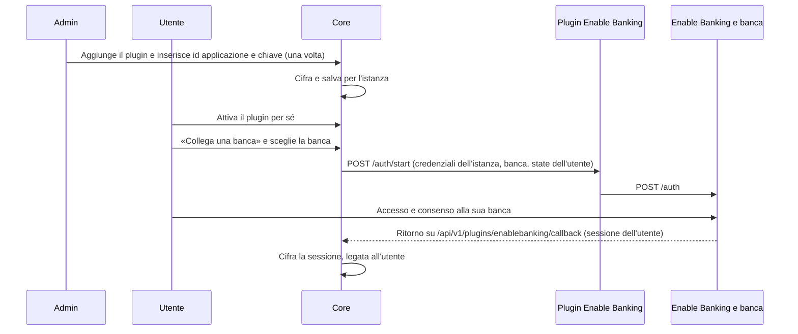

# 13. Plugin gestiti dall'admin, applicazione Enable Banking unica e Addons

Indice del piano: [`../rewrite-plan.md`](../rewrite-plan.md). Registro: [`01-decisions.md`](01-decisions.md) H48-H50.

Decisione di Mattia del **16/11/2026**. Questo documento scrive la decisione, i fatti che la condizionano, le
domande aperte e gli effetti sugli altri rilasci. Non riscrive i rilasci e non contiene codice.

**Stato: la decisione è scritta; rilascio e dettagli sono da decidere (§13.5, §13.6).** Nessuno sviluppo parte prima
delle risposte. Fino al rilascio che la realizza, la produzione resta com'è (`v0.22.1`): plugin attivati per utente,
credenziali Enable Banking per utente.

Segni usati: **[PROPOSTA]** = default proposto da questo documento, non deciso da Mattia. **[DEV]** = stima o scelta
tecnica da confermare con lo sviluppo. **[DA VERIFICARE]** = fatto non ancora verificato.

## 13.1 La decisione

Parole di Mattia:

> «Facciamo una modifica per il futuro: i plugin vengono gestiti e aggiunti dall'admin, poi gli utenti possono
> decidere se attivarli oppure no. Nello specifico Enable Banking: l'application è gestita dall'admin, le altre
> persone ci si collegano e basta. Ci deve essere anche la sezione Addons. Un Addon è un modulo core che può essere
> disattivato dal singolo utente, come (investments, work), oppure le singole sotto categorie come payroll,
> subscriptions, budgets, pocket, timeoff possono essere disattivate o attivate, tranne quelle necessarie per il
> funzionamento base dell'applicazione.»

Tre regole:

| ID | Regola | Cosa dice |
|---|---|---|
| H48 | **Plugin gestiti dall'admin** | L'admin gestisce e aggiunge i plugin dell'istanza. Ogni utente decide solo se attivare o no un plugin che l'admin ha aggiunto |
| H49 | **Applicazione Enable Banking unica** | L'applicazione Enable Banking è una per istanza e la gestisce l'admin. Gli altri utenti collegano solo la loro banca: non inseriscono id applicazione e chiave |
| H50 | **Sezione Addons** | Un addon è un modulo del core che il singolo utente può disattivare: un modulo intero (Investments, Work) oppure una sotto-categoria (Payroll, Subscriptions, Budgets, Pockets, Time Off). I moduli necessari al funzionamento di base non si disattivano |

Due parole, due cose:

| Parola | Cos'è | Chi lo gestisce | Cosa fa l'utente |
|---|---|---|---|
| **Plugin** | Una sorgente esterna, fuori dal core, in un container separato (Enable Banking; Wallet e Trek da R5c) | L'admin | «Attiva», «Disattiva» |
| **Addon** | Un modulo del core, già dentro Ledgerly | Nessuno: fa parte del core | «Attiva», «Disattiva» |

## 13.2 Cosa sostituisce

| Regola di prima | Stato dopo H48-H50 |
|---|---|
| **H25** «I plugin si attivano per utente. L'admin non fa niente» | **Sostituita in parte.** Cade «l'admin non fa niente» e «nessun passo dell'admin nell'interfaccia». Resta: l'attivazione è per utente; dopo la disattivazione le letture si fermano e i dati restano |
| **H27** «I plugin del catalogo fanno parte dell'installazione standard. Nessun "installa, aggiorna, rimuovi", per nessun ruolo» | **Sostituita.** L'admin aggiunge e gestisce i plugin. Le azioni esatte sono la domanda PA6. Resta: il tab Plugin dell'utente ha solo «Attiva» e «Disattiva» |
| **C1c** «Enable Banking: credenziali per utente. Ogni utente registra la sua applicazione» | **Sostituita** da H49. Se un utente può ancora usare una sua applicazione: domanda PA3 |
| **H26**, parte «Rimuovi credenziali» dell'utente | **Sostituita in parte.** Le credenziali dell'applicazione sono dell'admin. «Scollega» della banca resta dell'utente |
| **C4** «Nessun passo dell'admin nell'interfaccia» | **Sostituita** per questa frase. Resta: container separato senza stato, interrogato dal core |
| **H28** «Nessun plugin fuori catalogo» | **Non toccata dalle parole di Mattia.** Da confermare: domanda PA5 |
| **H29** «Il registro grezzo è per utente; l'admin vede solo lo stato dei plugin» | **Resta.** L'admin gestisce i plugin, non legge i dati degli altri utenti |
| **H30** «Disattivazione: credenziali e accesso restano cifrati; "In pausa"; Wallet e Trek attivi da subito in R5c per chi ha un collegamento» | **Resta** per l'utente che disattiva. Nuovo caso senza regola: l'admin toglie un plugin (domanda PA8). In R5c vale solo se l'admin ha aggiunto Wallet e Trek (§13.8) |
| **D2** «moduli attivabili» | **Precisata** da H50: nome «Addons», elenco di partenza, moduli di base non disattivabili |
| **D3** «Settings: tab Finance e tab Plugin (di ogni utente)» | **Da rivedere:** servono un posto per i plugin dell'utente, uno per gli addon e uno per la gestione dell'admin (domanda PA16) |

## 13.3 Fatti che cambiano la decisione

### F1 · L'applicazione Enable Banking di Mattia è «Restricted»

- L'applicazione di produzione di Mattia è gratuita e in stato «Restricted» (emerso nella prova sulla banca vera del
  15/11/2026).
- Un'applicazione «Restricted» legge **solo i conti già collegati nel pannello di Enable Banking** di chi possiede
  l'applicazione («Link accounts»). La guida «Collega una banca» lo dice già (`messages/it.json`, passo 4 della guida
  alle credenziali).
- Effetto su H49: con una sola applicazione dell'admin, i conti di **ogni altro utente** vanno collegati prima in
  quel pannello, dall'admin insieme alla persona, che fa l'accesso alla sua banca. Altrimenti serve un'applicazione
  **non** «Restricted».
- **[DA VERIFICARE]** Condizioni, tempi e costo per togliere lo stato «Restricted» (verifica di Enable Banking,
  contratto). **[DA VERIFICARE]** Se le condizioni d'uso di un'applicazione «Restricted» ammettono i conti di persone
  diverse dal proprietario. Sono le ipotesi A17 e A18 (e A19 per il passaggio) di [`09-risks.md`](09-risks.md) §9.1.

### F2 · Una chiave sola firma le richieste di tutti gli utenti

- Oggi ogni utente ha la sua chiave privata: una chiave compromessa espone un solo utente.
- Con H49 la chiave dell'admin firma le richieste di ogni utente. Chi ottiene quella chiave e una sessione può
  leggere i conti di ogni banca collegata all'istanza. La revoca o la scadenza dell'applicazione ferma tutti gli
  utenti insieme.
- Altri effetti: il limite di letture e gli eventuali blocchi di Enable Banking valgono per l'applicazione, quindi
  per tutti; nel pannello dell'admin compaiono i conti e i consensi di tutti.
- Rischi R-37, R-38, R-39 e, per il passaggio, R-40 in [`09-risks.md`](09-risks.md) §9.2. Per gli addon: R-41. Punto aggiunto alla review di sicurezza finale
  ([`03-releases.md`](03-releases.md) «Z»).

### F3 · In produzione esistono credenziali per utente e collegamenti di banca

- In produzione (`v0.22.1`) le credenziali Enable Banking sono per utente (`plugin_user_credentials`, cifrate).
- Mattia ha 2 collegamenti di banca attivi, creati con la sua applicazione.
- Una sessione di Enable Banking appartiene all'applicazione che l'ha creata. **[DEV]** Da confermare sul codice e
  sulla documentazione di Enable Banking.
- Serve una **regola di passaggio**. **[PROPOSTA]** (domanda PA4):
  1. Al rilascio, l'applicazione salvata oggi dall'admin diventa l'applicazione dell'istanza. Il valore cifrato si
     copia; nessuno lo inserisce di nuovo.
  2. I collegamenti dell'admin restano validi senza un nuovo accesso alla banca: l'applicazione è la stessa.
  3. Le credenziali di un utente non admin, se esistono, restano valide per i suoi collegamenti fino alla scadenza
     del consenso. Al rinnovo il collegamento passa all'applicazione dell'istanza. **[DEV]** Contare al rilascio
     quante righe esistono per utenti diversi dall'admin.
  4. Dopo il passaggio nessuno inserisce credenziali nuove per utente (salvo la risposta B alla domanda PA3).
  5. Rollback: l'immagine precedente legge ancora `plugin_user_credentials`, che il passaggio non cancella.

## 13.4 Modello proposto **[PROPOSTA]**

Tutto in questa sezione è una proposta: serve a rendere concrete le domande di §13.6.

### 13.4.1 Plugin

| Stato del plugin nell'istanza | Chi lo decide | Cosa vede l'utente |
|---|---|---|
| Nel catalogo, non aggiunto | — | Niente |
| Aggiunto dall'admin, non configurato (esempio: manca l'applicazione Enable Banking) | Admin | Niente, oppure «Non ancora disponibile» (domanda PA7) |
| Aggiunto e pronto | Admin | La voce del plugin, «Non attivo», con «Attiva» |
| Attivo per l'utente | Utente | La sezione del plugin (esempio: «Banche») |
| Tolto dall'admin | Admin | La voce sparisce; collegamenti «In pausa», dati conservati (domanda PA8) |

### 13.4.2 Enable Banking con un'applicazione unica

- L'utente non vede e non riceve mai la chiave. La sessione di ogni utente resta legata al suo utente: un utente
  non legge i conti di un altro.
- Con l'applicazione «Restricted» (F1) il passo «Accesso e consenso» riesce solo per i conti già collegati nel
  pannello dell'admin.

### 13.4.3 Addons

Elenco proposto (domanda PA9). I nomi sono quelli del menu di oggi.

| Tipo | Voce | Disattivabile | Nota |
|---|---|---|---|
| Base | Overview | No | — |
| Base | Accounts (conti, saldi, patrimonio) | No | — |
| Base | Expenses (movimenti, categorie, «Da rivedere») | No | — |
| Base | Settings, collegamenti e sorgenti, avvisi, esportazione | No | — |
| Addon, modulo | **Investments** (servizi collegati, portafoglio, fondi pensione) | Sì | Oggi «Funds» è una voce a parte: fino a R5b è un addon suo |
| Addon, modulo | **Work** (Payroll + Time Off) | Sì | Spegne le due sotto-categorie insieme |
| Addon, sotto-categoria | **Payroll** | Sì | Dentro Work |
| Addon, sotto-categoria | **Time Off** | Sì | Dentro Work |
| Addon, sotto-categoria | **Budgets** | Sì | — |
| Addon, sotto-categoria | **Subscriptions** | Sì | — |
| Addon, sotto-categoria | **Pockets** | Sì | — |
| Addon, sotto-categoria | **Interests** | Sì **[PROPOSTA]** | Mattia non l'ha nominato. Funds e Pockets lo usano |

Dipendenze tra i moduli, misurate sul codice (`main` a `b3ab940`, import tra moduli, file non di test):

| Modulo | Chi lo importa | Effetto sulla disattivazione |
|---|---|---|
| `budgets`, `pockets`, `subscriptions`, `timeoff` | Nessun altro modulo | Si disattivano senza effetti su altri moduli |
| `payroll` | `funds`, `imports`, `timeoff` | Time Off legge la maturazione dalle buste paga (N5.1). Un fondo pensione può avere la sorgente «busta paga» (N6) |
| `interests` | `funds`, `pockets` | Fondi e Pockets usano i tassi |
| `funds` | `investments`, `payroll` | — |
| `accounts`, `transactions` | Quasi tutti | Sono moduli di base |

Regola proposta per le dipendenze (domanda PA12): la disattivazione di un addon non spegne un altro addon. La
funzione che dipende dall'addon spento resta, senza la parte che manca. Esempio: senza Payroll, Time Off resta e non
calcola la maturazione dalle buste paga.

Cosa fa la disattivazione, proposta (domande PA10 e PA11):

| Superficie | Addon disattivato |
|---|---|
| Menu, pagine, palette dei comandi, riquadri di Overview | Spariscono. L'URL diretto porta a Settings › Addons |
| Job e letture del modulo | Si fermano per quell'utente |
| Avvisi e mail del modulo | Nessuno |
| Dati | Restano tutti. Alla riattivazione tornano com'erano |
| Patrimonio e totali | Non cambiano: i conti del modulo continuano a contare |
| API e MCP | Le rotte e gli strumenti del modulo rispondono con un errore dichiarato «modulo non attivo» |
| Esportazione | Contiene anche i dati dei moduli disattivati |

## 13.5 Dove entra nei rilasci: domanda PA1

Tre opzioni. Le dimensioni sono stime **[DEV]**.

| | A · Dentro R5a e R5c **[PROPOSTA]** | B · Rilascio nuovo N7, fase A, dopo N4 | C · Diviso: N7 piccolo ora, il resto in R5a e R5c |
|---|---|---|---|
| Contenuto | **R5a:** sezione Addons (H50), al posto di «moduli attivabili». **R5c:** gestione dei plugin dell'admin (H48), applicazione Enable Banking dell'istanza e regola di passaggio (H49), insieme a Wallet e Trek come plugin | **N7:** tutto H48-H50 sul codice di oggi: gestione dei plugin dell'admin, applicazione dell'istanza, passaggio, sezione Addons sul menu di oggi | **N7:** solo H49 e la gestione minima dell'admin per Enable Banking (aggiungi, inserisci l'applicazione). **R5a:** Addons. **R5c:** gestione completa dei plugin, Wallet e Trek |
| Migrazioni | R5a: `user_preferences.modules` (già prevista). R5c: stato «aggiunto» del plugin nell'istanza; credenziali del plugin per istanza, cifrate; dati: copia dell'applicazione dell'admin. `plugin_user_credentials` resta fino a R5f | Le stesse, tutte in N7, più le preferenze degli addon. Additive | N7: stato «aggiunto», credenziali per istanza, copia dei dati. R5a: `user_preferences.modules` |
| Criteri §6 attesi | R5a: #1. R5c: #1, #3, #5 come oggi, più **#4** (azioni riservate all'admin) | #1 (schema e dati), #4 (azioni dell'admin), #5 (segreto dell'istanza) | N7: #1, #4, #5. R5a: #1. R5c: #1, #3, #5 |
| Dimensione **[DEV]** | R5a resta M (può passare a L, rischio R-15). R5c resta L | N7: L | N7: M. R5a e R5c come oggi |
| Effetto sul piano | Nessun rilascio nuovo. La fase A non si allunga | R0 parte dopo N7. Le schermate nascono sul codice che R3 riscrive e sul menu che R5a cambia: lavoro doppio | R0 parte dopo N7. Lavoro doppio solo sulla schermata dell'admin |
| Fino al rilascio | Un secondo utente usa una sua applicazione, come oggi | — | — |
| Quando sceglierla | La modifica è «per il futuro» e nessun secondo utente collega una banca prima di R5c | Vuoi tutto prima della riscrittura | Vuoi aggiungere presto un secondo utente con una banca, senza fargli registrare un'applicazione |

Motivo della proposta A: Mattia ha detto «per il futuro»; R5a ha già i moduli per utente e R5c ha già il tab Plugin;
nessun lavoro si fa due volte. Il fatto F1 pesa su tutte e tre le opzioni: prima del rilascio di H49 serve la
risposta alla domanda PA2.

## 13.6 Domande per Mattia

Ogni domanda ha un esempio, l'opzione A (default proposto), l'opzione B e l'effetto. «ok default» vale per tutte;
le eccezioni si scrivono come «PA3 B».

### Rilascio

| # | Domanda | Esempio | A (default) | B | Effetto |
|---|---|---|---|---|---|
| PA1 | In quale rilascio entra la modifica? | Oggi il piano ha i «moduli attivabili» in R5a e il tab Plugin in R5c | Dentro R5a (Addons) e R5c (plugin e applicazione unica). Nessun rilascio nuovo | Rilascio nuovo N7 nella fase A, dopo N4: tutto (B), oppure solo l'applicazione unica (C). Dettaglio in §13.5 | A: la fase A non si allunga; fino a R5c un secondo utente usa una sua applicazione. B: R0 parte dopo; parte del lavoro si rifà nella riscrittura |

### Enable Banking

| # | Domanda | Esempio | A (default) | B | Effetto |
|---|---|---|---|---|---|
| PA2 | Come collega la sua banca un secondo utente, con l'applicazione «Restricted» dell'admin? | Tua sorella ha un account su Ledgerly e vuole collegare il suo conto | Resta l'applicazione «Restricted». Tu colleghi prima il conto di tua sorella nel tuo pannello di Enable Banking, con lei che fa l'accesso alla banca. Poi lei preme «Collega una banca» in Ledgerly. La guida lo spiega | Chiedi a Enable Banking di togliere lo stato «Restricted». Poi ogni utente collega la banca da solo | A: nessun costo, un passo a mano tuo per ogni conto di ogni utente. B: nessun passo a mano; condizioni e costo da verificare (A17). Le condizioni d'uso sono da verificare in tutti e due i casi (A18) |
| PA3 | Un utente può ancora usare una sua applicazione Enable Banking? | Un amico tecnico ha già la sua applicazione e non vuole passare dalla tua | No. Esiste solo l'applicazione dell'istanza | Sì, sotto «Avanzate»: «Usa la mia applicazione». Chi non la imposta usa quella dell'istanza | A: una sola strada, meno codice; `plugin_user_credentials` si toglie in R5f. B: due strade da mantenere e da provare; la chiave di quell'utente resta fuori dal rischio F2 |
| PA4 | Cosa succede alle credenziali e ai collegamenti di oggi? | Hai la tua applicazione salvata e 2 banche collegate | La tua applicazione diventa quella dell'istanza, senza inserirla di nuovo. I tuoi 2 collegamenti restano, senza un nuovo accesso. Regola completa: §13.3, F3 | Inserisci di nuovo l'applicazione nella pagina dell'admin e rifai l'accesso alle 2 banche | A: nessun passo tuo; migrazione dei dati con OK sul SHA (#1, #5). B: nessuna migrazione dei dati; 2 consensi da rifare |

### Plugin

| # | Domanda | Esempio | A (default) | B | Effetto |
|---|---|---|---|---|---|
| PA5 | Da dove l'admin aggiunge un plugin? | Dopo R5c il catalogo ufficiale ha Enable Banking, Wallet e Trek. Un amico scrive un plugin per un'altra banca | Solo dal catalogo ufficiale. H28 resta: nessun plugin fuori catalogo | Anche fuori catalogo, solo l'admin, con l'etichetta «non verificato» (regola del 13/11/2026) | A: nessun codice di terzi nell'istanza. B: più libertà; un plugin non verificato riceve le credenziali degli utenti che lo attivano |
| PA6 | Quali azioni ha l'admin su un plugin? | Hai aggiunto Trek e poi non lo vuoi più | «Aggiungi», «Togli» e la configurazione dell'istanza (esempio: applicazione Enable Banking). Gli aggiornamenti arrivano con l'istanza. Il container resta nell'installazione standard: «Aggiungi» lo rende disponibile agli utenti | Anche «Aggiorna» dall'interfaccia: l'admin sceglie la versione del plugin | A: nessuna gestione di immagini dall'interfaccia; il core non riceve il socket Docker. B: il core deve poter scaricare e avviare immagini: superficie di sicurezza nuova e gate del Security Gatekeeper |
| PA7 | Cosa vede un utente di un plugin che l'admin non ha aggiunto? | Non hai aggiunto Wallet. Un utente apre il tab Plugin | Niente: il plugin non compare | Lo vede come «Non disponibile: chiedi all'amministratore» | A: elenco corto, nessuna domanda all'admin. B: l'utente sa che esiste e può chiederlo |
| PA8 | Cosa succede ai collegamenti quando l'admin toglie un plugin? | 3 utenti hanno una banca collegata. Tu togli Enable Banking | Conferma con il numero di utenti e di collegamenti. Poi: letture ferme per tutti, collegamenti «In pausa», conti e movimenti conservati, credenziali e accessi conservati cifrati. Se lo aggiungi di nuovo, tutto riparte | I collegamenti si chiudono: sessioni revocate presso il fornitore e credenziali cancellate. Conti e movimenti restano, senza sorgente | A: reversibile, come la disattivazione dell'utente (H30). B: più pulito per la sicurezza; ogni utente rifà l'accesso alla banca |

### Addons

| # | Domanda | Esempio | A (default) | B | Effetto |
|---|---|---|---|---|---|
| PA9 | Quali sono i moduli di base e quali gli addon? | Un utente usa Ledgerly solo per conti e spese | Base: Overview, Accounts, Expenses con le categorie, Settings, collegamenti, avvisi, esportazione. Addon: Investments (con i fondi pensione), Work (Payroll, Time Off), Budgets, Subscriptions, Pockets, Interests. Tabella in §13.4.3 | Il tuo elenco, senza Interests: Interests resta di base | A: tutto ciò che non serve ai conti e alle spese si spegne. B: una voce in meno da gestire; Interests resta nel menu di tutti |
| PA10 | Cosa fa la disattivazione di un addon? | Disattivi Subscriptions | Spento ovunque: menu, pagine, riquadri di Overview, job, avvisi e mail, API e MCP (errore dichiarato «modulo non attivo»). I dati restano e tornano alla riattivazione | Spento solo nell'interfaccia: job, avvisi, API e MCP continuano | A: un addon spento non lavora e non avvisa; al ritorno i dati si aggiornano. B: i dati restano sempre aggiornati; arrivano avvisi di un modulo che non vedi |
| PA11 | Un addon disattivato conta ancora nel patrimonio? | Hai 5.000 € su un servizio di investimento e disattivi Investments | Sì: patrimonio e totali non cambiano. Overview mostra la riga del gruppo, senza il link al modulo. Il valore resta l'ultimo letto | No: i conti del modulo escono dai totali finché l'addon è spento | A: nessun numero cambia per un interruttore; il valore invecchia. B: il patrimonio scende alla disattivazione e risale alla riattivazione |
| PA12 | Cosa succede quando un addon dipende da un altro? | Time Off legge la maturazione dalle buste paga. Un fondo pensione ha la sorgente «busta paga». Disattivi Payroll | L'altro addon resta attivo, senza la parte che manca: Time Off senza maturazione automatica, il fondo senza contributi dalla busta paga. Prima della conferma Ledgerly elenca cosa si ferma | Blocco: Payroll non si disattiva finché Time Off e la sorgente «busta paga» lo usano | A: massima libertà; qualche funzione resta a metà, con un avviso. B: nessuna funzione a metà; per spegnere Payroll devi prima spegnere o cambiare il resto |
| PA13 | Quali addon sono attivi all'inizio? | Arriva un utente nuovo. Tu hai già tutti i moduli in uso | Utenti di oggi: tutti gli addon attivi, niente cambia. Utente nuovo: sceglie nel primo avvio (R5a); nessun addon attivo senza la sua scelta | Tutti attivi per tutti, anche per l'utente nuovo; chi vuole spegne | A: l'utente nuovo vede solo ciò che sceglie. B: l'utente nuovo vede tutto il menu |
| PA14 | L'admin può limitare gli addon disponibili? | Non vuoi che gli altri utenti usino Payroll sulla tua istanza | No: ogni utente sceglie tra tutti gli addon | Sì: l'admin sceglie quali addon esistono nell'istanza; l'utente attiva solo quelli | A: nessuna schermata dell'admin per gli addon. B: una schermata in più e un secondo livello di regole (istanza, poi utente) |

### Nomi e posizione

| # | Domanda | Esempio | A (default) | B | Effetto |
|---|---|---|---|---|---|
| PA15 | Quali nomi si usano nelle schermate? | Oggi le schermate di N1 non usano la parola «plugin»: dicono «Sorgenti dei dati» | «Plugin» per le sorgenti esterne e «Addons» per i moduli del core, in italiano e in inglese | «Plugin» → «Sorgenti dei dati» e «Addons» → «Moduli» nelle schermate; «plugin» e «addon» restano parole del piano | A: le tue parole, uguali ovunque. B: parole più semplici per chi non è tecnico (premessa 2) |
| PA16 | Dove stanno nelle impostazioni? | Apri Settings | Utente: Settings › **Plugin** e Settings › **Addons**, due tab. Admin: Settings › Server › **Plugin** (aggiungi, togli, applicazione Enable Banking) | Un solo tab «Plugin e addon» per l'utente, con due sezioni. Admin come in A | A: due elenchi separati, come le due parole. B: un tab in meno; due concetti nella stessa pagina |

## 13.7 Righe del piano con una nota del 16/11/2026

Le righe restano com'erano: descrivono ciò che è in produzione o ciò che il piano prevedeva. Ogni riga ha una nota
con il rimando a H48-H50.

| # | Punto del piano | Cosa la decisione rende falso |
|---|---|---|
| 1 | `01-decisions.md` H25, H27, C1c, C4, D2, D3, H26, H30 | «L'admin non fa niente»; «nessun installa, per nessun ruolo»; «credenziali per utente»; «moduli attivabili» senza nome ed elenco |
| 2 | `03-releases.md` N1: «Contenuto», «Per l'utente», «Migrazioni», criteri 6 e 9 | «Credenziali per utente», «inserisce la sua applicazione», «nessun passo dell'admin». N1 è in produzione così e resta così fino al rilascio di H49 |
| 3 | `03-releases.md` R5a: «Contenuto», «Per l'utente», «Migrazioni», criteri | «Moduli attivabili per utente» diventa la sezione Addons; «tab Plugin» da rivedere con PA16 |
| 4 | `03-releases.md` R5c: «Contenuto», «Per l'utente» | «I plugin arrivano con l'istanza, senza installa, aggiorna, rimuovi»; «ogni utente attiva quelli che usa» senza il passo dell'admin |
| 5 | `03-releases.md` Z, parte «Sicurezza» | «Credenziali per utente»: si aggiunge l'applicazione unica dell'istanza |
| 6 | `04-now.md` §4.1: diagramma, righe «Segreti», «Installazione», «Attivazione», «Cosa non entra in N1» | Credenziali dell'utente; nessun passo dell'admin; nessun «aggiorna e rimuovi» in nessun rilascio |
| 7 | `04-now.md` §4.2: riga «Credenziali» | «Per utente … inseriti dall'utente» |
| 8 | `06-data.md` §6.1: `plugins`, `plugin_user_credentials`, `user_preferences.modules` | Mancano lo stato «aggiunto» dell'istanza e le credenziali per istanza |
| 9 | `07-apps.md` §7.4: «Chiavi: … applicazione Enable Banking»; «Admin: Utenti, Server, diagnostica» | L'applicazione è dell'admin; la gestione dei plugin torna tra le funzioni dell'admin |
| 10 | `09-risks.md` R-10, A9 (note); righe nuove A17-A19 e R-37…R-41 | «La chiave privata dell'utente»; «la chiave è per utente, come per Enable Banking» |
| 11 | `11-standardization.md` §11.1, classe «Plugin» | «Fa parte dell'installazione standard; chi lo usa lo attiva» |
| 12 | `rewrite-plan.md`: righe N1, R5a, R5c | Come i punti 2, 3 e 4 |
| 13 | `ux/n1-plugin-bank.md`, `ux/n2-connection-status.md` | Specifiche dei rilasci in produzione: restano valide per il codice di oggi. La specifica nuova nasce con il rilascio di H48-H50 |

## 13.8 Effetti sugli altri rilasci

Questa sezione elenca gli effetti. Non riscrive i rilasci: ogni rilascio si aggiorna dopo le risposte di §13.6.

| Rilascio | Effetto | Da confermare |
|---|---|---|
| **N1, N2** (in produzione) | Nessun cambio ora. Le credenziali per utente e la voce «Enable Banking» in Settings › Integrations restano fino al rilascio di H49 | — |
| **N3.1, N4** | Nessun effetto: lavorano sui collegamenti, non su chi possiede l'applicazione | — |
| **N5, N5.1, N6** | Nessun effetto ora. Con gli addon: Time Off senza Payroll non ha la maturazione; la sorgente «busta paga» di un fondo non riceve contributi | PA12 |
| **N7** (solo con PA1 = B o C) | Rilascio nuovo della fase A. R0 parte dopo N7 | PA1 |
| **R1** | I job di un addon disattivato non girano per quell'utente. I job di un plugin tolto dall'admin non girano per nessuno | PA8, PA10 |
| **R2** | 1) Rotte dell'admin per i plugin (aggiungi, togli, configurazione dell'istanza), riservate al ruolo admin. 2) Risposta dichiarata «modulo non attivo» per le rotte e gli strumenti MCP di un addon spento. 3) `GET /api/v1/meta` espone gli addon attivi dell'utente e i plugin disponibili, senza segreti | PA10. **[DEV]** L'errore nuovo è un cambio additivo del contratto (F5b)? |
| **R3** | Le schermate nuove (gestione dei plugin dell'admin, tab Plugin, sezione Addons) nascono in `packages/ui` | — |
| **R5a** | «Moduli attivabili» diventa la sezione Addons: elenco, moduli di base, dipendenze, valori di partenza. Il primo avvio propone gli addon. Il menu a 3 gruppi mostra solo gli addon attivi. Posto dei tab in Settings | PA9-PA16 |
| **R5b** | Investments unificata: l'addon Investments comprende i fondi pensione. Overview mostra o no il gruppo di un addon spento | PA9, PA11 |
| **R5c** | 1) Gestione dei plugin dell'admin al posto di «arrivano con l'istanza, senza azioni». 2) Wallet e Trek compaiono agli utenti solo se l'admin li ha aggiunti. H30 («attivi da subito per chi ha già un collegamento») vale solo in quel caso: **[PROPOSTA]** al passaggio Wallet e Trek nascono già «aggiunti» se almeno un utente ha un collegamento. 3) Applicazione Enable Banking dell'istanza e regola di passaggio. 4) Criterio §6 in più: #4 | PA1, PA4-PA8 |
| **R5d** | Le fonti di prezzo extra sono plugin `prices`: le aggiunge l'admin. L'ipotesi A9 (licenza EODHD con più utenti) non può più citare Enable Banking come esempio di chiave per utente | — |
| **R5e** | Nessun avviso per un addon spento o per un plugin non attivo. Avviso all'admin quando l'applicazione dell'istanza è rifiutata o scade: oggi H31 Q4 dice «nessun avviso all'admin» per un plugin che non risponde | **[PROPOSTA]** Un avviso all'admin solo per l'applicazione dell'istanza |
| **R5f** | Candidato alla rimozione: `plugin_user_credentials`, dopo un rilascio stabile dell'applicazione unica | PA3 (con B la tabella resta) |
| **R5g** | Nessun effetto sul contenuto. Payroll e Time Off sono addon: i tipi di assenza e i profili restano dati dell'utente anche con l'addon spento | — |
| **C1, C2 (Android)** | «Moduli attivi» nel profilo diventa «Addons». La gestione dei plugin dell'admin resta solo sul web, con le altre funzioni dell'admin. «Applicazione Enable Banking» esce dalle chiavi dell'utente | — |
| **Z** | Punto nuovo della parte sicurezza: applicazione Enable Banking unica (R-37…R-40), azioni dell'admin sui plugin, isolamento tra le sessioni degli utenti con la stessa chiave | — |
| **Contratto dei plugin** (`04-now.md` §4.1) | Il manifest distingue i campi dell'istanza (li inserisce l'admin) dai campi dell'utente (`userSettings`). Lo schema di oggi ha solo i secondi | **[DEV]** Cambio additivo dello schema del manifest |
