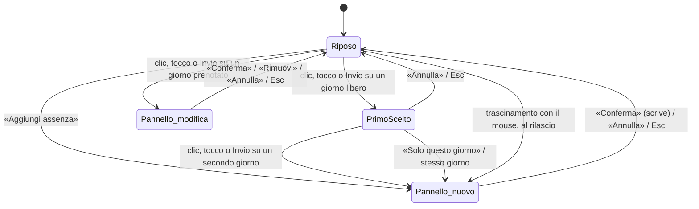

# N5 · Time Off — specifica UX

Indice del piano: [`../../rewrite-plan.md`](../../rewrite-plan.md). Rilascio: [`../03-releases.md`](../03-releases.md) «N5».
Lavoro «ora»: [`../04-now.md`](../04-now.md) §4.7. Decisione: D1 in [`../01-decisions.md`](../01-decisions.md).
Audit: UI-TOF-1 … UI-TOF-6 in [`../audit-ui.md`](../audit-ui.md).

Questa specifica descrive solo l'interazione e le schermate. Non cambia le regole di calcolo dei residui
(`residual()` in `src/modules/timeoff/rules.ts`) e non cambia la sync con Trek. Se questa specifica e il piano
sono in conflitto, vale il piano.

Le decisioni di prodotto che il piano non scrive sono nella §14 «Domande per Mattia», ognuna con un default. Lo
sviluppo può partire con i default: ogni default è isolato e si cambia senza rifare il resto.

## 1. Cosa cambia, in breve

| Oggi | Con N5 |
|---|---|
| Un clic scrive subito e fa girare il tipo (ferie → ROL → ferie) | Un clic sceglie il primo giorno. Nessuna scrittura prima di «Conferma» |
| Mezza giornata: pressione lunga | Controllo «Durata» nel pannello |
| Mezze ferie + mezzo ROL: pressione lunga con il tasto destro | Pulsante «Aggiungi l'altra metà» nel pannello |
| Cancellare: tasto destro | Pulsante «Rimuovi» nel pannello, tasto Canc, pulsante nella tabella |
| Nota e altri tipi: Alt o Maiusc + clic | Campi del pannello |
| «Aggiungi» solo nello stato vuoto | Pulsante «Aggiungi assenza» sempre visibile nell'intestazione della pagina |
| Conferma di cancellazione con `window.confirm` | Rimozione immediata e toast con «Annulla» |
| Una chiamata al server per ogni clic | Una chiamata per ogni «Conferma», «Rimuovi» o «Annulla» |

Un solo pannello (`LeavePanel`) serve tre ingressi: la selezione sul calendario, il pulsante «Aggiungi assenza»,
il tocco su un giorno prenotato.

## 2. Pagina

L'ordine delle sezioni della pagina non cambia: intestazione, schede, avvisi, quattro card, calendario, tabella.
Cambiano l'intestazione, la card del calendario e i pulsanti di riga della tabella.

### 2.1 Intestazione

- Il pulsante «Aggiungi assenza» (`Button variant="primary" size="md"`, icona `Plus` di lucide) entra in
  `Page.actions`, a destra del selettore dell'anno. È presente in ogni stato della pagina.
- A 400 px `Page.actions` va a capo sotto il titolo: selettore dell'anno a sinistra, pulsante a destra, stessa riga.
- Il pulsante dello stato vuoto (§10.1) apre lo stesso pannello.

### 2.2 Card del calendario

```
┌ Calendario 2026 ───────────────── ■ Ferie ■ ROL □ Pianificato ■ Contabilizzato ▫ Festivo ┐
│ Scegli il primo e l'ultimo giorno. Tocca un giorno prenotato per modificarlo.            │
│                                                                                          │
│  Gennaio        3 gg   Febbraio            Marzo          1 gg   Aprile                  │
│  L M M G V S D         L M M G V S D       …                     …                       │
│  …                                                                                       │
│ ┌ barra di selezione (solo durante la selezione, §4.4) ────────────────────────────────┐ │
│ │ Dal 10 ago · scegli l'ultimo giorno          [Solo questo giorno]  [Annulla]         │ │
│ └──────────────────────────────────────────────────────────────────────────────────────┘ │
└──────────────────────────────────────────────────────────────────────────────────────────┘
```

- La riga di aiuto `calendar.howTo` resta, con il testo nuovo (§12). Una riga sola: non elenca più gesti.
- La legenda non cambia.

### 2.3 Griglia dei mesi

La griglia passa da `auto-fill, minmax(196px, 1fr)` a un numero fisso di colonne, sul contenitore di `Page`
(`@container`). Motivo: 12 mesi in righe complete (oggi a 1440 px: 5 + 5 + 2) e una cella ≥ 40 px quando lo
schermo è stretto.

| Contenitore (`main`) | Colonne | Classe | Larghezza della cella |
|---|---|---|---|
| < 672 px | 1 | `grid-cols-1` | 46 px a 400 px di viewport; 40 px a 360 px |
| ≥ 672 px | 2 | `@2xl:grid-cols-2` | ≥ 42 px |
| ≥ 896 px | 3 | `@4xl:grid-cols-3` | ≥ 37 px |
| ≥ 1152 px | 4 | `@6xl:grid-cols-4` | 36 px a 1440 px con la barra laterale aperta |
| ≥ 1600 px | 6 | `@[100rem]:grid-cols-6` | ≥ 33 px |

- Spazio tra i mesi: `gap-4 gap-x-5` (invariato). Spazio tra le celle: `gap-0.5` (invariato).
- A 1440 px (barra laterale 240 px, `p-6`): contenitore 1152 px, 4 colonne × 3 righe.
- A 400 px (`p-4`, card `p-4`): contenuto 336 px, 1 colonna, 12 mesi in sequenza.
- Sotto 360 px di viewport la cella è larga meno di 40 px (36 px a 320 px) e resta alta 40 px. Il minimo WCAG 2.5.8
  (24 px) resta rispettato.

## 3. Cella del giorno

### 3.1 Misure

| | Viewport < 768 px (`max-md`) | Viewport ≥ 768 px |
|---|---|---|
| Altezza | 40 px (`h-10`) | 28 px (`h-7`) |
| Larghezza | 1/7 della colonna, vedi §2.3 | 1/7 della colonna |
| Numero | `text-base` (13 px) | `text-xs` (11 px), come oggi |
| Raggio | `rounded-ctl` (6 px) | `rounded-[4px]`, come oggi |
| Iniziali dei giorni | `text-xs`, riga alta 20 px | come oggi |

Motivo dell'altezza a 28 px su desktop (oggi 24 px): il trascinamento con il mouse chiede un bersaglio meno stretto.
La cella vuota di riempimento (`blank`) prende la stessa altezza.

### 3.2 Aspetto per stato

Il disegno dei giorni prenotati (pieno = contabilizzato, vuoto con bordo = pianificato, angolo = mezza giornata,
secondo tipo nell'angolo opposto) non cambia. Si aggiungono solo gli stati della selezione.

| Stato | Aspetto | Classi (token esistenti) |
|---|---|---|
| Libero, lavorativo | Numero `text-fg`, sfondo al passaggio | come oggi: `hover:bg-hover` |
| Sabato e domenica | Numero `text-faint`, nessun bordo | come oggi |
| Festivo | Bordo `border-border`, sfondo `bg-hover`, numero `text-muted` | come oggi |
| Prenotato | Come oggi (`KIND_CLASS`, `KIND_BORDER`, `KIND_TEXT`) | invariato |
| Oggi | Numero in grassetto e sottolineato | `font-semibold underline underline-offset-2` |
| Primo giorno scelto | Sfondo pieno | `bg-primary text-primary-fg font-semibold` |
| Dentro l'intervallo, lavorativo | Sfondo di selezione | `bg-sel` |
| Dentro l'intervallo, escluso (weekend, festivo) | Sfondo di selezione, numero barrato | `bg-sel text-faint line-through` |
| Dentro l'intervallo, già prenotato | Disegno del tipo + anello di selezione | `ring-2 ring-accent ring-offset-1 ring-offset-card` |
| Ultimo giorno (anteprima o scelto) | Come il primo giorno | `bg-primary text-primary-fg font-semibold` |
| Focus da tastiera | Anello standard | `focus-ring` |
| In attesa del server (dopo «Conferma» o «Rimuovi») | Aspetto finale subito, opacità ridotta | `opacity-60` fino alla risposta |

Lo stile della selezione è quello di `src/ui/date-range-picker.tsx:308-315` (`bg-primary` per gli estremi, `bg-sel`
per l'interno): nessun colore nuovo. «Oggi» è l'unico segno nuovo; motivo: senza gesti rapidi l'utente deve trovare
la data di partenza a colpo d'occhio.

### 3.3 Cosa è un pulsante

- Giorno lavorativo libero e giorno prenotato: `<button>`, come oggi.
- Sabato, domenica e festivo senza prenotazione: `<span>`, come oggi. Non sono un primo o un ultimo giorno valido
  dal calendario. Durante il trascinamento contano come posizione: l'intervallo si chiude sul giorno lavorativo
  più vicino dentro l'intervallo.
- Dal pannello («Dal», «Al») l'utente può scrivere anche una data esclusa: il pannello la segna come esclusa (§5.4).

## 4. Selezione di primo e ultimo giorno

### 4.1 Stati



Nessuno stato prima di «Conferma» o «Rimuovi» scrive sul server (criterio 3 di N5).

### 4.2 Mouse

1. Clic su un giorno libero: è il primo giorno. Compare la barra di selezione (§4.4).
2. Movimento del puntatore: l'intervallo dal primo giorno al giorno sotto il puntatore è in anteprima (§3.2).
3. Clic su un secondo giorno: è l'ultimo giorno. Si apre il pannello.
4. In alternativa, **trascinamento**: tasto premuto sul primo giorno, rilascio su un altro giorno. Al rilascio si apre
   il pannello. Un rilascio sullo stesso giorno vale come il clic del punto 1.
5. Il secondo giorno può stare prima del primo: l'intervallo si ordina da solo.
6. Il secondo giorno può essere un giorno prenotato: entra nell'intervallo e il pannello lo elenca tra le
   sostituzioni (§5.5).

Il trascinamento è solo del mouse (`pointerType === "mouse"`). Con dito e penna il movimento resta lo scorrimento
della pagina: il calendario non imposta `touch-action: none`.

### 4.3 Touch

1. Tocco su un giorno libero: primo giorno, barra di selezione.
2. Tocco su un secondo giorno: ultimo giorno, si apre il pannello.
3. Tocco sullo stesso giorno, o pulsante «Solo questo giorno»: intervallo di un giorno, si apre il pannello.

Nessuna pressione lunga: il menu contestuale del sistema resta libero.

### 4.4 Barra di selezione

È il controllo visibile per i due passi che altrimenti sarebbero nascosti: «un giorno solo» e «annulla».

- Presente solo nello stato `PrimoScelto`. Elemento `role="status"` dentro la card del calendario.
- Posizione: `sticky bottom-4` dentro la card; sotto 768 px `bottom-[84px]`, sopra la barra delle schede (64 px),
  come il `Toaster`.
- Aspetto: `rounded-lg border border-border bg-card shadow-overlay px-3 py-2`, testo `text-base`.
  A 400 px il testo sta sulla prima riga e i due pulsanti sulla seconda, allineati a destra.
- Contenuto: testo «Dal {data} · scegli l'ultimo giorno»; `Button size="md"` «Solo questo giorno»;
  `Button variant="ghost" size="md"` «Annulla».
- I pulsanti sono `size="md"` (32 px) su desktop e `size="lg"` (36 px) sotto 768 px.
- Dopo la comparsa il focus resta sul giorno. La barra è la tappa successiva di Tab dopo il mese attivo.

### 4.5 Tastiera

Vedi la tabella completa in §9. In breve: Invio sul primo giorno, frecce fino all'ultimo, Invio di nuovo.

## 5. Pannello `LeavePanel`

### 5.1 Contenitore

Il pannello usa `Modal` (`src/ui/modal.tsx`), `width={460}`, su ogni larghezza.

- A 1440 px: finestra centrata, 460 px.
- A 400 px: `max-w-[calc(100vw-32px)]` → 368 px; `max-h-[calc(100dvh-32px)]`; i campi scorrono, titolo e pulsanti
  restano fermi. Comportamento già presente nel componente.
- Motivo della scelta: componente esistente, focus intrappolato, Esc, ritorno del focus, nessuno stile nuovo.
  Alternativa scartata: pannello agganciato a destra del calendario (desktop) e foglio dal basso (mobile). Chiede
  due contenitori nuovi e una gestione propria del focus; in N5 non dà un vantaggio che la giustifichi (§14, Q6).
- Alla chiusura il focus torna al giorno di partenza (`finalFocus`), o al pulsante «Aggiungi assenza».
- Durante il pannello la selezione resta disegnata sul calendario, dietro lo sfondo.

### 5.2 Struttura

```
┌──────────────────────────────────────────────┐
│ Nuova assenza                                │  titolo (text-xl)
│ 10 – 21 agosto 2026                          │  descrizione (text-muted)
│                                              │
│ Dal [10/08/2026 ▾]      Al [21/08/2026 ▾]    │  2 colonne; 1 colonna < 400 px di pannello
│ Tipo [Ferie                              ▾]  │
│ Durata  (Giornata intera | Mezza giornata)   │  Segmented
│ Nota [                                    ]  │  Textarea, 2 righe, max 200
│      Per esempio mattina o pomeriggio…       │
│ ┌ Riepilogo ───────────────────────────────┐ │  riquadro bg-hover, rounded-card, p-3
│ │ Durata          9 gg (9 giorni lavorativi)│ │
│ │ Giorni esclusi  3: sab 15, dom 16,        │ │
│ │                 ven 14 (festivo)          │ │
│ │ Sostituisce     1: mer 12 (ROL)           │ │
│ │ Residuo ferie   14 gg → 5 gg              │ │
│ └──────────────────────────────────────────┘ │
│ [messaggio di errore, se c'è]                │
│                                              │
│ [Rimuovi]                 [Annulla] [Conferma]│  piede
└──────────────────────────────────────────────┘
```

Spazio tra i campi: `gap-4` (come `LeaveDialog`). «Dal» e «Al»: `grid grid-cols-2 gap-3`.

### 5.3 Campi

| Campo | Controllo | Valori | Default |
|---|---|---|---|
| Dal | `Input type="date"` in `Field` | Qualsiasi data | Primo giorno scelto; da «Aggiungi assenza»: oggi |
| Al | `Input type="date"` in `Field`, `min` = «Dal» | ≥ «Dal» | Ultimo giorno scelto; da «Aggiungi assenza»: uguale a «Dal» |
| Tipo | `Select` in `Field` | I tipi di `LEAVE_DAY_KINDS` senza `sick` (decisione H20), nell'ordine attuale | `vacation` |
| Durata | `Segmented` in `Field` | «Giornata intera» (1), «Mezza giornata» (0,5) | Giornata intera |
| Nota | `Textarea` in `Field`, `rows={2}`, `maxLength={200}` | Testo libero | Vuota |

- «Al» non è più facoltativo e non ha più il suggerimento «Lascia vuoto». Un giorno solo = «Dal» uguale a «Al».
- Se l'utente porta «Dal» oltre «Al», «Al» prende il valore di «Dal».
- «Durata» vale per ogni giorno dell'intervallo: mezza giornata su 5 giorni = 2,5 gg.
- Suggerimento sotto «Nota»: `dialog.noteHint` per ferie, ROL, recupero; `dialog.localOnly` per altro
  (regola di oggi, `noteHint()` in `leave-actions.tsx`).
- `Segmented` è alto 24 px: rispetta il minimo di 24 px. Sotto 768 px i suoi pulsanti passano a `h-8` (32 px) con
  una classe passata dal pannello, non con una variante nuova del componente.

### 5.4 Riepilogo

Il riepilogo si ricalcola a ogni modifica dei campi, sul client, senza chiamate. È un `<dl>` con `aria-live="polite"`.
Etichette `text-sm text-muted`; valori `text-base tabular-nums`.

| Riga | Quando | Contenuto |
|---|---|---|
| Durata | Sempre | Totale in giorni e numero di giorni scritti: «9 gg (9 giorni lavorativi)»; con mezza giornata: «2,5 gg (5 mezze giornate)» |
| Giorni esclusi | Se ce n'è almeno uno | Numero, poi elenco: giorno della settimana corto + numero; i festivi con «(festivo)». Oltre 6 voci: prime 5 e «+ altri N» |
| Sostituisce | Se ce n'è almeno uno | Numero, poi elenco dei giorni con il tipo attuale tra parentesi. Stessa regola delle 6 voci |
| Residuo {tipo} | Tipo ferie o ROL | «prima → dopo», in giorni, formato di `units.days` |
| Residuo {altro tipo} | Se una sostituzione libera giorni di ferie o di ROL | Una riga in più per quel tipo, stesso formato |
| Residuo | Tipo recupero, altro, senza sostituzioni | «Questo tipo non consuma il residuo.» |

Regole di calcolo del riepilogo (nessuna regola nuova sui residui):

- **Giorni esclusi**: i giorni dell'intervallo che `bookable()` rifiuta (sabato, domenica, festivi, patrono). Stessa
  funzione che usa oggi `saveLeaveDay`.
- **Residuo prima**: `remainingMinutes` della `ResidualView` che la pagina mostra già nella card di quel tipo.
- **Residuo dopo**: la stessa `residual()`, con la lista dei giorni come sarà dopo la scrittura. La pagina passa al
  pannello l'ingresso `ResidualInput` di ferie e di ROL: il pannello non legge dati per conto suo.
- **Giorni di un altro anno**: la pagina ha i dati del solo anno mostrato. Se l'intervallo tocca un altro anno, il
  residuo conta solo i giorni dell'anno mostrato e una riga in più dice: «{n} giorni sono nel {anno}: il loro
  residuo si vede nella pagina di quell'anno.»
- **Residuo non calcolabile** (`remainingMinutes === null`): «— · dotazione non indicata», con il collegamento
  «Imposta il monte ferie» (`/timeoff/settings?year=`).

### 5.5 Sostituzioni

Regola proposta (default di Q1, §14). Dopo la scrittura un giorno non contiene mai più di una giornata intera:

1. Sullo stesso giorno, la riga dello stesso tipo viene aggiornata (come oggi).
2. Se la nuova riga più le righe di altro tipo superano una giornata, le righe di altro tipo vengono rimosse.
3. Se non la superano (mezza giornata nuova + una mezza giornata di altro tipo), le due righe convivono: è il giorno
   «mezze ferie + mezzo ROL» di oggi.

Le righe rimosse passano per la stessa strada di «Rimuovi» (§7.4): Trek riceve la cancellazione come oggi.
Il pannello mostra ogni riga che la regola rimuove o cambia nella riga «Sostituisce», prima di «Conferma».

### 5.6 Piede e pulsanti

| Pulsante | Componente | Quando | Azione |
|---|---|---|---|
| Rimuovi | `Button variant="danger"`, a sinistra | Solo in modifica | §7.4 |
| Annulla | `Button` (secondario) | Sempre | Chiude senza scrivere; la selezione sparisce |
| Conferma | `Button variant="primary"`, `type="submit"` | Sempre | Scrive, vedi sotto |

Il piede di `Modal` è allineato a destra: «Rimuovi» va a sinistra con `mr-auto`. A 400 px i pulsanti sono `size="lg"`.

«Conferma»:

1. Il pulsante e i campi diventano `disabled`; il testo del pulsante diventa «Salvataggio…».
2. Una sola chiamata al server scrive tutto l'intervallo, in una transazione: tutte le righe o nessuna.
3. Esito positivo: il pannello si chiude, il calendario mostra subito i giorni (aggiornamento ottimistico, poi
   `router.refresh()`), toast «Assenza salvata · {n} gg» con «Annulla» (§8).
4. Esito negativo: il pannello resta aperto con i valori; l'errore compare sopra il piede (§10.3).

«Conferma» è disabilitato solo se l'intervallo non contiene nessun giorno prenotabile (§10.4) o se è in corso il
salvataggio. Il residuo insufficiente non lo disabilita (§10.5).

### 5.7 Titoli

| Ingresso | Titolo | Descrizione |
|---|---|---|
| Selezione sul calendario | «Nuova assenza» | Intervallo in chiaro: «10 – 21 agosto 2026», o «lunedì 10 agosto 2026» |
| «Aggiungi assenza» | «Nuova assenza» | «Sabato, domenica e festivi non si contano.» |
| Giorno prenotato | «Modifica assenza» | La data in chiaro: «mercoledì 12 agosto 2026» |

## 6. Pulsante «Aggiungi assenza»

- Apre `LeavePanel` senza selezione: «Dal» = oggi (se oggi è nell'anno mostrato; altrimenti il 1° gennaio di
  quell'anno), «Al» = «Dal», tipo ferie, giornata intera.
- Il focus iniziale è sul campo «Dal».
- I due campi data sono gli stessi del pannello aperto dal calendario: un solo componente, un solo percorso di
  scrittura.
- È la strada principale su telefono per un intervallo lungo o per un intervallo tra due mesi lontani.

## 7. Giorno prenotato: modifica o «Rimuovi»

### 7.1 Apertura

Clic, tocco o Invio su un giorno prenotato, senza una selezione in corso, apre il pannello in modifica.

- La data è in sola lettura (testo nella descrizione, nessun campo «Dal» / «Al»): la modifica tocca quel giorno,
  come oggi.
- Tipo, durata e nota hanno i valori della riga.
- Il riepilogo mostra il residuo prima → dopo se la modifica lo cambia (tipo o durata diversi).
- Per iniziare un intervallo da un giorno prenotato: «Aggiungi assenza», oppure partire da un giorno libero e
  chiudere sul giorno prenotato.

### 7.2 Giorno con due righe (due mezze giornate)

Sopra i campi, un `Segmented` con etichetta «Quale assenza» e una voce per riga: «Ferie ½», «ROL ½». La prima è
attiva. I campi, «Rimuovi» e «Conferma» valgono per la riga attiva. Sostituisce l'apertura muta della prima riga
(`openDialog`, `year-calendar.tsx:181-186`).

### 7.3 «Aggiungi l'altra metà»

Se il giorno ha una sola riga di mezza giornata, sotto «Durata» c'è `LinkButton` «Aggiungi l'altra metà». Il
pannello passa a «Nuova assenza» sullo stesso giorno, durata mezza giornata, tipo ROL se la riga è ferie, altrimenti
ferie. L'utente può cambiare il tipo. È il controllo visibile che sostituisce la pressione lunga con il tasto destro
(`splitDayAction`).

### 7.4 «Rimuovi»

1. Il pannello si chiude subito. Nessuna finestra di conferma: il rimedio è «Annulla» nel toast.
2. Il giorno torna libero sul calendario (aggiornamento ottimistico).
3. Toast: «Assenza rimossa» + «Annulla». Se Trek conosce il giorno: «Rimossa qui; Trek lo saprà al prossimo
   passaggio» + «Annulla» (regola di oggi, `toasts.removalPending`).
4. Se il server rifiuta: il giorno ricompare e un toast di errore dice perché.

Stesso comportamento per:

- il tasto Canc sul giorno (§9);
- il pulsante «Rimuovi» della riga in tabella (`RowActions`): sparisce `window.confirm`.

Il pulsante «Modifica» della riga apre lo stesso `LeavePanel` in modifica.

## 8. Toast con «Annulla»

Estensione di `notify()` (`src/ui/toast.tsx`): terzo argomento facoltativo `action: { label, onClick }`, reso con
`Toast.Action` di Base UI. Nessun componente nuovo.

- Aspetto: pulsante di testo dentro il toast, a destra del messaggio e prima della «X»: `text-base font-semibold
  underline underline-offset-2`, area minima 24 × 24 px, `focus-ring`. Colore `text-card`, come il messaggio.
- Durata: **8 secondi** quando il toast ha un'azione (3,2 secondi per gli altri, come oggi). Il passaggio del
  puntatore e il focus fermano il conto (comportamento di Base UI).
- Tastiera: F6 porta il focus nell'area dei toast (Base UI); Tab raggiunge «Annulla».
- Un solo «Annulla» disponibile per volta: un nuovo toast con azione chiude il precedente.
- «Annulla» riporta i giorni toccati allo stato di prima: righe create tolte, righe rimosse o sostituite rimesse
  con tipo, durata e nota di prima. Una chiamata, una transazione.
- Dopo «Annulla»: toast semplice «Annullato». Se fallisce: toast di errore «Non è stato possibile annullare.
  Riprova dalla tabella.»
- Il toast compare dopo: «Conferma» (nuova assenza e modifica), «Rimuovi», Canc.

## 9. Tastiera

Una tappa di Tab per mese, come oggi. Dentro il mese si muove il focus con le frecce.

| Tasto | Riposo | Primo giorno scelto | Pannello aperto |
|---|---|---|---|
| Tab / Maiusc+Tab | Mese successivo / precedente, poi barra, poi tabella | Idem; la barra di selezione è raggiungibile | Tra i campi del pannello |
| ← → | Giorno prima / dopo | Idem; l'anteprima dell'intervallo segue il focus | Nei campi |
| ↑ ↓ | Stessa colonna, settimana prima / dopo | Idem | Nei campi |
| Home / End | Primo / ultimo giorno del mese | Idem | — |
| Invio o Spazio | Giorno libero: primo giorno. Giorno prenotato: pannello in modifica | Ultimo giorno: apre il pannello. Sullo stesso giorno: un giorno solo | Invia il modulo («Conferma»), salvo nella nota |
| Esc | — | Annulla la selezione; il focus resta sul giorno | Chiude senza scrivere |
| Canc o Backspace | Giorno prenotato: «Rimuovi» (§7.4). Giorno libero: niente | Niente | Nei campi di testo: cancella il testo |

Cambi rispetto a oggi:

- Le frecce passano al mese vicino quando il focus è sul bordo del mese (oggi si fermano). Motivo: un intervallo
  può attraversare due mesi. ← dal primo giorno va all'ultimo giorno del mese prima; ↓ dall'ultima settimana va
  alla stessa colonna del mese dopo. Ai bordi dell'anno il focus si ferma.
- Le frecce saltano sabato, domenica e festivi liberi (come oggi): quei giorni entrano nell'intervallo come esclusi.
- Canc su un giorno con due righe rimuove tutte e due, come oggi `clearDay`; il toast dice «2 assenze rimosse».
- Il tasto menu (`contextmenu` da tastiera) non cancella più.

## 10. Stati

### 10.1 Vuoto (nessuna assenza nell'anno)

- Il calendario è visibile e funziona: i 12 mesi senza giorni prenotati.
- La tabella mostra `table.empty`.
- `EmptyState` in fondo alla pagina resta, con il testo nuovo (§12) e il pulsante «Aggiungi assenza».
- Se manca la dotazione, il pulsante «Imposta il monte ferie» resta nell'intestazione (come oggi) e il pannello mostra
  «— · dotazione non indicata» (§5.4).

### 10.2 Caricamento

| Momento | Aspetto |
|---|---|
| Prima apertura della pagina | Nuovo `src/app/(app)/timeoff/loading.tsx` con `LoadingState` (`src/ui/states.tsx`), etichetta «Caricamento di Time Off» |
| «Conferma» in corso | Pulsante «Salvataggio…» disabilitato, campi disabilitati, pannello aperto |
| Dopo «Conferma», «Rimuovi», «Annulla» | Giorni con l'aspetto finale e `opacity-60` fino alla risposta del server; nessuno spinner |
| Cambio d'anno | Come oggi (navigazione) |

Il calendario non mostra mai uno scheletro dopo il primo caricamento.

### 10.3 Errore

| Caso | Dove | Testo |
|---|---|---|
| La pagina non si carica | `src/app/error.tsx` esistente (`ErrorState` con «Riprova») | invariato |
| «Conferma» rifiutata dal server | Nel pannello, sopra il piede: `<p role="alert" class="text-sm text-neg">` | `errors.*` esistenti; il pannello resta aperto |
| Rete assente o errore non previsto | Idem | `errors.failed` |
| «Rimuovi» o Canc rifiutati | Toast di errore; il giorno ricompare | `errors.not_found` o `errors.failed` |
| «Annulla» del toast fallito | Toast di errore | `toasts.undoFailed` |
| Intervallo oltre 260 giorni | Nel pannello, sotto «Al», prima dell'invio: `Field` con `error` | `errors.range_too_long` |
| Data non valida nei campi | Sotto il campo | `errors.invalid` |

Gli errori di campo usano `Field` con `aria-invalid` e `aria-describedby`. Il focus va al primo campo in errore.

### 10.4 Intervallo con giorni esclusi

- Sul calendario: i giorni esclusi dentro l'intervallo sono barrati (§3.2).
- Nel pannello: riga «Giorni esclusi» (§5.4). Non è un errore e non blocca.
- **Tutti i giorni esclusi** (per esempio un sabato e una domenica scritti nei campi): riga «Durata: 0 gg»,
  messaggio `text-warn` «Nessun giorno prenotabile in questo intervallo.», «Conferma» disabilitato.
- **Un solo giorno, escluso**: stesso messaggio, con il motivo: «Il 15 agosto è un giorno festivo.» (`errors.weekend`,
  `errors.holiday` esistenti).

### 10.5 Residuo insufficiente

Quando il residuo dopo è sotto zero:

- Riga del residuo in `text-neg`, con l'icona `TriangleAlert` (16 px): «Residuo ferie 2 gg → −3 gg».
- Sotto il riepilogo, un avviso `rounded-card border border-neg/40 bg-neg-bg p-3 text-sm`: «Superi il residuo di
  3 gg. Puoi confermare lo stesso: la pagina lo segnala tra i saldi sforati.»
- «Conferma» resta attivo. Motivo: oggi l'app non blocca una prenotazione oltre il residuo, la segnala con la card
  «saldi sforati» (`overdrawn`). Bloccare sarebbe una regola nuova (Q2, §14).
- Il colore non è l'unico segnale: ci sono l'icona, il segno meno e il testo.

### 10.6 Altri stati

| Caso | Comportamento |
|---|---|
| Giorno arrivato da Trek (`origin = "trek"`) | Si modifica e si rimuove come gli altri. Nel pannello in modifica, sotto il titolo: `Badge tone="neutral"` «Da Trek» |
| Giorno in attesa di Trek (`pending ≠ none`) | Nel pannello in modifica: `Badge tone="warn"` con il testo di `table.pending.*` |
| Giorno contabilizzato in busta paga | Si modifica come oggi. Nessun blocco nuovo |
| Due schede aperte, dati vecchi | Il server decide sullo stato reale; se il giorno non c'è più: `errors.not_found` e `router.refresh()` |
| Selezione in corso e cambio d'anno | La selezione si annulla |
| Movimento ridotto (`prefers-reduced-motion`) | Nessuna animazione nuova: la barra di selezione e il pannello usano `animate-in` (0,2 s), come gli altri pannelli. `globals.css` oggi non ha una regola per il movimento ridotto: è un problema di tutta l'app, fuori da N5 (§14, nota) |

## 11. Layout di riferimento

Controllare ogni vista nei due temi (`data-theme="light"` e `"dark"`). Tutti i colori sono token: nessun valore
esadecimale nuovo.

### 11.1 400 px

```
┌──────────────────────────────────────┐
│ Time Off                             │
│ [‹ 2026 ›]        [+ Aggiungi assenza]│
│ Ferie e permessi · 26 gg ferie · …   │
│ (Panoramica) (Impostazioni)          │
│ ┌ card ferie ──────────────────────┐ │   4 card in colonna, come oggi
│ └──────────────────────────────────┘ │
│ ┌ Calendario 2026 ─────────────────┐ │
│ │ ■ Ferie ■ ROL □ Pianificato …    │ │
│ │ Scegli il primo e l'ultimo…      │ │
│ │ Agosto                     9 gg  │ │
│ │  L    M    M    G    V    S    D │ │   7 celle da 46 × 40 px
│ │ [ 3][ 4][ 5][ 6][ 7]  8    9     │ │
│ │ [10][11][12][13][14] 15   16     │ │
│ │ …                                │ │
│ │ ┌ Dal 10 ago · scegli l'ultimo ┐ │ │   barra sticky, sopra la barra schede
│ │ │ [Solo questo giorno][Annulla]│ │ │
│ │ └──────────────────────────────┘ │ │
│ └──────────────────────────────────┘ │
│ ┌ tabella ─────────────────────────┐ │
└──────────────────────────────────────┘
```

- La pagina non scorre in orizzontale (controllo già presente in `tests/e2e/mobile.spec.ts`).
- Il pannello occupa 368 px, alto al massimo `100dvh − 32px`.
- Il toast sta a `bottom-[84px]`, come oggi. Toast e barra di selezione non compaiono insieme: la barra esiste
  solo prima del pannello, il toast solo dopo.

### 11.2 1440 px

```
┌ barra laterale 240 ┬─────────────────────────────────────────────────────────────────────┐
│                    │ Time Off                              [‹ 2026 ›] [+ Aggiungi assenza]│
│                    │ ┌ ferie ┐ ┌ ROL ┐ ┌ totale ┐ ┌ barre ┐                                │
│                    │ ┌ Calendario 2026 ───────────────────────────────── legenda ───────┐ │
│                    │ │ Gennaio     Febbraio    Marzo       Aprile                       │ │  4 × 3 mesi
│                    │ │ Maggio      Giugno      Luglio      Agosto                       │ │  cella 36 × 28 px
│                    │ │ Settembre   Ottobre     Novembre    Dicembre                     │ │
│                    │ └──────────────────────────────────────────────────────────────────┘ │
│                    │ ┌ tabella ─────────────────────────────────────────────────────────┐ │
└────────────────────┴─────────────────────────────────────────────────────────────────────┘
```

- Il pannello è centrato, 460 px.
- Il toast sta in basso a destra, come oggi.

## 12. Testi

Spazio dei nomi `timeoff` in `messages/it.json` e `messages/en.json`. «Assenza» sostituisce «giornata» nei testi
dell'azione: un'assenza può durare più giorni.

### 12.1 Chiavi da cambiare

| Chiave | Italiano | Inglese |
|---|---|---|
| `actions.add` | Aggiungi assenza | Add leave |
| `actions.remove` | Rimuovi | Remove |
| `actions.save` | Conferma | Confirm |
| `dialog.addTitle` | Nuova assenza | New leave |
| `dialog.editTitle` | Modifica assenza | Edit leave |
| `dialog.description` | Sabato, domenica e festivi non si contano. | Weekends and public holidays are not counted. |
| `calendar.howTo` | Scegli il primo e l'ultimo giorno. Tocca un giorno prenotato per modificarlo. | Pick the first and the last day. Select a booked day to edit it. |
| `calendar.bookLabel` | {date}: libero | {date}: free |
| `toasts.saved` | Assenza salvata · {days} | Leave saved · {days} |
| `toasts.removed` | {count, plural, one {Assenza rimossa} other {# assenze rimosse}} | {count, plural, one {Leave removed} other {# leaves removed}} |
| `toasts.removalPending` | Rimossa qui; Trek lo saprà al prossimo passaggio | Removed here; Trek will be told at the next pass |
| `empty.title` | Ancora nessuna assenza | No time off yet |
| `empty.description` | Scegli i giorni sul calendario o usa «Aggiungi assenza». | Pick the days on the calendar, or use "Add leave". |

### 12.2 Chiavi nuove

| Chiave | Italiano | Inglese |
|---|---|---|
| `selection.from` | Dal {date} · scegli l'ultimo giorno | From {date} · pick the last day |
| `selection.single` | Solo questo giorno | This day only |
| `selection.cancel` | Annulla | Cancel |
| `selection.firstLabel` | {date}: primo giorno | {date}: first day |
| `selection.lastLabel` | {date}: ultimo giorno | {date}: last day |
| `selection.announce` | Intervallo dal {from} al {to}: {days} | Range from {from} to {to}: {days} |
| `calendar.today` | oggi | today |
| `panel.rangeTitle` | {from} – {to} | {from} – {to} |
| `panel.which` | Quale assenza | Which leave |
| `panel.otherHalf` | Aggiungi l'altra metà | Add the other half |
| `panel.saving` | Salvataggio… | Saving… |
| `panel.summary` | Riepilogo | Summary |
| `panel.duration` | Durata | Duration |
| `panel.durationWhole` | {total} ({count, plural, one {# giorno lavorativo} other {# giorni lavorativi}}) | {total} ({count, plural, one {# working day} other {# working days}}) |
| `panel.durationHalf` | {total} ({count, plural, one {# mezza giornata} other {# mezze giornate}}) | {total} ({count, plural, one {# half day} other {# half days}}) |
| `panel.excluded` | Giorni esclusi | Days left out |
| `panel.excludedHoliday` | {day} (festivo) | {day} (holiday) |
| `panel.more` | + altri {count} | + {count} more |
| `panel.replaces` | Sostituisce | Replaces |
| `panel.replacedDay` | {day} ({kind}) | {day} ({kind}) |
| `panel.balance` | Residuo {kind} | {kind} balance |
| `panel.balanceChange` | {before} → {after} | {before} → {after} |
| `panel.balanceNone` | Questo tipo non consuma il residuo. | This type does not use the balance. |
| `panel.balanceUnknown` | — · dotazione non indicata | — · allowance not stated |
| `panel.otherYear` | {count, plural, one {# giorno è} other {# giorni sono}} nel {year}: il residuo si vede nella pagina di quell'anno. | {count, plural, one {# day is} other {# days are}} in {year}: see that year's page for the balance. |
| `panel.overdrawn` | Superi il residuo di {amount}. Puoi confermare lo stesso: la pagina lo segnala tra i saldi sforati. | This is {amount} over the balance. You can still confirm: the page lists it among the overdrawn balances. |
| `panel.nothingBookable` | Nessun giorno prenotabile in questo intervallo. | No day in this range can be booked. |
| `toasts.undo` | Annulla | Undo |
| `toasts.undone` | Annullato | Undone |
| `toasts.undoFailed` | Non è stato possibile annullare. Riprova dalla tabella. | The undo did not work. Try again from the table. |
| `loading` | Caricamento di Time Off | Loading Time off |

### 12.3 Chiavi da togliere

`actions.confirmDelete`, `dialog.toHint`, `dialog.workingDaysOnly`, `errors.not_cyclable`. Sono già senza uso nel
codice e si tolgono nello stesso commit: `dialog.hours`, `dialog.rolLocal`. `dialog.to` resta.

### 12.4 Etichette per i lettori di schermo

- Giorno libero: `calendar.bookLabel`. Giorno prenotato: `calendar.dayLabel` (invariata).
- Oggi: aggiungere `, {calendar.today}` all'etichetta.
- Primo e ultimo giorno: `selection.firstLabel`, `selection.lastLabel`.
- Alla scelta dell'ultimo giorno e a ogni spostamento dell'anteprima da tastiera, una regione `aria-live="polite"`
  legge `selection.announce`.

## 13. Componenti e token

### 13.1 Da riusare, senza modifiche

| Serve per | Componente o token |
|---|---|
| Pannello | `Modal` (`src/ui/modal.tsx`) |
| Campi | `Field`, `Input type="date"`, `Select`, `Textarea` |
| Durata, scelta della riga | `Segmented` (`src/ui/segmented.tsx`) |
| Pulsanti | `Button` (`primary`, `secondary`, `ghost`, `danger`), `LinkButton` |
| Badge «Da Trek», «in attesa» | `Badge` |
| Stati | `EmptyState`, `ErrorState`, `LoadingState` |
| Colori dei tipi | `KIND_CLASS`, `KIND_BORDER`, `KIND_TEXT` (`src/modules/timeoff/ui/kinds.ts`) |
| Selezione | `bg-primary`, `text-primary-fg`, `bg-sel`, `ring-accent` |
| Avvisi | `text-neg`, `bg-neg-bg`, `border-neg/40`, `text-warn` |
| Superfici | `bg-card`, `bg-hover`, `border-border`, `shadow-overlay`, `rounded-ctl`, `rounded-card`, `rounded-modal` |
| Focus | `focus-ring` |

### 13.2 Nuovo o modificato, con il motivo

| Cosa | Dove | Motivo |
|---|---|---|
| `notify()` con azione | `src/ui/toast.tsx` | «Annulla» nel toast è nel contenuto di N5. Usa `Toast.Action` di Base UI, già nel progetto |
| Durata di 8 s per i toast con azione | `src/ui/toast.tsx` | 3,2 s non bastano per leggere e premere (WCAG 2.2.1) |
| `LeavePanel` | `src/modules/timeoff/ui/leave-panel.tsx`, sostituisce `LeaveDialog` | Componente client senza lettura dati propria (§4.7 del piano) |
| `SelectionBar` | `src/modules/timeoff/ui/selection-bar.tsx` | Controllo visibile per «un giorno solo» e «annulla» (criterio 1) |
| `DayCell` | `src/modules/timeoff/ui/day-cell.tsx`, estratta da `year-calendar.tsx:268-393` | UI-TOF-6; gli stati della selezione vivono in un posto solo |
| Griglia a colonne fisse | `year-calendar.tsx` | §2.3 |
| Altezza della cella 40 / 28 px | `DayCell` | Criterio 2 di N5; trascinamento |
| Segno di «oggi» | `DayCell` | §3.2 |
| `loading.tsx` | `src/app/(app)/timeoff/` | Stato di caricamento della pagina |

Nessuna libreria nuova. Nessun token nuovo in `globals.css`.

## 14. Domande per Mattia

Decisioni di prodotto che il piano non scrive. Ogni voce ha il default usato in questa specifica.

| # | Domanda | Default proposto | Se la risposta è diversa |
|---|---|---|---|
| Q1 | Un intervallo che passa sopra giorni già prenotati li sostituisce? | Sì, con la regola di §5.5; il pannello li elenca prima di «Conferma» | Alternativa: i giorni già prenotati restano e vanno tra gli «esclusi». Cambia solo §5.5 e una riga del riepilogo |
| Q2 | Il residuo insufficiente blocca «Conferma»? | No: avviso rosso, conferma possibile (come oggi, che segnala e non blocca) | Blocco: «Conferma» disabilitato in §10.5 |
| Q3 | Il tocco su un giorno prenotato modifica solo quel giorno, o tutto il periodo contiguo dello stesso tipo? | Solo quel giorno (come oggi). Togliere una settimana = 5 rimozioni, o Canc su ogni giorno | Aggiunta in §7.1 di una scelta «Solo questo giorno / Tutto il periodo (10–14 ago)»: «Rimuovi» e i campi valgono per il periodo |
| Q4 | Dopo «Rimuovi» serve una conferma, oltre al toast con «Annulla»? | No: il toast con «Annulla» (8 s) sostituisce `window.confirm` | Conferma nel pannello prima della rimozione |
| Q5 | Su telefono il calendario si apre sul mese corrente? | No: si apre in alto, come oggi (12 mesi in colonna, circa 3.600 px) | Scorrimento automatico al mese corrente all'apertura, solo sotto 768 px e solo per l'anno corrente |
| Q6 | Il pannello è una finestra centrata (`Modal`) anche su desktop? | Sì: componente esistente, nessuno stile nuovo | Pannello agganciato a destra del calendario su desktop e foglio dal basso su telefono: due contenitori nuovi, circa +1 giorno di lavoro |
| Q7 | La parola per l'azione: «assenza» in italiano? | Sì: «Aggiungi assenza», «Nuova assenza», «Assenza rimossa» (il piano scrive «Aggiungi assenza») | Tornare a «giornata» nei testi di §12 |

Nota fuori da N5: `src/app/globals.css` non ha una regola `prefers-reduced-motion` per `animate-in` e
`animate-shimmer`. Vale per tutta l'app; va in una issue propria.

## 15. Passaggio allo sviluppo

Parti fuori dall'interfaccia che questa specifica presuppone. Sono di Homelab Homeserver Dev; qui c'è solo il
comportamento atteso.

| Parte | Comportamento atteso |
|---|---|
| Anteprima dell'intervallo | Funzione pura in `rules.ts` (per esempio `previewLeaveRange`): dati in ingresso i campi del pannello, i giorni dell'anno, i festivi, i due `ResidualInput`. In uscita: giorni scritti, giorni esclusi con il motivo, righe sostituite, residuo prima e dopo per tipo. Usa `bookable()`, `datesBetween()` e `residual()` esistenti. La usano il pannello e il servizio: stesso risultato sui due lati |
| Scrittura dell'intervallo | Servizio `(ctx, input)` nuovo (§4.7 del piano), una transazione: tutte le righe o nessuna. Restituisce lo stato di prima dei giorni toccati, per «Annulla». La Server Action è un involucro sottile |
| «Annulla» | Servizio che riporta i giorni toccati allo stato di prima, una transazione. Verso Trek usa gli stati `pending` di oggi (`upsert`, `delete`): nessuna chiamata diretta. Da coprire con un test di integrazione sui casi «riga nota a Trek rimossa e poi ripristinata» e «riga creata e poi annullata prima della sync» |
| Rimozione | `clearDay` e `deleteLeaveDay` esistenti, più lo stato di prima in uscita |
| Dati per il pannello | La pagina passa per prop: i giorni prenotati dell'anno, i festivi dell'anno (con il patrono), i `ResidualInput` di ferie e ROL, `minutesPerDay`, `today` |
| Da togliere | `cycleDayAction`, `halveDayAction`, `splitDayAction` e i servizi `cycleDay`, `halveDay`, `splitDay`; `HOLD_MS`, `pressStart`, `endPress`, `cancelPress`, `consumeHold`, `rightHandled`, `onContextMenu`, il ramo `altKey / shiftKey` in `year-calendar.tsx`; `window.confirm` in `RowActions` |

### 15.1 Gesti da togliere

| Gesto di oggi | Riferimento | Controllo visibile che lo sostituisce |
|---|---|---|
| Clic: ciclo niente → ferie → ROL → ferie | `year-calendar.tsx:78-91`, `:299-306` | Campo «Tipo» del pannello |
| Pressione lunga, tasto sinistro: mezza giornata | `:133-154`, `:280-285` | Campo «Durata» del pannello |
| Pressione lunga, tasto destro: mezze ferie + mezzo ROL | `:140-143`, `:284` | «Aggiungi l'altra metà» (§7.3) |
| Clic destro: cancella | `:103-116`, `:286-297`, `:307-314` | «Rimuovi» nel pannello e nella tabella; Canc |
| Alt o Maiusc + clic: apre il dialogo | `:302-304` | Il pannello si apre sempre |

Il menu contestuale del browser torna disponibile sul calendario.

### 15.2 Test dell'interfaccia attesi

- `tests/e2e/timeoff.spec.ts`: settimana di ferie con due clic e «Conferma»; trascinamento con il mouse; giorno
  prenotato → «Rimuovi» → «Annulla»; nessuna richiesta di scrittura prima di «Conferma».
- `tests/e2e/keyboard.spec.ts`: Invio, frecce (anche tra due mesi), Invio, «Conferma»; Esc; Canc e «Annulla» da F6.
- `tests/e2e/mobile.spec.ts` a 400 px: cella ≥ 40 × 40 px (`boundingBox`), tocco-tocco, barra di selezione sopra la
  barra delle schede, nessuno scorrimento orizzontale, pannello dentro lo schermo.
- `tests/e2e/a11y.spec.ts`: axe sulla pagina con la selezione in corso e con il pannello aperto, nei due temi.
- Aggiornare `year-calendar.test.tsx`: via i test dei gesti; dentro gli stati di §3.2.

## 16. Accessibilità (WCAG 2.2 AA)

| Criterio | Come |
|---|---|
| 2.1.1 Tastiera | Ogni azione ha un percorso da tastiera (§9) |
| 2.5.7 Trascinamento | Il trascinamento ha l'alternativa a clic singoli (§4.2) e i due campi data (§6) |
| 2.5.8 Dimensione del bersaglio | Cella ≥ 40 × 40 px sotto 768 px (da 360 px di viewport), ≥ 28 px sopra; pulsanti ≥ 24 px |
| 2.2.1 Tempo regolabile | Toast con azione: 8 s, fermo con puntatore o focus; l'azione resta possibile dalla tabella |
| 1.4.1 Uso del colore | Esclusi: barrati. Residuo insufficiente: icona, segno meno e testo. Primo e ultimo giorno: etichetta ARIA |
| 1.4.3 / 1.4.11 Contrasto | Solo coppie di token già in uso: `primary-fg` su `primary`, `fg` su `sel`, `neg` su `neg-bg`. Verificare `text-faint` su `bg-sel` nei due temi (≥ 4,5:1); se non passa, usare `text-muted` |
| 2.4.7 / 2.4.11 Focus | `focus-ring` su celle, barra, pannello, toast. La barra `sticky` non copre la cella con il focus: `scroll-margin-bottom: 96px` sulle celle |
| 4.1.3 Messaggi di stato | Barra di selezione `role="status"`; riepilogo `aria-live="polite"`; errori `role="alert"`; toast di Base UI |
| 3.3.4 Prevenzione degli errori | Riepilogo prima di «Conferma»; «Annulla» dopo ogni scrittura |

## 17. Criteri di accettazione di N5

| Criterio (`03-releases.md`) | Dove in questa specifica |
|---|---|
| 1) Ogni azione ha un controllo visibile | §4.4 (barra), §5 (pannello), §6 (pulsante), §7 («Rimuovi», «Aggiungi l'altra metà»), §8 («Annulla»), §15.1 (tabella gesto → controllo) |
| 2) Cella del giorno ≥ 40 px su mobile | §2.3, §3.1 |
| 3) Nessuna scrittura prima di «Conferma» | §4.1, §5.6: scegliere i giorni e aprire il pannello non scrive nulla. «Rimuovi» e Canc sono comandi espliciti, con «Annulla» nel toast (§7.4, Q4) |
| 4) Residui uguali a prima a parità di giorni | §5.4: il riepilogo usa `residual()` senza modifiche; nessuna formula nuova |
| 5) La sync con Trek funziona come prima | §5.5, §8, §15: le scritture passano dagli stati `pending` di oggi |
