# Features

How each section of Ledgerly works, and the rules that decide its numbers. The sections follow the
order of the side menu.

Two rules apply everywhere:

- **Unknown is not zero.** When a value is missing, the app shows `—` and says which part is
  missing. It never fills the gap with zero.
- **Your edits win.** When data comes from a provider, the fields you change by hand stay as you
  set them. A later sync does not overwrite them.

## Overview and Accounts

**Overview** shows your net worth over time. **Accounts** lists the accounts behind it. Each account
has its own page with the tabs Overview, Transactions, Balance entries and Settings.

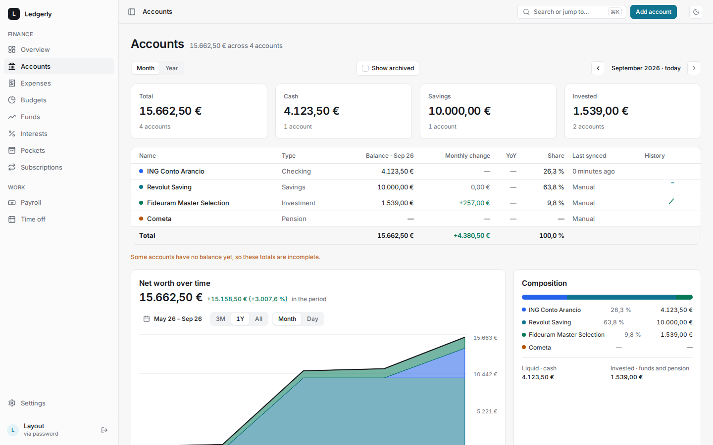

- **A balance is a dated observation.** The value of an account on a day is its last balance on or
  before that day. Before the first balance, the value is unknown.
- **Interpolation** is a per-account option. It draws a straight line between known months, in the
  charts of that account only. Totals always use the last known balance.
- **Manual or synced.** You can add, correct and delete balances by hand. A synced account comes
  from a provider. A balance that you type on a synced account is a correction, and it wins for
  that date. When the provider stops sending an account, the account becomes `unavailable`; it does
  not disappear.
- **Monthly snapshot.** On the 1st of each month, every included account gets a balance for the
  last day of the previous month. You can see each run, and start one, in **Settings → Data**.
- **Alerts.** Once a day the app checks two conditions: a balance under the account's threshold,
  and a sync older than the account's limit (36 hours by default). While a condition lasts, you get
  one email per week.

## Expenses

**Expenses** shows the movements synced from Budget Makers Wallet. You link Wallet in
**Settings → Integrations**.

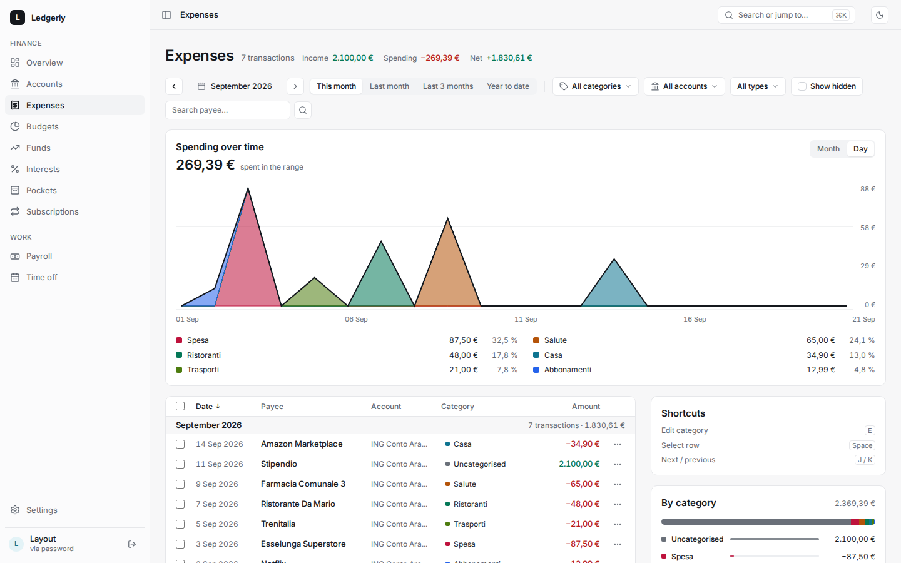

- **The token is encrypted.** The app encrypts the Wallet token before it writes it, and never
  sends it back to the browser. The field on the card can only replace it.
- **Schedule.** Each link has its own sync schedule: intervals in a time window, fixed times, or a
  cron expression, on chosen days. The editor shows the next five runs. The default is every hour.
  Details: [`scheduler.md`](scheduler.md).
- **What a sync reads.** The first sync reads the last 12 months. Each later sync reads the last
  7 days again. If Wallet rejects the token, the link is marked as revoked. The sync log on the
  same page lists every attempt.
- **What belongs to whom.** Payee, amount and date come from Wallet. Category, labels, note and
  visibility are yours.
- **Hide** removes a movement from the totals. You can undo it. A movement that Wallet stops
  returning is treated the same way.
- **Transfers** are paired only by the reference that Wallet gives them, never by amount and date.
- **Recurrences.** A payee becomes a recurrence after three payments at a regular interval (weekly
  to yearly), with amounts within 10 % of the median.
- **Categories and labels** are in **Settings → Data**. Categories are archived, never deleted.

## Budgets

A budget is a monthly limit on a category, an account, or both.

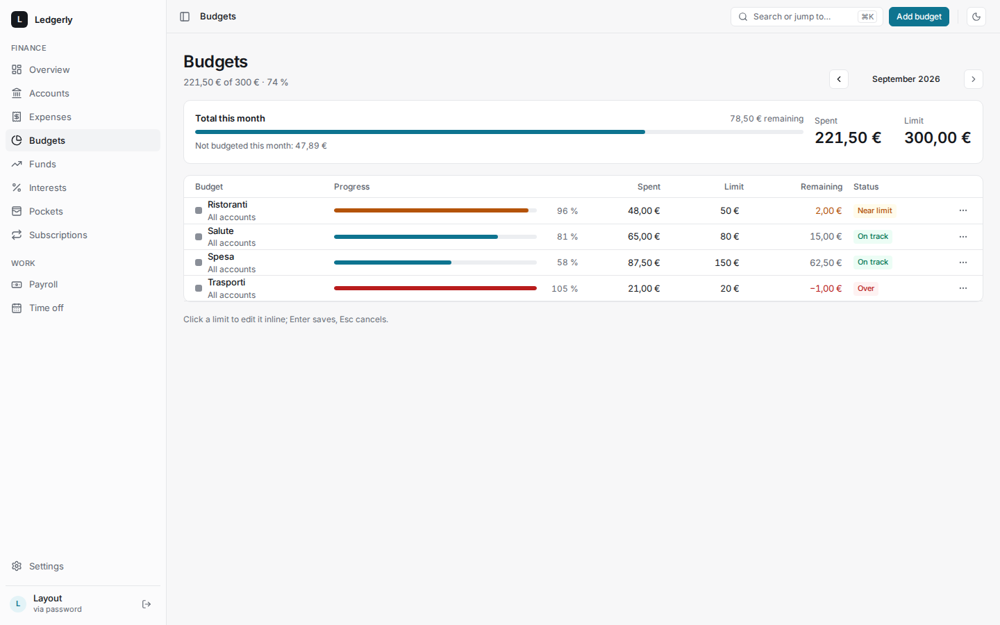

- A new or changed limit applies from that month on. **Remove from this month** ends it there.
- **Spent** is the month's expenses for the category, in your time zone. Transfers between your
  accounts and hidden movements do not count. A group of categories includes its sub-categories.
- A budget is **Near limit** from 85 % and **Over** above 100 %. The five budgets nearest to their
  limit are on Overview.

## Funds

**Funds** holds your PAC funds and your pension fund. Each fund has its own account, so net worth
counts its value once.

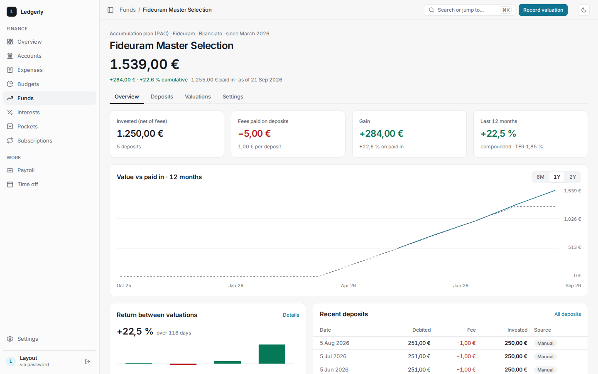

### PAC funds

- **Value.** **Record valuation** writes the balance of the fund's account.
- **Deposits** are entered by hand, or matched after each sync from the debits of the paying account.
  The fund's fee per deposit is subtracted.
- **Gain** is value minus money paid in. The monthly return is Simple Dietz between two month-end
  values.
- If a deposit is missing three days after the charge day, the app shows an alert.

### Pension fund (Fondo Cometa)

A pension fund shows six numbers that are not the same and are never added together: accrued in
your payslips, credited by the fund, invested in units, value at its date, gain after the known
costs, and what is still to reconcile.

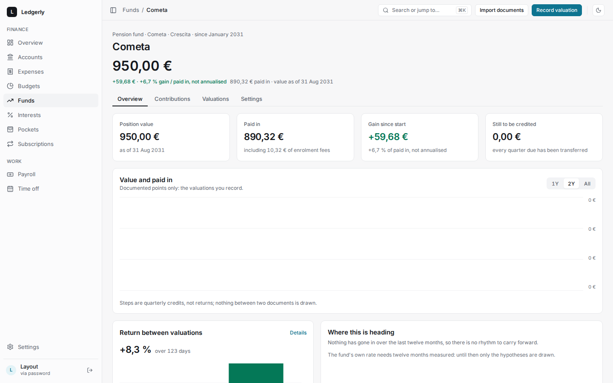

- **Accrued** comes from your payslips. When you apply a payslip, its contributions go to the fund.
- **Two Cometa documents** can be imported. The operations export (`.xls`) gives one operation per
  row; you see each row as new, known or changed before you apply it. The position summary (PDF)
  gives the value at its date.
- **Reconciliation is per quarter.** It compares what the payslips accrued with what the fund
  credited. Money not credited yet shows the date by which the fund must credit it, so "not yet"
  and "late" are different states.
- **Costs** are the fund's published tariff, with the date it was checked.

## Investments

**Investments** connects eToro and Binance with an API key and shows the portfolio of each service:
positions, activity and the connection status.

- **One period controls every number.** The period you choose changes the profit and loss of the
  whole section: totals, charts, services, positions and movements.
- **Profit and loss first.** Each page answers "how much did I gain or lose in this period" first,
  and shows the current value second.
- The design is in [`design/investments-ux.md`](design/investments-ux.md).

## Interests

An interest rule belongs to an account. It has rate tiers, tax withheld, a 365- or 360-day year, a
payout frequency and a validity period.

- Every day the app accrues interest up to yesterday on the account's daily balance. A day with a
  negative or unknown balance is skipped, and the app shows it.
- Each closed period becomes a payout. The app compares it with what the bank paid: matched,
  missing, awaited, anomalous or no data.
- Changing a rule recalculates only what was not paid out yet.
- **Post to Wallet** is off by default. When it is on, each payout is posted once. If the result of
  a post is not known, the app does not retry by itself: the rule's page has **Retry** and
  **Mark as posted**.

## Pockets

A pocket sets money aside without moving it.

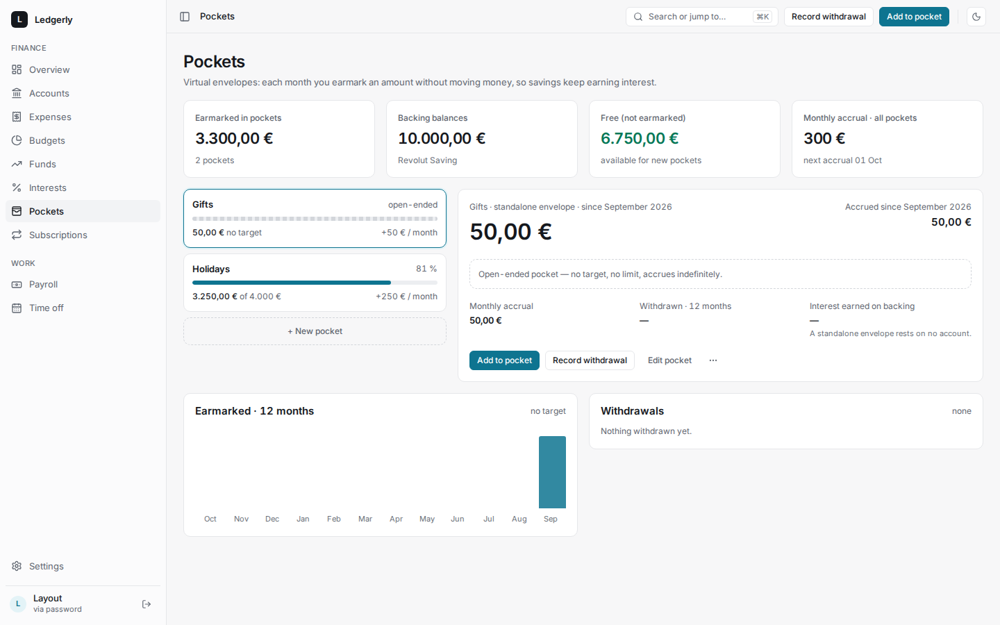

- A pocket can rest on an account or stand alone. Target and monthly amount are both optional.
- On the 1st of each month, every active pocket gets its monthly amount once. Past months are never
  filled in later.
- **Free** is the money on the backing accounts beyond their pockets.
- **Interest earned on backing** is an estimate: the account's interest of the last 12 months, times
  the pocket's share of the balance.

## Subscriptions

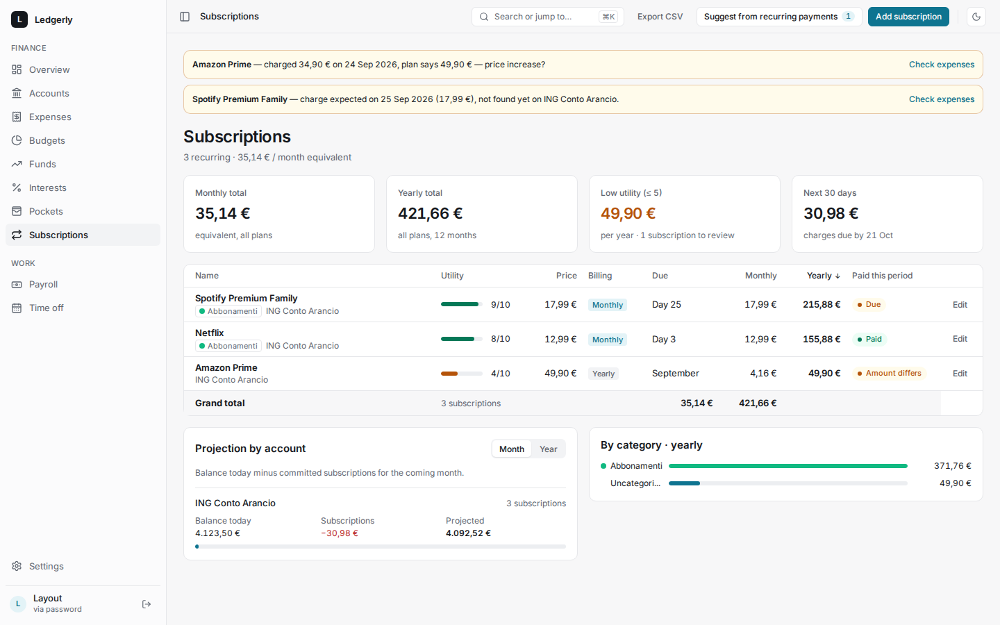

- You add a subscription by hand, or accept one from the recurrences found in Expenses.
- After each sync, and once a day, the app looks for each charge in the paying account: **Paid**, **Amount differs**
  (outside the tolerance, 5 % by default), **Due** (in the next seven days) or **Not found** (the
  month closed without it). One movement pays one charge only.
- **Projection by account** is today's balance minus the charges due in the next 30 days or
  12 months. **Export CSV** downloads the table.
- An account used by a pocket or a subscription is archived instead of deleted.

## Payroll

Every document Ledgerly reads — a payslip, a Cometa export or statement — follows the same steps:
**upload → read → review → verify → apply**. The original file is kept in storage and never
overwritten. A second upload of the same file is recognised as a duplicate.

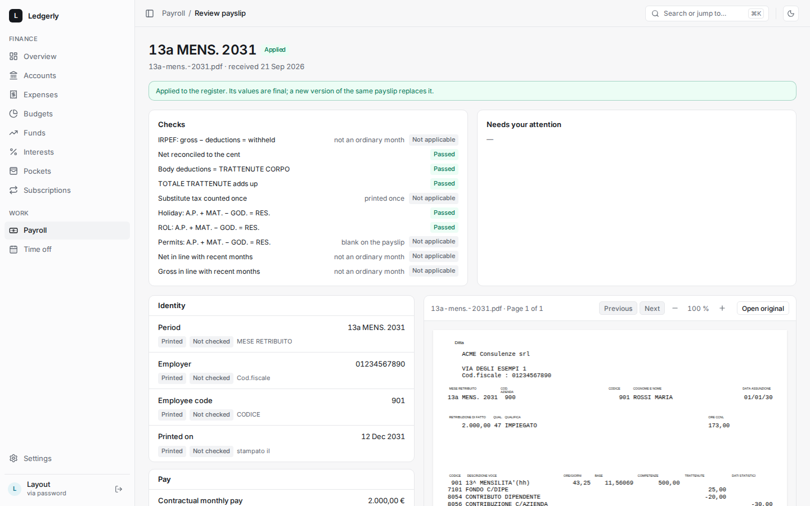

- **Reading.** The app reads a Reply/TeamSystem payslip from the position of the text on the page.
  Each value keeps its evidence: page, area and raw text. On the review screen, click a field to see
  its box on the PDF.
- **Scanned PDFs** without enough text wait in `needs_ocr`. OCR is not available.
- **AI is only a fallback.** If a required field is missing, you can ask OpenAI for that field only.
  The answer is marked `inferred`, and you must confirm or correct it before you can verify the
  payslip. Without an OpenAI key, the option does not appear.
- **Checks** run on every reading: tax, net pay to the cent, deduction totals, holiday and ROL
  balances, and consistency with recent months. To verify a payslip with a failed check, you must
  acknowledge the failure.
- **Apply** is the only step that changes your data. A reprint of the same payslip replaces the
  original; it is never added twice. Applying a payslip also updates the pension fund and time off.
- **Unknown codes.** In **Payroll → Settings** you give a role to a payslip code once, and the app
  knows it from then on.

## Time off

**Time off** shows, for the year you choose, the days accrued, taken, planned and left, and where
each number comes from.

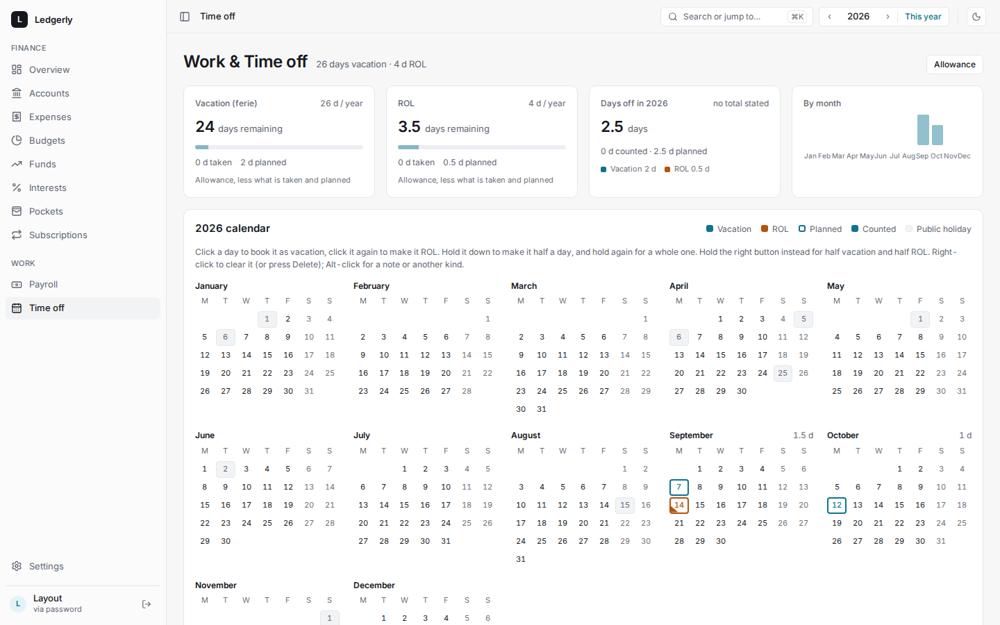

- Holiday and ROL are counted apart. A day is whole or half. Only working days can be booked:
  weekends, public holidays and an optional company calendar are excluded.
- **The balance comes from the payslip.** The app starts from what the last payslip says is left,
  then subtracts the days booked here. The screen says which payslip it used.
- **Trek** is the leave calendar that Ledgerly syncs with. Ledgerly never deletes a day in Trek by
  mistake: a day it does not know is imported, and only a removal you make in Ledgerly removes a
  day.

## Settings

- **Profile and Security.** Change your password, set up two-factor authentication (TOTP with
  recovery codes), manage connected apps and API clients. SSO-only accounts have no password form.
- **Integrations.** Wallet, Trek and the other links, each with its schedule and sync log. Admins
  also see every background job with its last run, and can run a job now.
- **Data.** Categories, labels, monthly snapshots and **Export my data**: a ZIP with every table as
  CSV and JSON, plus your original documents.
- **Admin → Users** (admins only). Invite a user (single-use link, valid seven days), change roles,
  block, reset the password or the 2FA, remove. The last admin cannot be demoted, blocked or
  removed.
- **Admin → Server** (admins only). Authentik SSO and outgoing mail, each with a test button, three
  switches for the emails the server may send, and **Export all data**. A saved value overrides
  `.env.homelab`. Changing the SSO issuer signs out every user.

## On a phone

Every screen works at 400 px wide. Where a table does not fit, the same rows show as a list with the
same controls. Both themes are checked for contrast.

| Overview                                                | Accounts                                                | Expenses                                                |
| ------------------------------------------------------- | ------------------------------------------------------- | ------------------------------------------------------- |
| 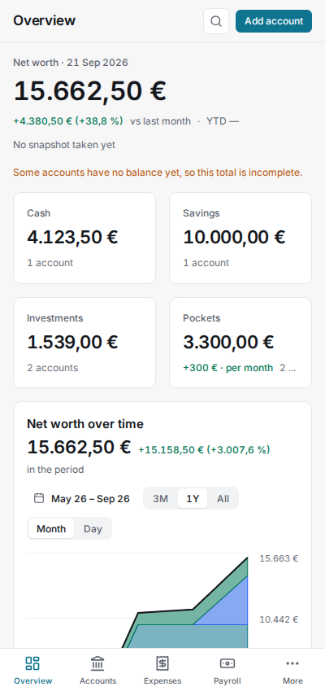 | 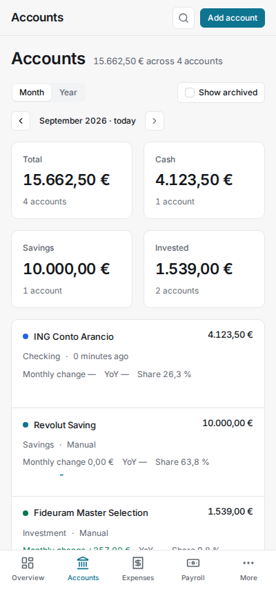 | 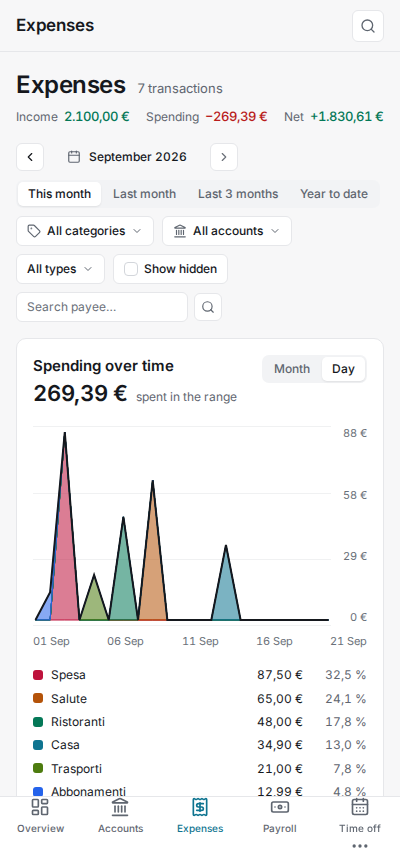 |
