# Features

How each section of Ledgerly works, and the rules that decide its numbers. The sections follow the
order of the side menu.

Two rules apply everywhere:

- **Unknown is not zero.** When a value is missing, the app shows `—` and says which part is
  missing. It never fills the gap with zero.
- **Your edits win.** When data comes from a provider, the fields you change by hand stay as you
  set them. A later sync does not overwrite them.

## Overview and Accounts

**Overview** shows your net worth over time. **Accounts** lists the accounts behind it. Each account
has its own page with the tabs Overview, Transactions, Balance entries and Settings.

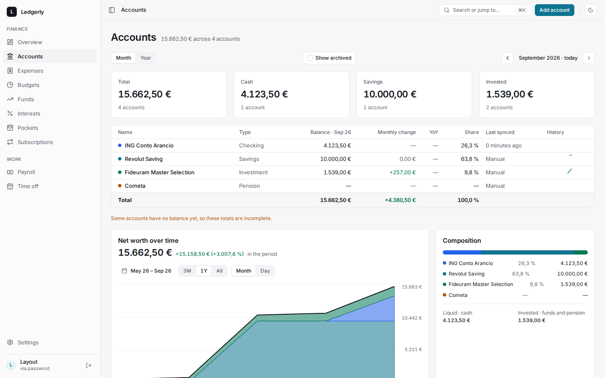

- **A balance is a dated observation.** The value of an account on a day is its last balance on or
  before that day. Before the first balance, the value is unknown.
- **Interpolation** is a per-account option. It draws a straight line between known months, in the
  charts of that account only. Totals always use the last known balance.
- **Manual or synced.** You can add, correct and delete balances by hand. A synced account comes
  from a provider. A balance that you type on a synced account is a correction, and it wins for
  that date. When the provider stops sending an account, the account becomes `unavailable`; it does
  not disappear.
- **Archive or delete.** Settings → Danger zone has two buttons. **Archive** hides the account and
  keeps everything; **Restore** undoes it. **Delete** deletes the account, with its movements and
  balances, on every account — also one that comes from Wallet or a bank — and never archives it.
  Before it deletes, the dialog lists what uses the account (pockets, interest rules, budget limits,
  subscriptions, funds and their contribution sources) and moves each one to another account with
  **Move to…**. An account of a source also leaves the accounts that source brings here, so the next
  reading does not add it again. To have it back, choose it again in **Settings → Integrations**
  ("Choose accounts"): it comes back with the history the source still gives.
- **Monthly snapshot.** On the 1st of each month, every included account gets a balance for the
  last day of the previous month. You can see each run, and start one, in **Settings → Data**.
- **Alerts.** Once a day the app checks two conditions: a balance under the account's threshold,
  and a sync older than the account's limit (36 hours by default). While a condition lasts, you get
  one email per week.

## Expenses

**Expenses** shows the movements synced from Budget Makers Wallet. You link Wallet in
**Settings → Integrations**.

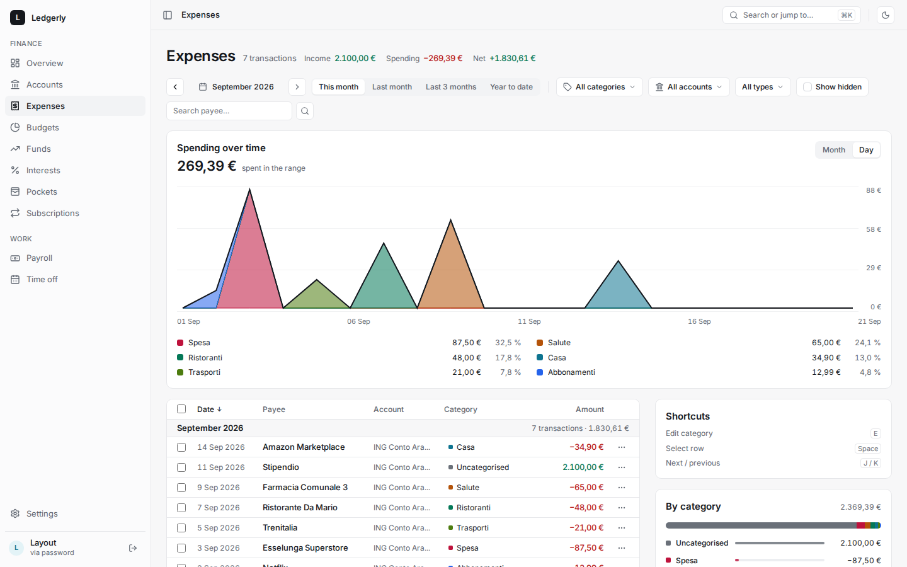

- **The token is encrypted.** The app encrypts the Wallet token before it writes it, and never
  sends it back to the browser. The field on the card can only replace it.
- **Schedule.** Each link has its own sync schedule: intervals in a time window, fixed times, or a
  cron expression, on chosen days. The editor shows the next five runs. The default is every hour.
  Details: [`scheduler.md`](scheduler.md).
- **What a sync reads.** The first sync reads the last 12 months. Each later sync reads the last
  7 days again. If Wallet rejects the token, the row of the link says that the key is no longer
  valid and offers "Replace key".
- **Which accounts arrive.** "Choose accounts" in the menu of the Wallet row, as for a bank, says
  which Wallet accounts arrive here. An account not chosen is not added and not updated. The accounts
  already here are always chosen: to take one off, delete it. A new Wallet account arrives unless
  you leave it out.
- **One state for each connection.** Every connection — Wallet, Trek, a bank, an investment
  service — has the same row, with one state of five: up to date, in progress, delayed, action
  needed, paused. The row says when the last update was and when the next attempt is, and it has
  one button when something has to be done. "History" shows the last ten updates. A failure is a
  fixed sentence, never what the provider said. You get a mail at the third failure in a row, at
  once when only you can repair it (a key, an access that ended), and 14 and 3 days before an
  access to a bank ends.
- **Advanced.** The link at the bottom of the page opens the schedule of each connection and the
  log of every reading of the last 30 days, yours only. "Copy report" copies a text with no
  secret in it, to ask for help.
- **What belongs to whom.** Payee, amount and date come from Wallet. Category, labels, note and
  visibility are yours.
- **A transaction by hand.** "Add transaction" writes a movement that no source gives: cash, or
  a payment the bank has not listed yet. You choose money out or money in, the amount, the day,
  the account, and optionally a payee, a category and a note. The row carries the badge "Manual";
  its menu changes it or deletes it. It is offered on the accounts you keep by hand and on the
  accounts a bank only reads, not on investment accounts.
- **The balance follows.** A transaction by hand changes the balance of its account at once, in
  Accounts, Overview and the net worth: last known balance plus the transactions by hand after
  it. A day before the last balance you wrote changes nothing: that balance already holds it. On
  an account a bank reads, the bank's balance applies again after its next reading, and the
  transaction stays in Expenses and in the budgets. The dialog warns that it can appear twice.
- **Automatic categories.** A bank gives no category to its transactions, so Ledgerly looks for
  one, on the accounts a bank reads and on the accounts you keep by hand. It goes in order: what
  the bank itself says (a salary, a fee), then a text you put in the same category the last three
  times, then a classifier that learns from your own categories, then tables of merchant types and
  known brands. A category given this way counts at once in Expenses and Budgets and carries a
  mark: the mark opens the reason, and "Confirm" makes the category yours. Ledgerly never writes
  over a category you chose, and never touches the transactions of a source that gives its own
  categories.
- **Suggestions.** When Ledgerly is less sure it only suggests: a dashed chip that starts with
  "Suggestion". A suggestion counts in no category until you confirm it; until then the
  transaction is "To categorise".
- **To review.** Expenses › To review lists the transactions with no category, grouped by their
  text. One action confirms or sets the category of a whole group, and "Undo" puts it back. After
  you choose a category for one transaction, Ledgerly asks whether the similar ones follow. Expenses
  and Budgets say how many transactions wait.
- **What Ledgerly learns from.** Only categories you chose or confirmed, and the ones a source
  gave. A category Ledgerly gave by itself is never an example. The classifier and what it
  remembers are yours alone and are in no export, in the API or in MCP.
- **Default groups and duplicates.** With no category yet you can start from twelve default groups.
  Settings › Categories proposes to merge two categories that look the same; the merge moves the
  transactions and adds the two budget limits together.
- **Hide** removes a movement from the totals. You can undo it. A movement that Wallet stops
  returning is treated the same way.
- **Transfers** are paired only by the reference that Wallet gives them, never by amount and date.
- **Recurrences.** A payee becomes a recurrence after three payments at a regular interval (weekly
  to yearly), with amounts within 10 % of the median.
- **Expenses › Categories** (`/expenses/categories`) shows the three sections — Income, Expenses,
  Transfers — with their groups and categories, closed by default, and the totals of the same period
  and accounts as Expenses (the total of a section is the header of Expenses). Each category and
  group has its page: what it spent, received or moved against the period before, the chart, its
  budget and its movements. The row's menu renames, recolours, moves a category to another group of
  the same section, merges, archives and deletes; moving, merging and archiving offer "Undo".
- **The section decides how a movement counts** (N3.3). A movement with a category of Transfers is a
  transfer: it leaves income, spending and budgets. Under Income, Expenses or no category the sign
  decides; a leg of a pair stays a transfer. The category picker of a movement offers its sign's
  section and Transfers. "Move to another section…" moves a group, or a category of Transfers, with
  the numbers said first (subscriptions, pockets, interest and the budget that stops) and "Undo". A
  source's category may count under Transfers; its movements keep the source's category.
- **Rules** (N3.4, **Settings → Rules**). A rule is conditions, all true — text, counterparty,
  counterparty is one of your accounts, amount, direction, account, source, currency — and a
  category (its section comes with it), with labels and a note if asked. On every reading the first
  active rule that matches gives its category to a movement with none, before the automatic
  categories; the row shows the mark "automatic" with "Rule “name”". A rule never changes a
  person's choice, a movement of a source that gives its own categories (Wallet) or a leg of a pair,
  and a category given by a rule never teaches the model. The editor shows how many movements match
  today; "Apply to existing transactions…" says what changes first and offers "Undo". The list is
  ordered by drag or by "Move up/down"; a rule on an archived category is off. "Create a rule…" is
  in the row's menu of Expenses and in the question about similar movements; a category's page lists
  its rules. The export has the rules. At most 200 rules.
- **Labels**, the proposals to merge and the default groups are in **Settings → Categories**.

## Budgets

A budget is a monthly limit on a category, an account, or both.

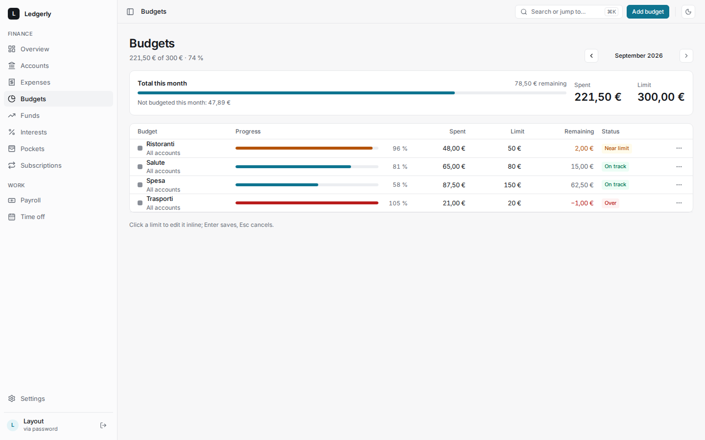

- A new or changed limit applies from that month on. **Remove from this month** ends it there.
- **Spent** is the month's expenses for the category, in your time zone. Transfers between your
  accounts and hidden movements do not count. A group of categories includes its sub-categories.
- A budget is **Near limit** from 85 % and **Over** above 100 %. The five budgets nearest to their
  limit are on Overview.

## Funds

**Funds** holds your pension funds. Each fund has its own account, so net worth counts its value
once. There is one kind of fund: what a fund's page shows depends on how the money reaches it, and
you say that when you add the fund.

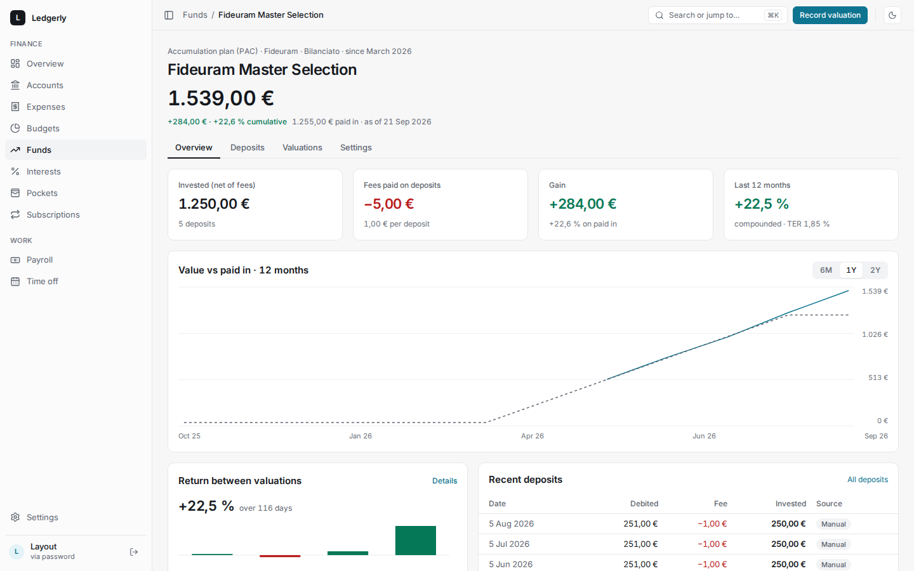

- **Add a fund** in four steps: the fund, how you pay in, its fees, a summary. Only the first step
  is required. A fund with no source and no fee is a fund whose contributions and values you write
  by hand.
- **Contribution sources** (Settings › Contributions):
  - **Payslip.** When you apply a payslip, the contributions it withholds — yours, your employer's,
    the TFR — go to the fund. You choose the components, whether a transfer covers a month or a
    quarter, and when it is due. A payslip feeds one fund at a time.
  - **Recurring debit.** After each sync the app finds the debit among the movements of the paying
    account and records the contribution. The debit can be every N weeks, months or years, with a
    start and an optional end. If the debit of the running period is missing three days after the
    expected day, the app shows an alert.
  - **Payments by hand.** Adds **Record contribution** to the top of the fund's page. The button is
    always in the Contributions tab too.
  A source with contributions is paused, never removed, so its contributions keep their origin.
- **Record contribution** writes a voluntary payment, a contribution from the payslip as the fund
  states it, or another operation: joining, a transfer in, a change of compartment, an exit. An exit
  is money that left the fund, not a loss.
- **Value.** **Update value** writes the balance of the fund's account. A fund has no daily price:
  its gain runs between the dates of two values.
- **Fees** are a list you edit: on joining, on each contribution, recurring, on the assets, on
  request. The list explains and estimates; the fee written on each contribution is the one that
  counts. The yearly cost on the assets is shown, never subtracted: it is already inside the value.
- **Reconciliation by period**, for a fund fed by the payslip with due dates: it compares what the
  payslips accrued with what you recorded as received. Money not received yet shows the date by
  which it is due, so "not yet" and "late" are different states.

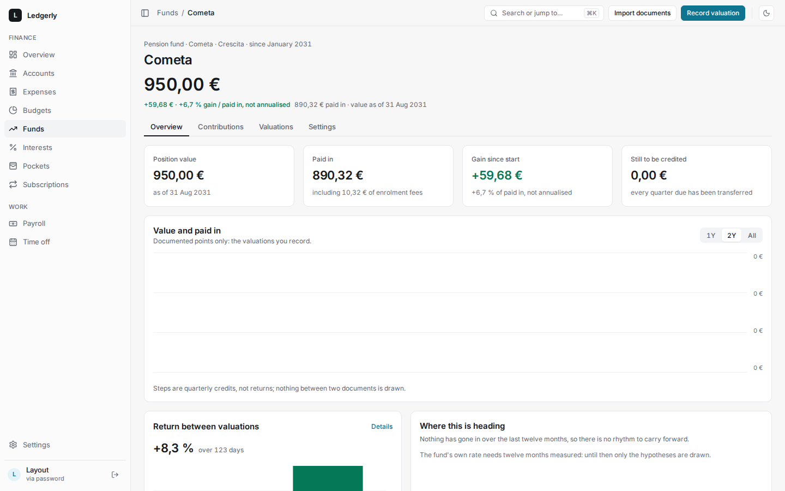

A fund's documents are not imported any more. What was read from them before stays part of the
fund, read only.

## Investments

**Investments** connects eToro and Binance with an API key and shows the portfolio of each service:
positions, activity and the connection status.

- **One period controls every number.** The period you choose changes the profit and loss of the
  whole section: totals, charts, services, positions and movements.
- **Profit and loss first.** Each page answers "how much did I gain or lose in this period" first,
  and shows the current value second.
- The design is in [`design/investments-ux.md`](design/investments-ux.md).

## Interests

An interest rule belongs to an account. It has rate tiers, tax withheld, a 365- or 360-day year, a
payout frequency and a validity period.

- Every day the app accrues interest up to yesterday on the account's daily balance. A day with a
  negative or unknown balance is skipped, and the app shows it.
- Each closed period becomes a payout. The app compares it with what the bank paid: matched,
  missing, awaited, anomalous or no data.
- Changing a rule recalculates only what was not paid out yet.
- **Post to Wallet** is off by default. When it is on, each payout is posted once. If the result of
  a post is not known, the app does not retry by itself: the rule's page has **Retry** and
  **Mark as posted**.

## Pockets

A pocket sets money aside without moving it.

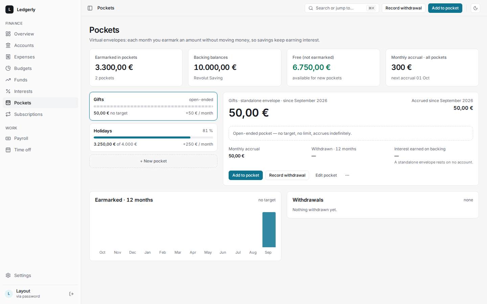

- A pocket can rest on an account or stand alone. Target and monthly amount are both optional.
- On the 1st of each month, every active pocket gets its monthly amount once. Past months are never
  filled in later.
- **Free** is the money on the backing accounts beyond their pockets.
- **Interest earned on backing** is an estimate: the account's interest of the last 12 months, times
  the pocket's share of the balance.

## Subscriptions

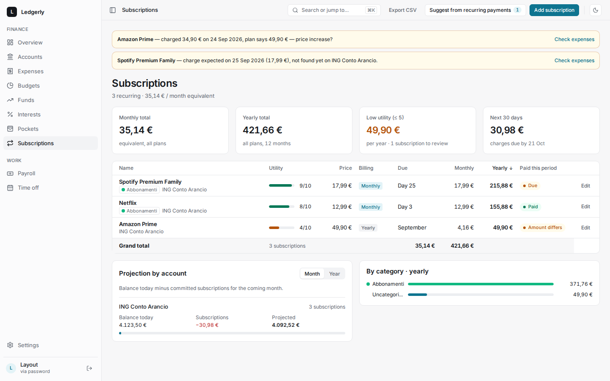

- You add a subscription by hand, or accept one from the recurrences found in Expenses.
- After each sync, and once a day, the app looks for each charge in the paying account: **Paid**, **Amount differs**
  (outside the tolerance, 5 % by default), **Due** (in the next seven days) or **Not found** (the
  month closed without it). One movement pays one charge only.
- **Projection by account** is today's balance minus the charges due in the next 30 days or
  12 months. **Export CSV** downloads the table.
- An account used by a pocket or a subscription can be deleted after you move them to another account.

## Payroll

Every payslip Ledgerly reads follows the same steps:
**upload → read → review → verify → apply**. The original file is kept in storage and never
overwritten. A second upload of the same file is recognised as a duplicate.

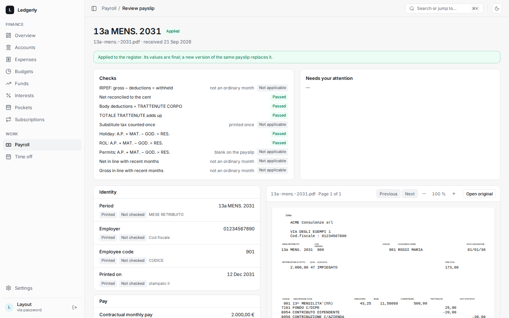

- **Reading.** The app reads a Reply/TeamSystem payslip from the position of the text on the page.
  Each value keeps its evidence: page, area and raw text. On the review screen, click a field to see
  its box on the PDF.
- **Scanned PDFs** without enough text wait in `needs_ocr`. OCR is not available.
- **AI is only a fallback.** If a required field is missing, you can ask OpenAI for that field only.
  The answer is marked `inferred`, and you must confirm or correct it before you can verify the
  payslip. Without an OpenAI key, the option does not appear.
- **Checks** run on every reading: tax, net pay to the cent, deduction totals, holiday and ROL
  balances, and consistency with recent months. To verify a payslip with a failed check, you must
  acknowledge the failure.
- **Apply** is the only step that changes your data. A reprint of the same payslip replaces the
  original; it is never added twice. Applying a payslip also updates the pension fund and time off.
- **Unknown codes.** In **Payroll → Settings** you give a role to a payslip code once, and the app
  knows it from then on.

## Time off

**Time off** shows, for the year you choose, the days accrued, taken, planned and left, and where
each number comes from.

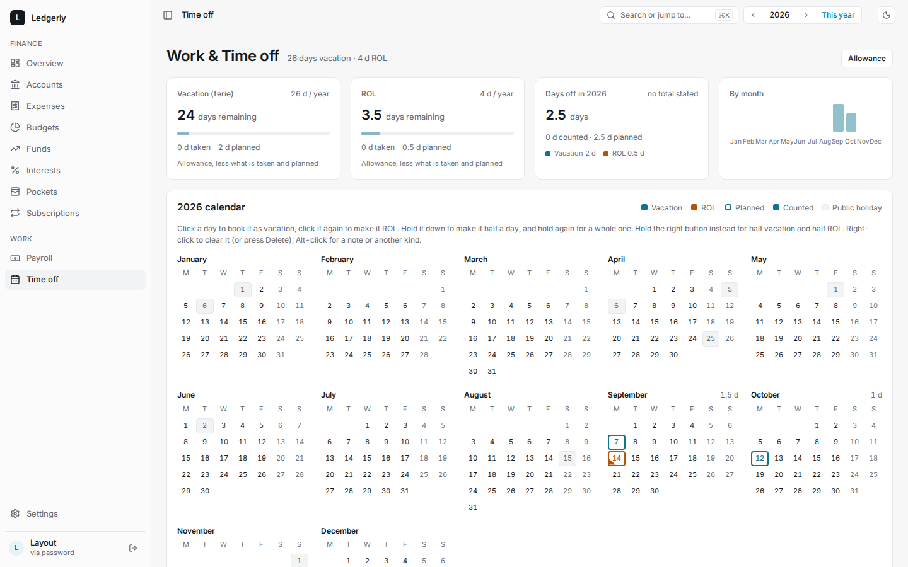

- Holiday and ROL are counted apart. A day is whole or half. Only working days can be booked:
  weekends, public holidays and an optional company calendar are excluded.
- **Booking.** Pick the first and the last day on the calendar, or use **Add leave**: a panel shows
  the type, the duration, the days left out, the days it replaces and the balance before and after.
  Nothing is saved before **Confirm**. A booked day opens the same panel to change or remove it.
  After each change a message offers **Undo** for a few seconds. A balance can go below zero: the
  page is also for planning.
- **The balance comes from the payslip.** The app starts from what the last payslip says is left,
  then subtracts the days booked here. The screen says which payslip it used.
- **Trek** is the leave calendar that Ledgerly syncs with. Ledgerly never deletes a day in Trek by
  mistake: a day it does not know is imported, and only a removal you make in Ledgerly removes a
  day.

## Settings

- **Profile and Security.** Change your password, set up two-factor authentication (TOTP with
  recovery codes), manage connected apps and API clients. SSO-only accounts have no password form.
- **Integrations.** Wallet, Trek, the banks and the other links, each with its state; the schedule
  and the log of the readings are under "Advanced". Admins also see, in Server, every background
  job with its last run and whether each plugin of the instance answers ("Diagnostics") —
  nothing of another person's connections.
- **Data.** Categories, labels, monthly snapshots and **Export my data**: a ZIP with every table as
  CSV and JSON, plus your original documents.
- **Admin → Users** (admins only). Invite a user (single-use link, valid seven days), change roles,
  block, reset the password or the 2FA, remove. The last admin cannot be demoted, blocked or
  removed.
- **Admin → Server** (admins only). Authentik SSO and outgoing mail, each with a test button, three
  switches for the emails the server may send, and **Export all data**. A saved value overrides
  `.env.homelab`. Changing the SSO issuer signs out every user.

## On a phone

Every screen works at 400 px wide. Where a table does not fit, the same rows show as a list with the
same controls. Both themes are checked for contrast.

| Overview                                                | Accounts                                                | Expenses                                                |
| ------------------------------------------------------- | ------------------------------------------------------- | ------------------------------------------------------- |
| 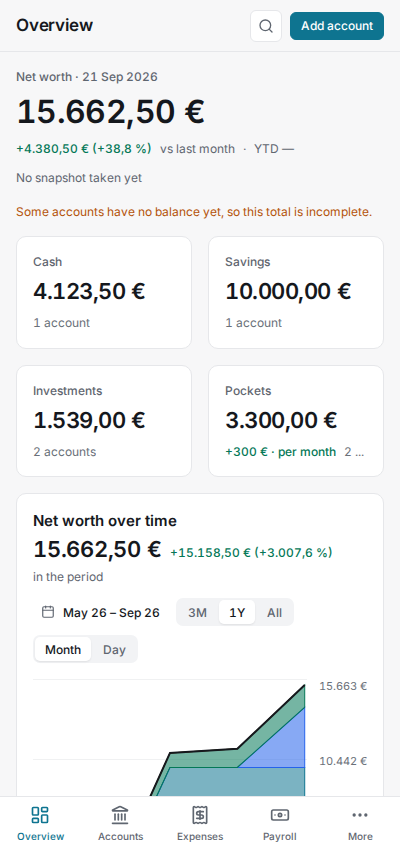 | 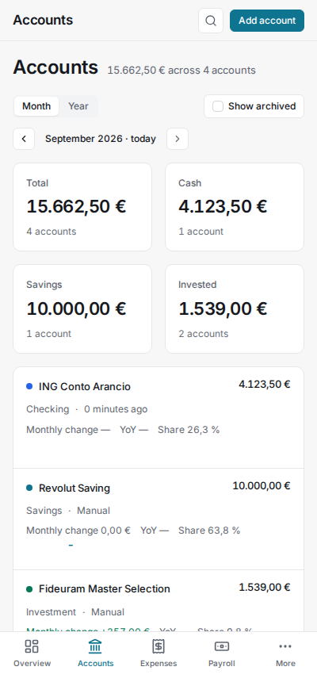 | 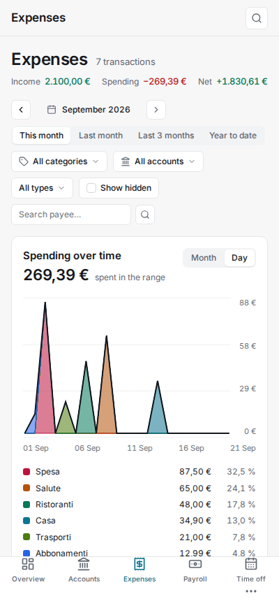 |
